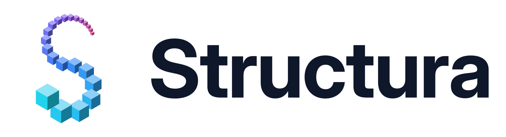
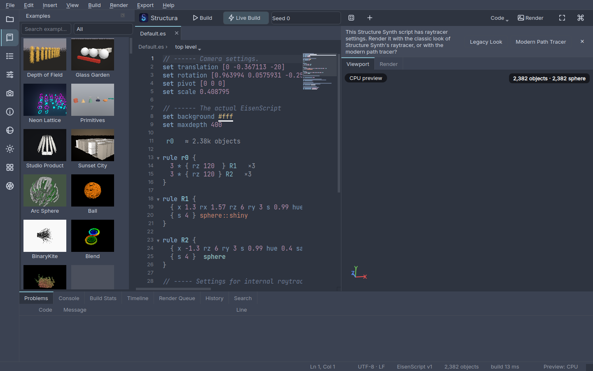

<p align="center">
  
</p>

**Structura** is a studio for grammar-based 3D structures. It succeeds
[Structure Synth](http://structuresynth.sourceforge.net/) and is rewritten in Python with PySide6. It has:

- **EisenScript**, 1.5-compatible: builds, template exports and OBJ exports are verified against
  Structure Synth 1.5 itself. There is also an opt-in **v2** dialect with materials, lights, camera and
  render blocks, `( expressions )`, `#param` sliders and animation.
- A code editor with:
  - semantic highlighting, completion with docs, signature help, hover (including rule probabilities) and inlay hints;
  - go to definition, rename and format;
  - number scrubbing (Alt+drag), colour swatches with a live colour picker (right-click a colour), and 74
    snippets;
  - error recovery: every broken rule is reported at once;
  - 40 themes (6 Nord variants), plus VS Code and base16 import.
- Two render engines:
  - the **preview engine** (GLSL: instancing, sphere impostors, SSAO, shadows, order-independent
    transparency, picking with jump-to-source, accumulation AA), with a CPU fallback;
  - the **precision engine** (Sunflow-derived path tracing with a principled BSDF, MIS, sun/point/sphere/
    spot/rect lights, emissive geometry, HDRI and sun-sky, glass with coloured absorption, adaptive sampling,
    AOVs, denoising, ground/shadow catcher, fog, and Structure Synth's classic look). One kernel source
    runs on **CUDA, OpenCL, WGSL and the CPU (Numba)**.
- A **photographic camera**: lens presets and focal lengths on real sensors, f-stops that blur like a real
  lens at the scene's scale, focus pulls, bokeh (blades, bias, anamorphic), shift and tilt, orthographic,
  360° and fisheye projections — simple by default, everything on demand.
- **Looks** (bloom, vignette, white balance, grading, `.cube` LUTs) and seven one-click **lighting rigs**.
- A studio window: an activity rail of side panels (Files, Examples gallery with thumbnails, Outline,
  Parameters, Camera with saved views, Inspector, Materials, Lights, Variations, Render Settings),
  workspaces (Code, Explore, Render, Present), a welcome page, toasts, a render queue and an Activity panel.
- **Render reports** with every statistic about a render — geometry, camera and lens, settings, lights,
  image statistics, visible objects, BVH, per-pass timings, device and memory — as PDF, HTML, Markdown,
  text, JSON, CSV or ODT, saved beside the image (and on every render if you like).
- **Crash recovery**: a recovery snapshot a few seconds after every edit, backups before every save, and an
  error banner with a log instead of a silent failure.
- Animation: a timeline with keyed parameters, seed, camera and focus, v2 `time` expressions, one-click
  turntables and camera paths through saved views, and frame/video rendering.
- Exports: OBJ (+MTL), PLY, STL (watertight union, CSG markers), 3MF (instanced, colour), glTF/GLB
  (optionally `EXT_mesh_gpu_instancing`), USD/USDZ (instanced), X3D and VRML97 (DEF/USE), a Blender script
  (meshes or Geometry Nodes), POV-Ray 3.8, Sunflow and Mitsuba 3 scenes, MeshLab projects, and every
  Structure Synth render template (byte-identical to 1.5). **PyMeshLab** cleans meshes on export (weld,
  print-ready repair, decimation, smoothing, remeshing) and checks them (watertight, manifold, holes).

The [user guide](docs/user-guide/README.md) explains everything; the planning and progress documents are in
[docs/](docs/README.md).



## Install and run

Python 3.12 or newer (3.12–3.14 are tested). Every dependency is required, so all features work the same
everywhere. On Linux, PyMeshLab needs `libopengl0` (Debian/Ubuntu: `sudo apt install libopengl0`) and
glibc 2.35 or newer.

```bash
uv venv --python 3.12 .venv
uv pip install --python .venv/bin/python -e ".[dev]"
.venv/bin/structura-gui                      # the studio (or: python -m structura)
```

### Troubleshooting

- **First launch is slow** (up to a minute): Numba compiles the builder and renderer kernels once, then
  caches them.
- **"CUDA preview" / "CPU preview" badge:** the OpenGL viewport needs desktop OpenGL 3.3. Structura probes the
  driver before creating the window; without it the viewport draws with the render kernels (on the GPU when
  CUDA, OpenCL or wgpu is available). Run `structura doctor` from your desktop session to see every OpenGL
  format tried, and include its output in bug reports.
- **Force a backend:** `STRUCTURA_PREVIEW=cpu structura-gui`, or `gpu` to try OpenGL even when the probe
  failed; `STRUCTURA_PREVIEW_DEVICE=cuda|opencl|wgpu|cpu` picks the device of the compute preview.
- **Linux, Wayland:** Structura asks for desktop OpenGL explicitly (Qt would otherwise pick OpenGL ES on
  NVIDIA). If native Wayland still has no OpenGL, it restarts itself once on XWayland and remembers that;
  `QT_QPA_PLATFORM=xcb structura-gui` forces it.
- **Linux, X11:** Qt ≥ 6.5 needs `libxcb-cursor0` (Debian/Ubuntu: `sudo apt install libxcb-cursor0`).

## Command line

```bash
structura lint   spiral.es                                # diagnostics with line:column
structura build  spiral.es --seed 3                       # object counts and stats
structura render spiral.es -o spiral.png --samples 256 --integrator path --device auto
structura render legacy.es -o legacy.png --integrator classic       # the Structure Synth 1.5 look
structura render spiral.es -o spiral.png --report spiral.pdf --report spiral.json   # render reports
structura export spiral.es -o spiral.usdz                 # .obj .ply .stl .glb .usd[a|c|z] .py .pov .sc …
structura export spiral.es -o spiral.stl --option watertight=true --option unit_scale=10
structura export spiral.es -o spiral.usdc --preset "Omniverse"     # options saved in the export sheet
structura template spiral.es --template Sunflow-Colored -o spiral.sc
structura render spiral.es -o spiral.png --lens "85mm f/1.8" --focus auto --look cinematic  # lens and look
structura animate anim.es -o frames/f.png --frames 0:96 --video anim.mp4    # v2: frame, time, fps
structura animate spiral.es -o turn/f.png --turntable 6 --video spin.mp4     # a seamless orbit
structura run "JavaScript - Movie.es" --limit 10          # Structure Synth '#javascript' scripts
structura doctor                                          # Qt platform, OpenGL and compute devices
structura devices                                         # the compute devices; which one 'auto' picks
structura theme list                                      # also: theme check FILE, theme import FILE
structura spiral.es                                       # open scripts or projects in the app
```

Devices: `auto` picks CUDA, then an OpenCL GPU, then a wgpu GPU, then the multithreaded CPU backend.

## Python API

```python
import structura.api as st

scene = st.build("spiral.es", seed=3)
st.render(scene, "spiral.png", samples=128, integrator="path")
st.export(scene, "spiral.glb")
```

## EisenScript v2 in one example

```
#version 2
#param arms int = 6 range 3..12
material gilded { preset gold roughness 0.2 }
light lamp { type sphere position [2 4 3] radius 0.4 power 600 }
environment { type gradient top #9bd bottom #fff }
camera { position [0 6 14] target [0 0 0] fov 40 }
render { integrator path samples 256 size 1280x720 }

arms * { ry (360 / arms) } 1 * { x 2 } arm
rule arm md 12 { { y 0.45 rz (6 + 4 * sin(time * 90)) s 0.92 } arm  { s 0.8 } box::gilded }
```

## Development

```bash
.venv/bin/pytest -m "not golden"              # unit, parity, render, preview, UI (offscreen)
.venv/bin/pytest -m golden                    # compatibility with Structure Synth 1.5 (943 cases)
.venv/bin/pytest -m gpu                       # on a machine with an NVIDIA GPU (reference: GTX 1660)
.venv/bin/ruff check src tests tools && .venv/bin/mypy && .venv/bin/lint-imports && .venv/bin/python tools/check_sizes.py
```

The plan, design and status are in [`docs/`](docs/README.md). [`docs/PROGRESS.md`](docs/PROGRESS.md) is
the running log.

## Licence

MIT. See [LICENSE](LICENSE) and [THIRD_PARTY_NOTICES.md](THIRD_PARTY_NOTICES.md). The bundled legacy
examples and templates keep their original licences ([resources/legacy](src/structura/resources/legacy)).
