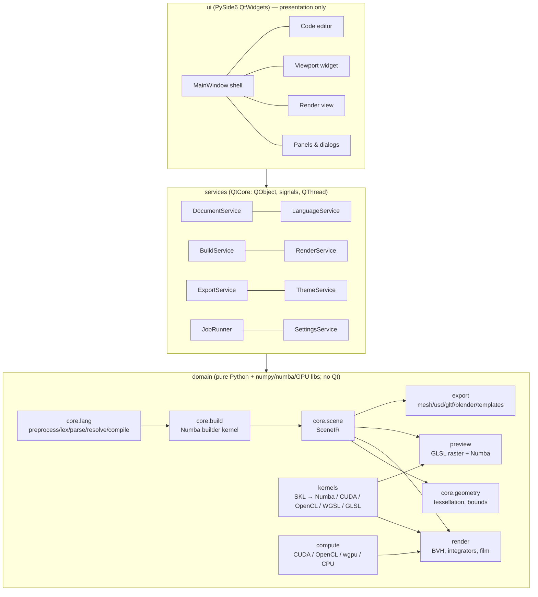
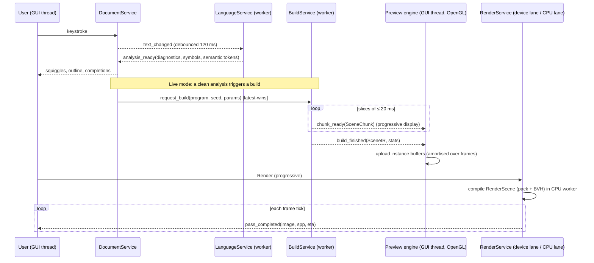

# 02 — Architecture

## 1. Architectural style

Structura is a **layered, data-oriented application**:

- **Data-oriented core.** The builder produces one immutable, struct-of-arrays scene (`SceneIR`). Every other
  subsystem is a *pure function of that data*: viewport upload, render compile, exporters, statistics.
  Nothing renders by callback or visitor.
- **Layers with one-way dependencies.** Lower layers never import higher ones. CI checks this with
  `import-linter` contracts (§4).
- **Qt only where needed.** `core`, `kernels`, `render` and `export` do not import Qt. They are usable
  headless and from the CLI and tests. `services` uses QtCore (signals/slots, threads) only. `ui` is the only
  layer that imports QtWidgets.
- **Registries instead of switch statements.** Integrators, materials, lights, cameras, filters, samplers,
  bucket orders, exporters, themes and completions are registered by name. This follows Sunflow's
  `PluginRegistry` and removes the long if/else chains seen throughout Structure Synth.

## 2. Layer diagram



`preview` sits in the domain layer because its GL pipelines only need a current context and are Qt-free.
The `QOpenGLWidget` that hosts them lives in `ui.viewport`.

## 3. Top-level packages

| Package | Layer | Qt? | Responsibility |
|---------|-------|-----|----------------|
| `structura.core.math` | domain | no | Affine 3×4/4×4 helpers, vector ops (numpy + numba-compatible) |
| `structura.core.color` | domain | no | Colour parsing (SVG names, `#rgb` forms), HSV↔RGB (legacy-exact), sRGB↔linear |
| `structura.core.rng` | domain | no | MT19937 (legacy-exact), PCG hash, Sobol/Owen tables |
| `structura.core.lang` | domain | no | Preprocessor, lexer, error-tolerant parser, AST/CST, resolver, linter, compiler → `RuleProgram` |
| `structura.core.build` | domain | no | Numba builder kernel, resumable slices, streaming chunks |
| `structura.core.scene` | domain | no | `SceneIR`, materials, lights, camera, render settings, provenance, project (de)serialisation |
| `structura.core.geometry` | domain | no | Unit-primitive templates, vectorised tessellation, LOD, bounds |
| `structura.kernels` | domain | no | SKL DSL and its emitters (Numba, CUDA C, OpenCL C, WGSL, GLSL); shared kernel modules (intersection, sampling, BSDF, colour) |
| `structura.compute` | domain | no | Precision-engine backends: CUDA (cuda-python + NVRTC), OpenCL (pyopencl), wgpu, CPU (Numba); device selection, limits, device lane runtime |
| `structura.render` | domain | no | Render compile (packing), BVH, integrators, samplers, filters, film, denoise, outputs, backends |
| `structura.preview` | domain | no | Preview engine: OpenGL/GLSL raster pipelines (ModernGL), impostors, SSAO, shadows, picking, overlays, Numba fallback |
| `structura.export` | domain | no | Exporter registry: mesh formats, USD, glTF, X3D, Blender script, templates, images, video |
| `structura.scripting` | domain + services | QtQml for legacy JS | Python batch API; QJSEngine bridge for `#javascript` |
| `structura.themes` | domain | no (data + model) | Theme model, loaders (TOML, VS Code JSON, base16), derived palettes |
| `structura.services` | services | QtCore | Jobs, Document/Project, Build/Render/Export/Language/Theme/Settings services |
| `structura.ui` | ui | QtWidgets | Main window, editor, panels, dialogs, viewport/render widgets, command palette |
| `structura.cli` | entry | QtCore only (`QCoreApplication` when JS is used) | `structura build/render/export/convert` |
| `structura.app` | entry | QtWidgets | GUI bootstrap, splash, kernel warm-up |

The complete file-level tree is in [17](17-code-standards-and-layout.md) §6.

## 4. Dependency rules (enforced)

`import-linter` contracts in `pyproject.toml`:

1. **Layers:** `structura.ui` → `structura.services` → {`render`, `preview`, `export`, `scripting`} →
   `compute` → {`core`, `kernels`, `themes`}. No upward imports.
2. **Qt isolation:** `structura.core`, `structura.kernels`, `structura.render`, `structura.preview`,
   `structura.export`, `structura.themes` and `structura.compute` must not import `PySide6`. The Qt widget that
   hosts the viewport surface lives in `structura.ui.viewport`.
3. **Widgets isolation:** only `structura.ui` and `structura.app` may import `PySide6.QtWidgets`.
4. **One-way render dependency:** `structura.render` must never import `structura.preview`.
   `structura.preview` may import **only `structura.render.api`**, for its CPU fallback, which reuses the
   `preview` integrator ([08](08-viewport.md) §9). All other shared GPU code lives in `structura.compute` and
   `structura.kernels`.
5. **Exporters are leaves:** `structura.export.*` modules may import only `core` (and `render.output` for
   images).

## 5. End-to-end data flow



### 5.1 Key data objects

| Object | Produced by | Consumed by | Mutability |
|--------|-------------|-------------|------------|
| `SourceDocument` (text + version + path) | DocumentService | LanguageService, BuildService | Immutable snapshot per version |
| `Analysis` (CST, AST, symbols, diagnostics, semantic tokens) | `core.lang` | Editor, outline, completion | Immutable |
| `RuleProgram` (compiled tables: rules, actions, loops, transforms, set-ops) | `core.lang.compile` | `core.build` | Immutable numpy arrays |
| `SceneChunk` | builder slice | Viewport (progressive) | Immutable |
| `SceneIR` | builder | everything downstream | Immutable (frozen dataclass of read-only arrays) |
| `RenderScene` (packed GPU/CPU buffers + BVH) | `render.compile` | GPU and CPU backends | Immutable; cached by `SceneIR.id + settings hash` |
| `FilmSnapshot` (HDR float32 + AOVs + spp map) | render backends | Render view, outputs, denoiser | Immutable snapshot |

Immutability is what makes threads simple ([04](04-concurrency-model.md)). A producer creates a snapshot,
freezes it with `array.flags.writeable = False`, and emits it. After that no one mutates it.

## 6. Cross-cutting abstractions

### 6.1 Registry (one implementation, many uses)

```python
# structura/core/registry.py  (sketch)
class Registry(Generic[T]):
    def register(self, name: str, *, aliases: tuple[str, ...] = ()) -> Callable[[type[T]], type[T]]: ...
    def create(self, name: str, **params: object) -> T: ...
    def names(self) -> list[str]: ...
    def describe(self, name: str) -> PluginInfo: ...   # docs shown in UI and completion
```

The same registry supports:

- the render settings UI (it lists integrators and filters);
- editor completion (`set raytracer::` keys, material types);
- CLI `--help` generation;
- the language reference documentation.

Each plug-in declares its parameters **once**, as a `ParamSpec` (name, type, default, range, doc). Dialogs,
validation, completion, serialisation and CLI flags are all generated from that spec.

### 6.2 ParamSpec: single source of truth for every setting

```python
@dataclass(frozen=True)
class ParamSpec:
    key: str                 # "samples", "dof", "sun.turbidity"
    type: ParamType          # INT, FLOAT, BOOL, COLOR, VEC3, ENUM, PATH, SIZE
    default: object
    range: tuple[float, float] | None = None
    choices: tuple[str, ...] = ()
    legacy_keys: tuple[str, ...] = ()   # e.g. "raytracer::ambient-occlusion-samples"
    doc: str = ""
```

### 6.3 Job (the only way to do background work)

Defined in [04](04-concurrency-model.md). Build, BVH compile, CPU render, export, thumbnail generation, analysis
and kernel warm-up are all Jobs.

### 6.4 ComputeDevice

`structura.compute.select_backend()` hides backend selection:

- `CudaBackend`, `OpenCLBackend`, `WgpuBackend`;
- `CpuBackend` (Numba).

The renderer and viewport ask for a device. They never check "is a GPU available?" themselves
([11](11-compute-backends.md)).

### 6.5 Errors

- Domain code raises typed exceptions (`StructuraError` hierarchy) carrying a `SourceSpan` where relevant.
- Services convert them into `ErrorInfo` records (message, span, severity, hint) and emit a signal. They
  never show dialogs.
- The UI decides how to present them: the Problems panel, a toast, or a modal for fatal errors.

### 6.6 Logging

- Standard `logging` with module loggers.
- A `QtLogHandler` in services forwards records to the Console panel via a signal, throttled to 30 Hz.
- Build and render statistics are structured records, not strings.

### 6.7 Settings & persistence

- App preferences: `QSettings` wrapped by `SettingsService`, with keys declared as `ParamSpec`s.
- Per-document settings (camera, render settings, parameters, keyframes) live in the `.structura` project
  ([07](07-scene-model.md) §8). Legacy `set` commands in `.es` files are still honoured.
- User data dirs come from `platformdirs`: themes, templates, presets, HDRIs, kernel cache.

## 7. Headless vs GUI

| Capability | GUI | CLI / Python API |
|------------|-----|------------------|
| Parse / lint | ✓ | ✓ (`structura lint`) |
| Build | ✓ (BuildService) | ✓ (direct call to `core.build.build_scene`) |
| Render | ✓ | ✓ (CUDA / OpenCL / wgpu offscreen, or CPU) |
| Export | ✓ | ✓ |
| Legacy `#javascript` | ✓ | ✓ (runs a `QCoreApplication` + `QJSEngine`, no widgets) |

The services layer holds no logic that the CLI needs. Services only **schedule** domain functions. That
keeps both paths DRY.

## 8. Extensibility points (post-1.0 friendly)

- Exporter plug-ins (Python entry points group `structura.exporters`).
- Theme packs (drop TOML files into the user themes dir).
- Render templates (legacy XML and new Jinja2 templates in the user templates dir).
- Material presets (TOML).
- A language-server bridge (`structura lsp`), reusing `core.lang` for VS Code users. This is post-1.0.
