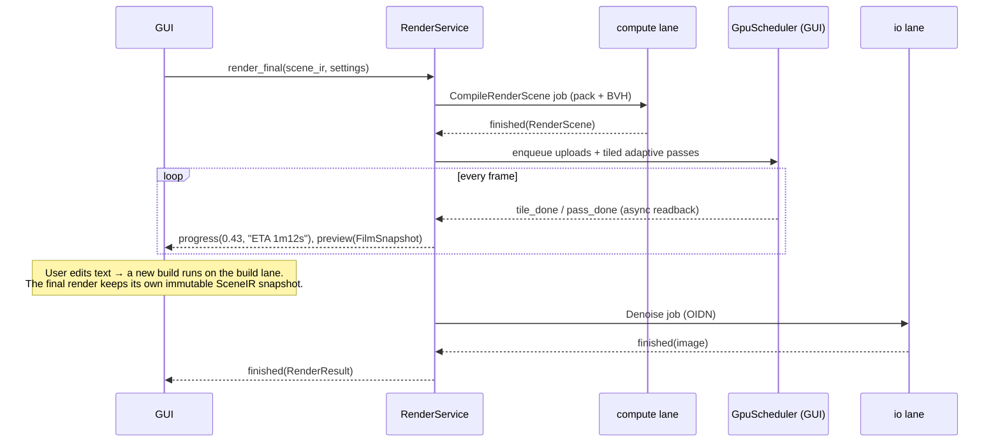

# 04 — Concurrency Model

**Rule zero: the GUI thread never waits.** It never sleeps, joins, blocks on I/O, or runs any loop whose
length depends on scene size. Every long-running activity is a **Job** that reports through Qt
**signals/slots**. Structure Synth ran its builder and raytracer on the GUI thread with `processEvents()`.
That pattern is banned, and a lint rule rejects any use of `processEvents`.

## 1. Threads at a glance

| Thread / lane | Kind | Concurrency | Runs | Policy |
|---------------|------|-------------|------|--------|
| **GUI** | Qt main thread | 1 | Widgets, editor, viewport draw, **GPU scheduler** (§5), signal fan-out | Never blocks; per-frame work ≤ 8 ms |
| **analysis** lane | `QThread` worker | 1 | Lint, parse, resolve, semantic tokens, completion model refresh | Latest-wins per document |
| **build** lane | `QThread` worker | 1 | Numba builder slices (`nogil=True`) | Latest-wins per document |
| **compute** lane | `QThread` worker | 1 | *Parallel* Numba kernels: BVH build, CPU render tiles, bulk tessellation, packing | FIFO with priorities; **exactly one parallel Numba call at a time** (§6) |
| **io** lane | `QThreadPool` | 2–4 | File writes, exporters (non-parallel parts), thumbnails, image encode, OIDN | FIFO |
| **isolated** lane | subprocess (`multiprocessing`, spawn) | 1 | Any third-party call that holds the GIL for > 50 ms (candidate: very large USD writes) | Used only where the watchdog proves it is needed (§8) |

Lanes are created once by `JobRunner` at start-up and reused. No code creates ad-hoc threads.

## 2. The Job framework

One small framework carries all background work (DRY).

```python
# structura/services/jobs/job.py  (sketch)
class Job(Protocol[T_co]):
    name: str
    lane: Lane                          # ANALYSIS | BUILD | COMPUTE | IO | ISOLATED
    key: str | None                     # for latest-wins coalescing (e.g. document id)
    def run(self, ctx: JobContext) -> T_co: ...

class JobContext:
    def check_cancelled(self) -> None: ...            # raises JobCancelled
    def progress(self, fraction: float, text: str = "") -> None: ...   # throttled to 30 Hz
    def partial(self, payload: object) -> None: ...   # streaming results (chunks, passes)

class JobHandle(QObject):
    started   = Signal()
    progress  = Signal(float, str)
    partial   = Signal(object)
    finished  = Signal(object)
    failed    = Signal(object)          # ErrorInfo
    cancelled = Signal()
    def cancel(self) -> None: ...
```

**Rules**

1. A Job's `run` is domain code. It must not import QtWidgets, and it touches Qt only through `ctx`.
2. `ctx.partial` and `finished` payloads must be **immutable**: frozen dataclasses holding read-only numpy
   arrays. Ownership transfers on emit, and the producer must not keep mutating references.
3. Signals cross threads as **queued connections** (Qt's AutoConnection does this automatically). Slots in
   the GUI thread must finish within the frame budget. Anything heavier schedules another Job.
4. **Latest-wins:** submitting a job with the same `(lane, key)` cancels the pending or running one. A
   generation counter drops stale results that arrive after a newer request.
5. Progress is throttled in `JobContext`, not in the UI, so every consumer benefits.
6. Every job has a `JobRecord` (timings, outcome) for the Activity panel and diagnostics.

## 3. Cancellation

| Work type | Cancellation granularity | Mechanism |
|-----------|--------------------------|-----------|
| Builder | ≤ 20 ms slice | The kernel is resumable: `step(state, budget)` returns; the Job checks `ctx.check_cancelled()` between slices |
| BVH build | Per top-level split task | Recursive split tasks are queued; the queue is checked between tasks |
| CPU render | Per tile batch (≈ 10–30 ms) | `render_tiles(tile_ids)` kernel calls |
| GPU render | Per dispatch batch (≈ 10–30 ms GPU time) | The scheduler stops submitting; in-flight work finishes, and its result is discarded if the generation is stale |
| Export | Per chunk (≤ 64k instances) | Writers are generators that yield between chunks |
| Analysis | Per phase (lex / parse / resolve / lint) | Short by construction |

`JobCancelled` is a normal outcome. It never shows up as an error.

## 4. Debouncing & live mode

- **Keystroke → analysis:** a 120 ms single-shot `QTimer`, restarted on every edit.
- **Analysis clean → build (live mode):** 200 ms after the last edit, only if there are no error
  diagnostics. The build is skipped if the compiled `RuleProgram` hash has not changed; comment-only edits
  do not rebuild.
- **Parameter slider / number scrubbing → build:** rebuilds continuously with latest-wins. While a drag is in
  progress, the BuildService applies a *preview budget*: maxobjects is capped at 250k, then a full rebuild
  runs on release.
- **Viewport camera change → progressive render reset:** immediate, because the accumulation simply restarts.

## 5. GPU scheduling (cooperative, GUI thread)

All wgpu calls happen on the GUI thread. This is a deliberate, documented constraint:

- Qt surfaces must be presented from the GUI thread.
- wgpu-py objects are not documented as safe to share across Python threads.
- Command *encoding* is cheap (microseconds to a few milliseconds); the heavy work runs asynchronously on
  the GPU.

The **`GpuScheduler`** (in `structura.gpu.scheduler`) runs once per display frame (vsync-driven via
rendercanvas `request_draw`, or a 16 ms `QTimer` when idle):

```text
tick():
    budget_cpu = 6 ms                      # encoding time allowed on the GUI thread
    1. viewport frame (if dirty)           # always first: interaction stays smooth
    2. pending uploads                     # large buffers split into ≤ 32 MB writes, one or more per tick
    3. progressive render passes           # k dispatches where k is tuned so GPU time ≈ 12–25 ms
    4. poll async readbacks                # map_async completions → FilmSnapshot → emit pass_completed
```

- **Timeout safety (Windows TDR ≈ 2 s, macOS watchdog):** no single dispatch may exceed about 50 ms of GPU
  time. The scheduler measures with timestamp queries where available, or falls back to wall-clock
  submit-to-completion. It adapts tile size and samples per dispatch.
- **Readback** is always asynchronous (`map_async`). The GUI thread never calls a blocking `map`.
- **Uploads** of large scenes are spread over ticks. The viewport shows already-uploaded chunks
  progressively.
- If the GPU device is lost, the scheduler emits `device_lost`. The RenderService switches to the CPU
  backend, and the viewport switches to its fallback ([08](08-viewport.md) §9). Both surface a
  non-blocking banner.

## 6. Numba threading rules

1. All CPU kernels are compiled with `nogil=True`, so the GUI thread keeps the GIL while they run.
2. Kernels with `parallel=True` run **only on the compute lane**. Numba's default `workqueue` threading
   layer is not safe for concurrent parallel calls from several threads, and TBB/OpenMP are not uniformly
   available as wheels. Serialising parallel work on one lane is correct on every platform.
3. Non-parallel `nogil` kernels (the builder, single-tile helpers) may run on any lane.
4. The thread count for `prange` is `numba.set_num_threads(max(1, physical_cores - 1))`, which leaves one
   core for the GUI. Users can change it in Preferences.
5. JIT compilation happens at start-up in the background (the *warm-up* Job) with `cache=True`. Installers
   pre-populate the cache ([11](11-compute-backends.md) §7). The first build never waits on the compiler
   unless warm-up is still running, and the status bar shows this.

## 7. Thread-affinity rules (checked in review and by tests)

| Object | Lives on | May be touched from |
|--------|----------|---------------------|
| Widgets, `QTextDocument`, `QSyntaxHighlighter` | GUI | GUI only |
| wgpu device, buffers, pipelines, canvas | GUI | GUI only |
| Service `QObject`s | GUI | GUI. Workers talk to them through signals only |
| Job workers (`QObject` in lanes) | Their lane thread | Their lane thread |
| `SceneIR`, `RenderScene`, `Analysis`, `FilmSnapshot` | Any (immutable) | Any |
| Numba typed containers inside the builder | Build lane | Build lane |

## 8. GIL & third-party calls

- Python switches threads every 5 ms (the `sys.getswitchinterval()` default), so pure-Python code in
  workers cannot starve the GUI for long. Still, workers should keep heavy loops in numpy or Numba.
- Third-party extension calls that hold the GIL can stall the GUI. In debug builds and CI, the **UI stall
  watchdog** pings the GUI thread every 16 ms. If a reply takes > 50 ms, it dumps all thread stacks
  (`faulthandler`) and fails the test.
- Any call the watchdog flags is either chunked (preferred) or moved to the **isolated** lane, which hands
  data over through `multiprocessing.shared_memory`. The export design ([15](15-export.md)) already chunks
  USD/glTF authoring into ≤ 64k-instance blocks, so the isolated lane should rarely be needed.

## 9. Shutdown & error containment

- On quit: prompt for unsaved documents, cancel all jobs, wait up to 2 s for lanes to stop (this wait happens
  after the main window is hidden), then exit. Exports that are still running ask whether to finish or abort.
- An exception inside a job becomes `failed(ErrorInfo)`. It never crashes the app.
- `sys.excepthook` and `threading.excepthook` route to the Console panel and a crash log. A crash dialog is
  shown only for GUI-thread exceptions.

## 10. Sequence example: "Render (final)" while the user keeps editing


