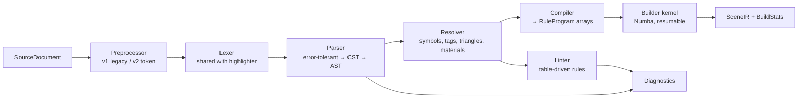

# 06 — Language Engine

The language engine turns EisenScript text into a `SceneIR`. It lives in `structura.core.lang` (front end)
and `structura.core.build` (builder). It has no Qt dependency.



## 1. Public API (the whole surface other layers use)

```python
# structura/core/lang/api.py
def analyze(doc: SourceDocument, *, params: ParamValues | None = None) -> Analysis: ...
def compile_program(analysis: Analysis, *, params: ParamValues, frame: FrameVars | None = None) -> RuleProgram: ...

# structura/core/build/api.py
def build_scene(program: RuleProgram, *, seed: int, limits: BuildLimits | None = None,
                ctx: BuildContext | None = None) -> SceneIR: ...
def iter_build(program: RuleProgram, *, seed: int, slice_ms: float = 20.0) -> Iterator[BuildProgress]: ...
```

`iter_build` is what the BuildService Job drives (slices → `ctx.partial(chunk)`). `build_scene` is a
convenience for the CLI and tests. It simply drains `iter_build`, so one code path serves both (DRY).

## 2. Source model

| Type | Purpose |
|------|---------|
| `SourceDocument(text, path, version, dialect)` | Immutable snapshot. `dialect` is detected from `#version 2`. |
| `SourceSpan(file_id, start, end)` | Character offsets. Line and column are computed lazily via `LineIndex`. |
| `SourceMap` | Maps preprocessed offsets back to original files and lines (includes, define expansion) |
| `Diagnostic(code, severity, span, message, fixes)` | Codes from the catalogue ([05](05-eisenscript-language.md) §10) |

All spans in diagnostics, provenance and the outline refer to **original** source, never to preprocessed text.

## 3. Preprocessor

Two implementations share one interface, `Preprocessor.process(doc, seed, params) -> PreprocessResult(text,
source_map, params_declared, diagnostics)`.

### 3.1 `LegacyPreprocessor` (v1)

- A line-by-line port of `Preprocessor.cpp`, including:
  - regex-equivalent matching of `#define NAME VALUE`, `(float:a-b)` and `(int:a-b)`;
  - substring substitution in alphabetical key order with restart and a cap of 100;
  - `random[a,b]` replacement using its own MT stream.
- It **records every substitution** (line, column, key) in the source map, so the editor can show what a
  define did (hover on a substituted token) and lint `W103` can name the collisions.
- `#include` is handled before substitution, with include-once.

### 3.2 `TokenPreprocessor` (v2)

- Runs on the lexer's token stream: whole-word replacement, expression values, and `#param` declarations.
- Defines are scoped in source order (a define applies only after its declaration).

## 4. Lexer (single implementation, two consumers)

`structura.core.lang.lexer.Lexer` is a hand-written scanner over `str` that yields
`Token(kind, start, end, text_lower)`.

| Consumer | How it uses the lexer |
|----------|-----------------------|
| Parser | Full-document token stream (after preprocessing) |
| Editor highlighter | `lex_line(text, state_in) -> (tokens, state_out)`, where `state` is `NORMAL` or `IN_BLOCK_COMMENT`. This is an exact fit for `QSyntaxHighlighter.currentBlockState()`. |

Token kinds: `RULE, SET, LBRACE, RBRACE, STAR, GT, NUMBER, OPERATOR, IDENT, PRIMITIVE, TAG_SEP, BRACKET,
COLOR, PREPROC, COMMENT, WHITESPACE, ERROR`.

- `PRIMITIVE` and `COLOR` are *refinements* of `IDENT`, chosen by table lookup (primitive names, SVG colour
  names, hex pattern). Highlighting and completion therefore use the same classification.
- The lexer **never raises**. Malformed input becomes `ERROR` tokens with a diagnostic.
- Performance target: ≥ 5 MB/s in CPython. A 1,000-line script lexes in < 3 ms.

## 5. Parser (error-tolerant, lossless)

- Recursive descent following the EBNF in [05](05-eisenscript-language.md) §3, with one function per
  production. Each function is small (≤ 30 lines, per [17](17-code-standards-and-layout.md)).
- It produces a **lossless CST**: every token, including trivia (whitespace and comments), belongs to a node.
  The formatter and refactorings (rename rule, extract rule) work on the CST. The **AST** is a typed view
  over it (`RuleDef`, `Action`, `Loop`, `TransformOp`, `SetStmt`, `MaterialDef`, …).
- **Recovery:**
  - On an error, record the diagnostic and skip to a synchronisation token (`rule`, `set`, `}`, or a token
    that can start an action at statement level).
  - Missing tokens are inserted virtually: an unclosed `{` is closed at the next `rule`.
- **Strictness switch:** in *legacy-strict* mode (used by the compat test harness and by Build in v1), any
  error stops compilation exactly where 1.5 would have thrown a `ParseError`. The editor always uses
  tolerant mode, so the outline and completion keep working on broken code.
- Dialect handling:
  - v2 productions (`material`, `light`, `environment`, `camera`, `render`, `( expr )`, bracket
    primitive arguments) are enabled only when `dialect == 2`.
  - In v1 they produce `E001` with the hint "requires `#version 2`".

## 6. Resolver & semantic model

`SemanticModel` is built from the AST. It is immutable and cheap to query from the editor.

| Facility | Details |
|----------|---------|
| Symbol table | `rules: name → [RuleDef…]` (multiple definitions form an ambiguous rule, with weights); primitives; tags; materials; lights; params |
| Reference resolution | `NAME` → rule, primitive, `prim::tag`, `triangle[...]` (parsed and validated), or `template::ID` |
| Call graph | Edges rule → rule, with loop multiplicity. Used for reachability (`W101`/`W102`), recursion analysis (`W108`) and the outline. |
| Retirement graph | Cycle detection (`E011`) |
| Static size estimate | Per-generation branching factor (expected children per application, weight-averaged over ambiguous alternatives). Bounded by depth limits, it yields an order-of-magnitude object estimate (`W107`) that the UI shows before a build. |
| Hover data | Rule probabilities (`I201`), define expansions, material resolution |

## 7. Compiler → `RuleProgram`

The compiler lowers the semantic model into **flat, typed numpy arrays** that Numba can consume. There are
no Python objects in the hot path.

| Table | Columns (dtype) |
|-------|-----------------|
| `rules` | `kind u1` (CUSTOM / AMBIGUOUS / PRIM / TRIANGLE / TEMPLATE / NOOP), `weight f8`, `maxdepth i4` (−1 = none), `retire i4`, `act_start i4`, `act_count i4`, `alt_start i4`, `alt_count i4`, `prim_kind u1`, `tag u2`, `aux i4`, `span u4` |
| `alts` | `rule i4` (custom rules of an ambiguous rule, in definition order) |
| `actions` | `kind u1` (CALL / SET), `loop_start i4`, `loop_count i4`, `target i4`, `has_xform u1`, `setop i4`, `span u4` |
| `loops` | `reps i4`, `xform i4` |
| `xforms` | `m f4[4,4]` (v1) / `f8[4,4]` (v2), `dh f4`, `ks f4`, `kv f4`, `ka f4`, `absolute u1`, `random u1`, `blend_hsv f4[3]`, `blend_k f4`, `mat i2` (v2 `mat` op) |
| `setops` | `op u1` (SEED_INT / SEED_INITIAL / MAXDEPTH / MAXOBJECTS / MINSIZE / MAXSIZE / SYNCRANDOM / COLORPOOL / SCENE_EVENT), `i i8`, `f f8`, `ref i4` |
| `pools` | Colour pool descriptors; image pools reference a `u1[h,w,3]` array |
| `triangles` | `p f4[3,3]` |
| `scene_events` | Ordered background, camera and raytracer settings (applied in Python after the build; no effect on geometry) |

### 7.1 Compat-exact details the compiler must honour

- Transform lists are composed with **`Transformation::append` semantics**:
  - matrix product in list order;
  - relative colour terms accumulate;
  - absolute-meets-absolute takes the latter;
  - absolute-meets-relative sets the absolute flag and combines the terms **arithmetically** (quirk kept).
    Δh is added and the factors are multiplied, so `{ hue 30 color #00f }` yields absolute hue 270°.
  - `color random` is encoded as absolute Δh = 1000. Any combined Δh > 360 means "draw from the pool";
  - the latest non-zero blend wins.
- Degrees to radians use `3.14159265/180` (legacy constant).
- v1 matrices are float32 and are multiplied by an explicit triple loop in **the same accumulation order as
  `Matrix4::operator*`**, with `fastmath=False`, to stay close to the C++ rounding.
- Axis-angle rotation uses the same formula as `Matrix4f::Rotation`.
- Colours use the **`QColorCompat`** module (§8), not Qt.

## 8. Colour compatibility (`structura.core.color.qcolor_compat`)

Absolute colours go through `QColor` in 1.5. So colour names, formats and **integer quantisation** must match
it:

- **Formats:** `#rgb`, `#rrggbb`, `#aarrggbb`, `#rrrgggbbb`, `#rrrrggggbbbb`, the 148 SVG colour names, and
  `transparent`.
- **`toHsv()` quantisation:** hue as an integer in degrees (−1 if achromatic), saturation and value in 0–255
  (divided by 255 afterwards).
- `fromHsv(h, 255, 255)` is used for `randomhue` pools.

The implementation is a small pure-Python module. **The test oracle is PySide6's own `QColor`** (property
tests over random colours). The golden corpus settles any Qt4-vs-Qt6 rounding difference, and the golden
result always wins.

## 9. Random numbers (`structura.core.rng`)

- `mt19937.py` is a Numba-jitted MT19937 with `init_genrand`, `rand_int()`, `rand_int_n(n)` (mask + reject),
  `get_double()` (`/4294967295.0`). It operates on state arrays owned by the builder (no globals; fixes D10).
- **Verified equivalence:** the stream equals
  `numpy.random.RandomState(seed)._bit_generator.random_raw()` for the same seed. This was checked during
  planning by comparing 2,000 outputs against an independent port of `MTRand` (identical). The numpy
  generator is used as the test oracle.
- Seeds are reduced `mod 2³²` exactly as the C++ `uint32` conversion does, including negative seeds.

## 10. Builder kernel (`structura.core.build`)

### 10.1 Design

- **One Numba `@njit(nogil=True, cache=True)` kernel** implements both BFS and DFS expansion over
  `RuleProgram` tables.
- The kernel is **resumable**. `step(program, state, budget_ops) -> status` processes up to `budget_ops` rule
  applications and returns, leaving all state in arrays.
- The Python driver (`iter_build`) sizes `budget_ops` adaptively so each slice takes about 20 ms. Between
  slices it yields `BuildProgress` (stats + newly emitted primitive range). This gives cancellation,
  progress and streaming ([04](04-concurrency-model.md) §3) without Python callbacks inside Numba.
- Because the same kernel runs with `NUMBA_DISABLE_JIT=1`, tests can also execute it as plain Python. There
  is no separate "reference implementation" to keep in sync (DRY).

### 10.2 State storage (struct-of-arrays, double-buffered for BFS)

| Array | Shape | Notes |
|-------|-------|-------|
| `M` | (cap, 4, 4) f4/f8 | Affine; the last row is kept for legacy-exact products |
| `hsv`, `alpha` | (cap, 3), (cap,) | |
| `prev_M`, `prev_hsv`, `prev_alpha`, `has_prev` | | Only materialised if the program uses `mesh` (compile-time flag) |
| `depth` | (cap, R_d) i4 | R_d = number of depth-limited rules; a value of −1 means "not yet entered" (the legacy map's "not contains") |
| `seed` | (cap,) i8 | |
| `rule` | (cap,) i4 | Rule to apply |
| `mat` | (cap,) i2 | v2 inherited material |

- Capacity grows by doubling.
- The **memory guard** estimates bytes per pending state. It stops with a clear message before exceeding a
  user-configurable share of RAM (default 50%, via psutil).
- DFS uses an explicit stack, with children pushed in reverse so they pop in emission order. This matches
  the legacy linked-list insertion.

### 10.3 Emission

Primitives are appended to growable output arrays ([07](07-scene-model.md) §2) **in emission order**. This
order matters for template export and for `template::*` CSG markers.

Each primitive records:

- `kind`, `M`, `rgba`, `tag`;
- `source` (the action id of the call site);
- `depth` (generation);
- `aux` (mesh or triangle index).

### 10.4 Provenance & "why is this here?"

- Every primitive stores its **call-site action** (`u4`) and **generation** (`u2`). That is enough to jump to
  source and to colour the viewport by generation or by rule.
- The full ancestry chain is **not** stored (that would cost memory per pending state). The builder is
  deterministic, so "Show ancestry" **re-runs the build in trace mode** with a target object index. That run
  records the (rule, action, loop counters) chain for that object only. The cost is one extra build, off the
  GUI thread.

### 10.5 Performance targets (reference machine)

| Scenario | Target |
|----------|--------|
| 100k boxes, BFS | < 60 ms build |
| 1M boxes, BFS | < 600 ms build |
| Warm start (JIT cached) | < 150 ms to the first kernel call |
| Memory | ≤ 120 bytes per emitted primitive (v1, float32), excluding optional mesh data |

### 10.6 Legacy-exact checklist (each item has a unit test)

1. Loop counters start at 1; odometer order, first loop fastest.
2. `prev` is recorded only for actions with a transform list (including single `{}` lists).
3. Ambiguous selection uses `r ≤ cumulative`, with a fallback to the last alternative.
4. Depth map semantics: first entry N−1; at 0, retire; a retirement resets to N.
5. One unconditional geometry draw per BFS generation; `syncrandom` reseeding; `seed initial` reseed-and-redraw.
6. Size culling before application, using the diagonal length of M·(1,1,1) − M·(0,0,0).
7. The termination conditions and their reporting.
8. `set maxdepth` in DFS mode pushes the limit into every rule without one (`setRulesMaxDepth`).
9. Top-level `set` commands execute in statement order during generation 0. Scene events (camera,
   background) are recorded, not interpreted, by the kernel.

## 11. Caching

- `analyze` results are cached per `(doc.version)`.
- `RuleProgram` is cached by a content hash of (AST, param values, dialect), so comment-only edits are free.
- A `SceneIR` is cached by `(program hash, seed, limits)`. An LRU of 3 lets undo and redo of a parameter
  change display instantly.
