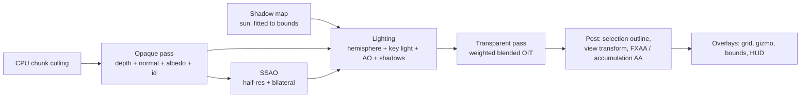

# 08 — Preview Engine & Viewport (GLSL + Numba; `structura.preview`, `structura.ui.viewport`)

Structura has **two render engines** ([ADR-0013](adr/0013-two-render-engines.md)):

| Engine | Purpose | Precision | Backends |
|--------|---------|-----------|----------|
| **Structura Preview** (this document) | Interactive viewport, picking, thumbnails, variation grids, quick looks | *Lower precision by design*: fp32 transforms, **unorm8 colours**, half-resolution effects, screen-space approximations, 1-spp ray-cast fallback | **GLSL** (OpenGL 3.3 core, 4.1 on macOS) via `QOpenGLWidget` + ModernGL; **Numba** CPU ray-cast fallback |
| **Structura Render** ([09](09-renderer.md)) | Final, physically based images | fp32 throughout, robust ray offsets, optional fp64 accumulation on CPU/CUDA, converged Monte Carlo | **CUDA**, **OpenCL**, **WGSL** (wgpu), **CPU** (Numba), all from one SKL source ([11](11-compute-backends.md)) |

The preview engine replaces Structure Synth's immediate-mode `EngineWidget`. It has to look good by default
and stay interactive at millions of instances. It is also the entry point for provenance: **click an object to
find the rule that made it.**

## 1. Budgets (reference GPU: **NVIDIA GTX 1660, 6 GiB**, 1920×1080)

| Scene | Target |
|-------|--------|
| 100k boxes, all effects | ≥ 120 fps |
| 1M boxes (12M triangles), all effects | ≥ 45 fps |
| 5M boxes, during interaction (effects adaptive) | ≥ 20 fps |
| First frame after a build finishes | ≤ 1 frame after the final chunk uploads |
| Pick latency (click → editor jump) | ≤ 50 ms |
| GPU memory at 5M instances | ≤ 400 MiB (fits alongside the precision engine in 6 GiB) |

## 2. Technology

- **OpenGL 3.3 core** baseline, **4.1 core** on macOS (the highest there). It uses GLSL `#version 330` /
  `#version 410`. No compute shaders or SSBOs are required, so the same code runs on every desktop OS and on
  Mesa llvmpipe (CI).
- **Hosting:** `PySide6.QtOpenGLWidgets.QOpenGLWidget`. ModernGL attaches to Qt's context
  (`moderngl.create_context()` inside `initializeGL`). Qt owns the surface, DPI scaling and docking, which is
  the most mature GL embedding available in Python.
- **Shared shader code:** GLSL modules for camera maths, colour and view transforms are **emitted from SKL**
  ([11](11-compute-backends.md)). The preview and the precision engine therefore agree exactly on camera and
  colour conventions. Preview-only shaders (instanced meshes, impostors, SSAO, OIT) are hand-written GLSL
  using a small `#include` preprocessor.
- **Thread:** all GL calls run on the GUI thread inside `paintGL` and scheduler ticks. They are cheap
  encodings; no GPU readback ever blocks ([04](04-concurrency-model.md) §5).

## 3. GPU data layout (lower precision where it is invisible)

Uploaded from `SceneIR` by `preview.gl.upload` in ≤ 32 MiB chunks per frame:

| Attribute (instanced, divisor 1) | Format | Bytes |
|----------------------------------|--------|-------|
| Transform rows 0–2 | 3 × `vec4` fp32 | 48 |
| Colour | `RGBA8` unorm (linear, quantised) | 4 |
| Meta (kind, tag or material, flags) | `uint` | 4 |

That is **56 B per instance**, or 280 MiB at 5M.

- Normal matrices are computed in the vertex shader (cofactor of the 3×3).
- Instances are sorted by kind on upload (numpy `argsort`, chunked), so each kind draws as one contiguous
  instanced range.
- **Culling without compute:** instances are grouped in spatial chunks of 16k (Morton order) with chunk
  AABBs. Chunks outside the frustum are skipped with CPU tests. This is O(#chunks), which is negligible.

## 4. Pipelines per primitive kind

| Kind | Technique |
|------|-----------|
| Box, cylinder, cone, torus | Instanced unit meshes from `core.geometry.unit_shapes` |
| Sphere, ellipsoid | **Ray-cast impostors**: a camera-facing quad per instance; the fragment shader intersects a true sphere or ellipsoid and writes `gl_FragDepth`. Pixel-perfect at 4 vertices per instance. |
| Line, tube, grid edges | Screen-space thick lines, generated in the vertex shader from `gl_VertexID` (grid = 12 edges per instance) |
| Dot | Round point sprites |
| Mesh sweeps, triangles | Pre-tessellated triangle VBOs |

## 5. Frame graph



- **Look presets:**
  - *Studio* (default: soft key light, SSAO, soft shadows, optional ground);
  - *Legacy* (the 1.5 flat Phong look);
  - *Clay*;
  - *Technical* (edges + flat colour);
  - *X-ray*.
- **Colour-by modes** (uniform switch, no re-upload): authored colour, generation, rule, tag, material,
  random.
- **Accumulation AA:** when the camera is still, jittered frames accumulate into a crisp converged image.
- **Adaptive quality:** if frame time exceeds 22 ms during interaction, SSAO runs at quarter resolution,
  shadows freeze and AA falls back to FXAA. Everything is restored on idle.
- **"Render in viewport":** the viewport can display the *precision engine's* progressive output for the same
  camera (Blender-style rendered view). The preview engine then only draws overlays.

## 6. Picking & provenance

1. On click or hover-pause, re-render the id pass (R32UI) if stale. Read a 5×5 region through a **pixel
   buffer object with a fence** (`glFenceSync`), and poll on the next frames. The GUI never blocks.
2. Resolve: instance id → `SceneIR` row → `source` action → provenance span.
3. Emit `object_picked(PickInfo)` with kind, tag, material, generation, size, depth under the cursor and
   source location. The editor flashes the call site, the Inspector fills in, and "Show ancestry" triggers a
   trace rebuild ([06](06-language-engine.md) §10.4).
4. Selection sets (by rule, tag or generation) are a per-instance flag bit, updated with `glBufferSubData`
   on the meta attribute. Outlines are drawn in post.
5. Alt+click sets the render camera's focus distance from the picked depth.

## 7. Camera controls

| Action | Structura (default) | Legacy preset (1.5) | Blender preset |
|--------|---------------------|---------------------|----------------|
| Orbit | LMB drag | LMB drag | MMB drag |
| Pan | MMB drag / Shift+LMB | RMB drag / Ctrl+LMB | Shift+MMB |
| Dolly | Wheel (toward the cursor) | Wheel | Wheel |
| Zoom + roll | Alt+LMB | Shift+LMB / LMB+RMB | Ctrl+MMB |
| Fly | RMB + WASD/QE | — | Shift+` |
| Frame all / selection | `F` / `Shift+F` | Reset view | Home / Numpad . |
| Standard views | Numpad 1/3/7 (+Ctrl), Numpad 5 persp/ortho | — | same |

- Turntable (default) or trackball (legacy) orbit; animated transitions (200 ms).
- **Copy camera to script** writes 1.5 `set` lines (v1) or a `camera {}` block (v2) via the exact mapping in
  [07](07-scene-model.md) §5.

## 8. Overlays & HUD

Axis gizmo (clickable), legacy coordinate system, auto-scaled ground grid, bounds, and a HUD with fps,
instance counts by kind, triangles drawn, GPU memory and build progress.

## 9. Compute fallback (no usable OpenGL 3.3)

**The decision is made before any GL widget exists.** A window containing a `QOpenGLWidget` is composited
through an OpenGL context (Qt's RHI backing store). If that context cannot be created, the window never
produces a frame, and on Wayland it is never shown at all. So the fallback cannot wait for the widget to fail.
At start-up `ui/viewport/gl_probe.py` creates throw-away contexts in this order:

1. OpenGL 3.3 core;
2. OpenGL 3.3 compatibility;
3. the driver's default context, accepted if `GL_VERSION` reports desktop OpenGL ≥ 3.3.

**Every format asks for desktop OpenGL explicitly** (`QSurfaceFormat.RenderableType.OpenGL`). With the
default renderable type, Qt's EGL code picks an *OpenGL ES* config on NVIDIA drivers (Wayland, EGLFS).
Asking that ES config for a 3.3 core context fails with `EGL_BAD_MATCH`, which Qt reports as
"Failed to create context: 3009", and the driver default then comes back as "OpenGL ES 3.2 NVIDIA". This
was the cause of the CPU preview on the reference machine (GTX 1660, Wayland, Qt 6.12). It is reproduced in
tests by requesting an ES config from a headless mutter compositor.

The first format that works becomes the application's default `QSurfaceFormat`, which the viewport widget
also uses. If none works:

1. **XWayland retry** (`ui/viewport/xwayland.py`). On a Wayland session with an X display, the app restarts
   itself once on the `xcb` platform, before any window exists. The same GPU is usually fully usable through
   GLX there. If OpenGL works on XWayland, the choice is remembered per Qt version, so later starts go there
   directly; a Qt update re-tests native Wayland. The retry is skipped when the user set `STRUCTURA_PREVIEW`
   or `QT_QPA_PLATFORM`.
2. **Compute preview.** No `QOpenGLWidget` is created and the viewport uses `ComputeViewport`.

Qt's own context warnings are captured and reported in one log line. `structura doctor` prints every
attempt; when native Wayland fails, it also probes XWayland in a child process and prints that result.
`STRUCTURA_PREVIEW=gpu|cpu|off` overrides the choice.

A watchdog still covers platforms where the GL widget is created but never initialised. The compute preview,
**`ComputeViewport`**, works as follows:

- It calls **`render.api` with the `preview` integrator on the best compute device**: CUDA, OpenCL or wgpu on
  a GPU, and Numba otherwise. That is the same SKL kernel the precision engine uses (DRY). It runs through
  the `RenderService` on the device lane. `STRUCTURA_PREVIEW_DEVICE` selects a device explicitly.
- It renders at half resolution during motion and refines to full resolution with AA when idle. The image is
  shown via `QImage` in the same widget.
- Picking is an exact CPU ray cast. Colour-by modes and selection outlines are applied in the same kernel.
- Target: 1M instances at 960×540, ≥ 15 fps on an 8-core CPU (CPU device).

A badge names the device ("CUDA preview", "CPU preview"), and the status bar shows it too. The feature set
is otherwise identical.

## 10. Screenshots

Offscreen FBO rendering at any size. Above `GL_MAX_RENDERBUFFER_SIZE`, tiles are stitched. Output can have
a transparent background, PNG 8/16 or EXR. Encoding runs on the io lane.

## 11. Module breakdown

```
structura/preview/
  backend.py             # PreviewBackend protocol (GL / CPU)
  gl/
    context.py           # ModernGL context bound to QOpenGLWidget's context
    upload.py            # chunked SceneIR → instanced VBOs, kind sort, Morton chunks
    culling.py           # chunk AABB frustum tests (numpy)
    pipelines/ mesh_instanced.py  sphere_impostor.py  lines.py  points.py  triangles.py
    passes/    shadow.py  ssao.py  lighting.py  oit.py  post.py  picking.py  overlays.py
    shaders/*.glsl       # preview-only GLSL; includes SKL-emitted shared modules
  cpu/
    preview_backend.py   # adapter over render.api (CPU, `preview` integrator) — the only render import allowed
  camera/ controller.py  presets.py  transitions.py  legacy_mapping.py
  picking.py  looks.py
structura/ui/viewport/
  viewport_widget.py     # QOpenGLWidget host; switches backend on failure
  hud.py  context_menu.py
```
