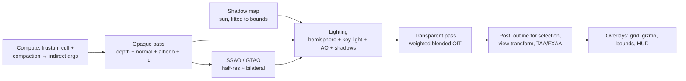

# 08 — Real-time Viewport (`structura.viewport`, `structura.ui.viewport`)

The viewport replaces Structure Synth's immediate-mode OpenGL `EngineWidget`. It has to look good by default
and stay interactive at millions of instances. It also doubles as the entry point for provenance:
**click an object to find the rule that made it.**

## 1. Budgets (reference GPU, 1920×1080)

| Scene | Target |
|-------|--------|
| 100k boxes, all effects | ≥ 120 fps |
| 1M boxes, all effects | ≥ 60 fps |
| 5M boxes, motion (effects adaptive) | ≥ 30 fps |
| First frame after a build finishes | ≤ 1 frame after the final chunk uploads |
| Pick latency (click → editor jump) | ≤ 50 ms |

## 2. Technology

- **wgpu** (WebGPU) device from `structura.gpu`, shared with the renderer. There is one device per process.
- The widget is **rendercanvas**'s Qt widget, embedded in `ui.viewport.ViewportWidget`. All wgpu calls run
  on the GUI thread under the `GpuScheduler` ([04](04-concurrency-model.md) §5).
- Shaders are **WGSL**. Shared modules (camera, colour and view transforms, sRGB conversion, unit shapes) are
  generated from SKL, so the viewport and the renderer agree on colour and camera maths
  ([11](11-compute-backends.md) §4). Viewport-only shaders (impostors, SSAO) are plain WGSL modules that
  share the same `#import` preprocessor.

## 3. GPU data layout

Uploaded from `SceneIR` by `viewport.upload` (chunked, ≤ 32 MB per tick):

| Buffer | Per instance | Notes |
|--------|--------------|-------|
| `xforms` | 48 B (3×4 f32) | Straight from `InstanceTable.xform` (zero-copy view) |
| `colors` | 4 B (rgba8 unorm, **linear**) | Packed once via `core.color.srgb_to_linear` |
| `meta` | 4 B (u32: kind 5 bits, tag/material 11 bits, flags 16 bits: selected, hidden, transparent) | |
| `ids` | (implicit) | Instance index = global row, used by picking and provenance |

That is about 56 B per instance, or about 280 MB at 5M instances.

- **Normal matrices are not stored.** The vertex shader computes the cofactor matrix of the 3×3 transform,
  which is cheap and saves 36 B per instance.
- Buffers larger than the adapter's `maxStorageBufferBindingSize` are split into **pages**, each with its own
  bind group and draw.
- Per-kind sub-ranges come from a GPU **counting sort by kind**, done once per upload, so each pipeline draws
  one contiguous range.

## 4. Pipelines per primitive kind

| Kind | Technique | Why |
|------|-----------|-----|
| Box, ellipsoid (low-poly fallback), cylinder, cone | Instanced unit meshes from `core.geometry.unit_shapes` | Exact silhouettes, cheap |
| Sphere | **Ray-cast impostor** (a camera-facing quad; the fragment shader intersects a true sphere and writes correct depth) | Pixel-perfect at any zoom, 4 vertices per sphere |
| Ellipsoid (v2) | Impostor with object-space ray transform | Pixel-perfect |
| Line, tube, grid edges | Screen-space thick lines (grid = 12 edges generated from `instance_index*12 + vertex_index`) | Thin geometry stays visible; width is set in px or world units |
| Dot | Round point sprites | |
| Mesh, triangle, torus | Pre-tessellated triangle buffers (shared unit torus, per-instance sweeps) | |

## 5. Shading and frame graph



- **Look presets:**
  - *Studio* (default: soft key light, AO, contact shadows on an optional ground plane);
  - *Legacy* (the flat Phong look of 1.5, for comparison);
  - *Clay* (uniform albedo);
  - *Technical* (edges + flat colours);
  - *X-ray*.
- **Colour-by modes:** authored colour, generation, rule (call site), tag, material, random per instance.
  These only switch a uniform, so there is no re-upload.
- **Transparency:** weighted blended order-independent transparency replaces the CPU depth sort of 1.5, which
  does not scale to millions of instances.
- **Anti-aliasing:** TAA while the camera moves. When the camera is still, jittered frames accumulate into a
  converged, crisp image. That makes the legacy "fast rotate" option unnecessary.
- **Adaptive quality:** if the frame time exceeds budget during interaction, SSAO resolution drops, shadows
  freeze and TAA falls back to FXAA. Everything is restored when the camera stops.
- **Render preview mode:** the viewport can host the progressive path tracer ([09](09-renderer.md)) in place
  of the raster pipeline, with the same camera, like Blender's rendered viewport. Any camera change restarts
  accumulation.

## 6. Picking & provenance

1. On click or hover-pause, render the **id pass** (the opaque pass with an R32Uint target) if it is stale.
   Copy a 5×5 region around the cursor to a readback buffer and `map_async` it. There is no stall.
2. Resolve the instance id → `SceneIR` row → `source` action → `provenance` span.
3. Emit `object_picked(PickInfo)`:
   - kind, tag, material;
   - generation;
   - world-space size and centre;
   - **depth under the cursor** (replacing 1.5's "Show 3D object information");
   - source location.
4. The editor jumps to and flashes the call site. The **Inspector** panel shows the details. "Show ancestry"
   triggers the trace re-build ([06](06-language-engine.md) §10.4).
5. **Selection sets:** "select all from this rule / tag / generation" writes a GPU selection bitmask (1 bit
   per instance). The post pass draws outlines, and the Inspector shows counts.
6. **Click-to-focus:** Alt+click sets the render camera's focus distance from the picked depth. This replaces
   the 1.5 workflow of reading the depth off the info display to tune `raytracer::dof`.

## 7. Camera controls

| Action | Default ("Structura") | Legacy preset (1.5) | Blender preset |
|--------|-----------------------|---------------------|----------------|
| Orbit | LMB drag | LMB drag | MMB drag |
| Pan | MMB drag / Shift+LMB | RMB drag / Ctrl+LMB | Shift+MMB |
| Dolly | Wheel (zooms toward the cursor) | Wheel | Wheel |
| Zoom + roll | Alt+LMB | Shift+LMB / LMB+RMB (vertical = zoom, horizontal = Z-rotate) | Ctrl+MMB |
| Fly | Hold RMB + WASD/QE | — | Shift+` |
| Frame all / selection | `F` / `Shift+F` | Reset view | Home / Numpad . |
| Standard views | Numpad 1/3/7 (+Ctrl for opposite), Numpad 5 = persp/ortho | — | same |

- Orbit style is selectable: turntable (Y-up, default) or trackball (legacy).
- Transitions are animated (200 ms ease).
- **Copy camera to script** produces either 1.5-style `set translation/rotation/pivot/scale` lines (v1) or
  a `camera { … }` block (v2), using the exact mapping in [07](07-scene-model.md) §5.

## 8. Overlays & HUD

- Axis gizmo (clickable: snaps to that view); "show coordinate system" (legacy, at the origin).
- Ground grid (auto-scaled to the scene bounds); bounding box of the scene or selection.
- HUD: fps, instance count by kind, triangles drawn, GPU memory, build progress ring during streaming.

## 9. CPU fallback viewport (no usable GPU)

If no wgpu adapter exists, or the device is lost, `ViewportWidget` switches its backend to
**`CpuPreviewViewport`**:

- It uses the **CPU renderer's `preview` integrator** ([10](10-renderer-shading.md) §2.4): a 1-spp ray cast
  with albedo × N·L + 4-sample AO, over the same BVH. This is DRY, because no second rasteriser exists.
- It renders at half resolution while the camera moves and refines progressively to full resolution with AA
  when still. The image is shown through `QImage` in the same widget.
- Picking, colour-by modes and the selection outline all work. Picking is an exact CPU ray cast.
- Target: 1M instances at 960×540 at ≥ 15 fps on an 8-core CPU.

The user sees a subtle "CPU mode" badge. Otherwise features are identical.

## 10. Screenshots ("Save as bitmap")

- Offscreen render at any resolution. Above the adapter's max texture size, tiles are stitched.
- Optional transparent background; PNG 8/16-bit or EXR.
- This runs as a Job. The GPU part runs in scheduler ticks; encoding runs on the io lane.

## 11. Module breakdown

```
structura/viewport/
  backend.py            # ViewportBackend protocol (GPU / CPU preview)
  gpu/
    device_bind.py      # bind-group layouts shared by pipelines
    upload.py           # chunked SceneIR → GPU buffers, kind sort
    culling.py          # compute cull + indirect args
    pipelines/
      mesh_instanced.py
      sphere_impostor.py
      lines.py
      points.py
      triangles.py
    passes/
      shadow.py  gtao.py  lighting.py  oit.py  post.py  picking.py  overlays.py
    shaders/*.wgsl      # viewport-only WGSL (imports shared modules)
  cpu/
    preview_backend.py  # adapter over render.api (CPU backend, `preview` integrator) — the only render import allowed
  camera/
    controller.py  presets.py  transitions.py  legacy_mapping.py
  picking.py            # id → PickInfo (backend-independent)
  looks.py              # look presets & colour-by modes (data)
```
