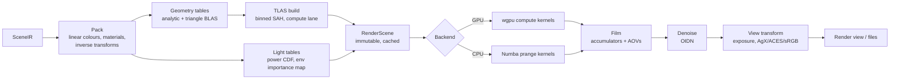

# 09 — Renderer Architecture (Structura Render, `structura.render`)

Structura Render is a **Sunflow-derived** physically based renderer. It runs on the GPU (WebGPU compute) and
on the CPU (Numba), from one kernel source ([11](11-compute-backends.md)). It replaces three things:

- Structure Synth's internal Phong/AO raytracer;
- the need to install Java + Sunflow;
- the need to install POV-Ray for quality renders.

## 1. Goals

| Goal | Target (reference machine, 1920×1080, 1M boxes, path tracing, 4 bounces) |
|------|-----------------------------------------------------------------------------|
| Interactive feedback | First progressive frame < 100 ms (quarter-res preview pass) |
| GPU throughput | ≥ 10 spp/s (to be validated in spike S2, [19](19-roadmap.md)) |
| CPU fallback throughput | ≥ 1 spp/s on 8 cores (to be validated in spike S3) |
| Scale | 5M instances on an 8 GB GPU; 20M on the CPU with 32 GB RAM |
| Fidelity | Sunflow feature set ([01](01-legacy-analysis.md) §2) minus the exclusions listed there, plus the POV-Ray ideas marked *Adopt* |
| Legacy look | The `classic` integrator reproduces the 1.5 internal raytracer closely enough for side-by-side recognition |
| Determinism | Same scene + seed + spp + backend → bit-identical image. GPU vs CPU → statistically equivalent (parity suite) |

## 2. Sunflow → Structura mapping

| Sunflow | Structura module | Notes |
|---------|------------------|-------|
| `SunflowAPI`, `ParameterList`, `Options` | `render.api.RenderRequest`, `ParamSpec` tables | Typed, frozen settings generated from registries |
| `Scene` | `render.compile.RenderScene` | Packed buffers + BVH; immutable; cached |
| `PluginRegistry` | `core.registry.Registry` | Shared with exporters and themes |
| `ImageSampler` → `BucketRenderer` / `ProgressiveRenderer` / `MultipassRenderer` | `render.samplers.image.{progressive, tiled_adaptive}` | Multipass is folded into progressive |
| `BucketOrder` (7 kinds) | `render.samplers.buckets` | hilbert (default), spiral, column, row, diagonal, random, inverted |
| `Filter` (9 kinds) | `render.film.filters` | Used as filter-importance-sampling distributions |
| `QMC` (Halton/Faure) | `render.sampling.{sobol_owen, halton_faure}` | Sobol default; Halton kept for reference comparisons |
| `AccelerationStructure` (BIH/KD/Grid) | `render.accel.{tlas, blas}` | Binned-SAH BVH2 with a compact node layout; two-level |
| `Instance`, `Geometry`, `PrimitiveList` | `render.geometry.{instances, analytic, triangles}` | Analytic unit primitives + triangle BLAS |
| `LightServer` | `render.integrators.common.light_sampling` | NEE, light selection by power, MIS |
| `GIEngine` (path, ambocc, igi, irr-cache, fake) | `render.integrators.{path, ao, classic, preview}` | See [10](10-renderer-shading.md) §2 |
| `CausticPhotonMap` | `render.integrators.photon_caustics` (phase R3) | CPU-first, GPU later |
| `Shader` (25 classes) | `render.materials.{principled, constant, wireframe, ao, debug}` | Presets replace most classes ([10](10-renderer-shading.md) §3) |
| `LightSource` (6) | `render.lights.{point, sphere, spot, sun, rect, mesh_emitter, env_hdri, env_sunsky, env_color}` | |
| `CameraLens` (4) | `render.cameras.{perspective_thinlens, orthographic, spherical, fisheye}` | Polygonal bokeh from `ThinLens` |
| `Display` (`imageBegin/Prepare/Update/End`) | `render.film.Film` → `FilmSnapshot` → Qt signals | |
| `BitmapWriter`s | `render.output.{png, exr, hdr, tiff, jpeg, webp}` | Metadata embedded |
| `.sc` parser | — (export only: `export.scene.sunflow_sc`) | |

## 3. Pipeline



### 3.1 Render compile (`render.compile`)

Runs as a compute-lane Job. It is cached by `(SceneIR.id, geometry-affecting settings hash)`. Camera-only or
sampling-only changes reuse the compiled scene.

| Output buffer | Contents | Size per item |
|---------------|----------|---------------|
| `inst_inv` | Inverse affine (world→object) 3×4 f32 | 48 B |
| `inst_rec` | kind u8, flags u8, material u16, colour rgba f16×4 | 12 B |
| `sphere_cr` | World centre + radius (spheres only; faster than the object-space test) | 16 B |
| `tlas_nodes` | BVH2 nodes: bounds (6×f32) + left/first u32 + count/axis u32 | 32 B, about 2N nodes |
| `tri_*` | World-space triangles for `mesh`, `triangle` and tessellated kinds; plus BLAS nodes | 36 B + per-vertex colour |
| `materials` | Packed principled parameters (std430-aligned) | 64 B |
| `lights`, `light_cdf` | Light records + selection CDF by power | — |
| `env_map`, `env_marginal`, `env_conditional` | HDRI + 2D importance-sampling CDFs (Sunflow `ImageBasedLight`) | — |

- Only the **inverse** transform is stored. Object-space hits are transformed back with it, and the normal
  transform uses its transpose.
- For 1M boxes the memory is about 64 B/instance of scene data (`inst_inv` + `inst_rec` + the 4 B reordered
  index; spheres add 16 B) + about 64 B of TLAS ≈ **130 MB**.

### 3.2 Acceleration structure (`render.accel`)

- **Two levels.**
  - The TLAS spans instance world AABBs. Analytic leaves are tested in object space (box slab test,
    cylinder, cone) or world space (sphere).
  - A TLAS leaf can also reference the **triangle BLAS**, a single identity-transform instance holding all
    world-space triangles. Shared unit meshes such as the torus get their own BLAS, instanced.
- **Build:**
  - The default is a binned SAH (16 bins) with a Numba `prange` over top-level tasks. It runs on the
    compute lane.
  - Above 4M instances the build switches to **LBVH** (Morton codes + radix sort) for the upper levels,
    with SAH refinement for the bottom levels.
  - Target: < 400 ms for 1M instances; < 3 s for 10M.
- **Layout:**
  - BVH2 with 32-byte nodes.
  - Leaves hold ≤ 4 primitives, stored as contiguous ranges in a reordered instance index buffer.
  - Traversal uses a fixed-size stack (64 entries) with near-child-first ordering.
  - Compressed wide BVH (BVH4/8) is a post-1.0 optimisation.
- **Robustness:** ray origins are offset using the error-bounds method of Wächter & Binder (*Ray Tracing
  Gems*, ch. 6). There is no scene-scale epsilon like the legacy `1E-7`.

## 4. Sampling

- **Per-pixel sequences:** Sobol (Joe–Kuo direction numbers) with **Owen scrambling via a hash** (Burley
  2020). The computation is integer-only, so GPU and CPU produce identical sample values.
- **Dimension allocation:**
  - 0–1: pixel (filter importance sampling);
  - 2–3: lens;
  - 4: time (reserved);
  - then per bounce: 2 for BSDF, 2 for light, 1 for light selection, 1 for Russian roulette.
- **Halton + Faure** (port of Sunflow `QMC`) is selectable, to compare against Sunflow renders.

## 5. Image samplers

### 5.1 Progressive (interactive; default in Render view and viewport preview)

- **Pass 0** is a quarter-resolution, 1-spp preview (the POV-Ray "mosaic preview" idea). Each following pass
  adds k spp at full resolution.
- The GPU scheduler splits passes into tile dispatches so that each dispatch stays within ≈ 25 ms GPU time
  ([04](04-concurrency-model.md) §5). The CPU backend renders tile batches in `prange`.
- A `FilmSnapshot` is published after each completed pass, at ≤ 10 Hz.
- It stops at target spp, a time limit, or a noise threshold (§5.3).

### 5.2 Tiled adaptive (final)

This follows Sunflow `BucketRenderer`, with POV-Ray's confidence test added:

1. Tiles (buckets, default 64×64) are scheduled in a chosen **bucket order** (Hilbert by default). The render
   view shows tile progress, like Sunflow.
2. Each tile gets `min_spp` samples.
3. **Adaptive refinement:** per pixel, the noise estimate is compared between two interleaved half-buffers.
   Pixels with relative error above the threshold (POV-Ray `variance` / `confidence` style stopping rule)
   get more samples, in rounds, up to `max_spp`. Sunflow's contrast threshold is exposed as the same knob.
4. Optionally, the whole image is refined in rounds instead of per tile ("progressive final"). This gives a
   better preview, at the same cost.

### 5.3 Noise threshold

A single user-facing setting, **Noise threshold** (0 = off), drives adaptive stopping in both samplers.
Internally it is the relative standard error of luminance. The render view can display the adaptive sample
map as a heatmap AOV.

## 6. Film (`render.film`)

- **Accumulators (f32):** radiance RGB sum, weight sum, and luminance sum of squares; plus two half-buffers
  for error estimation.
- **Reconstruction:** *filter importance sampling*. Each sample's pixel offset is drawn from the selected
  filter's distribution (box, triangle, gaussian, mitchell, catmull-rom, blackman-harris, lanczos, sinc,
  cubic B-spline, all from Sunflow). Negative lobes are handled with signed weights.
  - No atomics are needed on the GPU (WGSL has no float atomics).
  - CPU and GPU stay identical.
- **AOVs** (first hit):
  - albedo, shading normal, depth, position;
  - instance id, material id, tag, generation;
  - alpha (coverage), sample count.
  - AOVs are available in the render view and in multi-layer EXR.
- **Region render** (border render) restricts sampling to a rectangle.
- **Snapshot:** `Film.snapshot()` resolves to an immutable `FilmSnapshot` (HDR float32 + AOVs + spp map).

## 7. Post-processing

| Step | Implementation |
|------|----------------|
| Denoise | Open Image Denoise 2 (CPU device, via ctypes), with albedo + normal AOVs. Runs on the io lane. Used for final renders automatically when enabled; in progressive mode, it runs when idle for 500 ms. |
| Exposure & view transform | SKL shared functions: sRGB standard, **AgX** (default), ACES (fitted), Filmic-like. The same code runs in the viewport. |
| Glare / bloom | Post-1.0 |
| Background / alpha | Premultiplied alpha for PNG/EXR when "transparent background" is on |

## 8. Outputs & reproducibility

- Formats:
  - PNG (8/16-bit); JPEG; WebP; TIFF (16-bit);
  - **EXR** (half/float, multi-layer with AOVs);
  - Radiance **HDR**.
- **Metadata embedded** (PNG `tEXt`, EXR header): Structura version, script hash, full script text
  (optional, default on), seed, params, camera, render settings.
  - "File ▸ Open from render…" restores the complete project from a PNG or EXR.
  - This extends 1.5's "autosave EisenScript with seed and camera" feature.

## 9. Render view (UI summary; full UX in [14](14-ui-ux.md))

- Zoom/pan image viewer (1:1, fit, pixel inspector with HDR values);
- AOV selector; A/B compare (split slider) against a snapshot;
- exposure and view-transform controls that apply live, without re-rendering;
- progress: spp, elapsed time, ETA, rays/s; pause/resume/stop; region select;
- "Render to file" queue.

## 10. Module layout

```
structura/render/
  api.py                 # RenderRequest, RenderResult; entry points used by services & CLI
  compile/
    pack.py  materials.py  lights.py  env_importance.py  scene.py
  accel/
    aabb.py  sah_binned.py  lbvh.py  layout.py  refit.py
  geometry/
    analytic.skl.py  triangles.skl.py  instances.skl.py      # SKL sources (→ Numba & WGSL)
  sampling/
    sobol_owen.skl.py  halton_faure.skl.py  warp.skl.py
  integrators/
    common/ light_sampling.skl.py  mis.skl.py  rr.skl.py
    classic.skl.py  ao.skl.py  path.skl.py  preview.skl.py  photon_caustics/ (R3)
  materials/
    principled.skl.py  fresnel.skl.py  microfacet.skl.py  legacy_phong.skl.py  debug.skl.py  presets.toml
  lights/
    point.skl.py  sphere.skl.py  spot.skl.py  sun.skl.py  rect.skl.py  env.skl.py  sunsky.skl.py
  cameras/
    thinlens.skl.py  orthographic.skl.py  spherical.skl.py  fisheye.skl.py
  samplers/
    progressive.py  tiled_adaptive.py  buckets.py
  film/
    film.py  filters.py  aov.py  snapshot.py  view_transforms.skl.py
  backends/
    base.py  gpu_wgpu.py  cpu_numba.py
  denoise/
    oidn_ctypes.py  denoise.py
  output/
    writers.py  metadata.py
```

`*.skl.py` files are SKL kernel sources ([11](11-compute-backends.md)). They are ordinary Python modules that
import only `structura.kernels.skl`.
