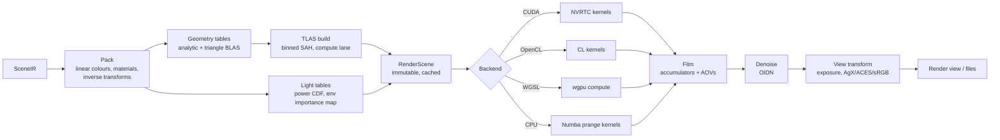

# 09 — Precision Render Engine (Structura Render, `structura.render`)

Structura Render is the **precision engine**: a **Sunflow-derived** physically based renderer. It runs on
**CUDA, OpenCL, WGSL (wgpu) and the CPU (Numba)**, all from one SKL kernel source
([11](11-compute-backends.md)). The interactive viewport is the separate, lower-precision **preview engine**
([08](08-viewport.md), [ADR-0013](adr/0013-two-render-engines.md)).

Sunflow is MIT-licensed, so its algorithms and code structure may be ported directly, with attribution
([ADR-0010](adr/0010-licensing.md)).

Structura Render replaces three things:

- Structure Synth's internal Phong/AO raytracer;
- the need to install Java + Sunflow;
- the need to install POV-Ray for quality renders.

## 1. Goals

| Goal | Target (reference GPU **NVIDIA GTX 1660, 6 GiB**; 1920×1080, 1M boxes, path tracing, 4 bounces) |
|------|------------------------------------------------------------------------------------------------|
| Interactive feedback | First progressive frame < 150 ms (quarter-res preview pass) |
| CUDA throughput | ≥ 5 spp/s (to be validated in spike S2, [19](19-roadmap.md)) |
| OpenCL / wgpu throughput | Within 1.5× of CUDA on the same GPU |
| CPU fallback throughput | ≥ 1 spp/s on 8 cores (to be validated in spike S3) |
| Scale | 10M instances within 6 GiB VRAM (≈ 1.3 GiB scene + film); larger scenes fall back to the CPU |
| Fidelity | Sunflow feature set ([01](01-legacy-analysis.md) §2) minus the exclusions listed there, plus the POV-Ray ideas marked *Adopt* |
| Legacy look | The `classic` integrator reproduces the 1.5 internal raytracer closely enough for side-by-side recognition |
| Determinism | Same scene + seed + spp + backend → bit-identical image. Across backends → statistically equivalent (parity suite) |

## 2. Sunflow → Structura mapping

| Sunflow | Structura module | Notes |
|---------|------------------|-------|
| `SunflowAPI`, `ParameterList`, `Options` | `render.api.RenderRequest`, `ParamSpec` tables | Typed, frozen settings generated from registries |
| `Scene` | `render.compile.RenderScene` | Packed buffers + BVH; immutable; cached |
| `PluginRegistry` | `core.registry.Registry` | Shared with exporters and themes |
| `ImageSampler` → `BucketRenderer` / `ProgressiveRenderer` / `MultipassRenderer` | `render.samplers.image.{progressive, tiled_adaptive}` | Multipass is folded into progressive |
| `BucketOrder` (7 kinds) | `render.samplers.buckets` | hilbert (default), spiral, column, row, diagonal, random, inverted |
| `Filter` (9 kinds) | `render.film.filters` | Used as filter-importance-sampling distributions |
| `QMC` (Halton/Faure) | `render.sampling.{sobol_owen, halton_faure}` | Sobol default; Halton kept for reference comparisons |
| `AccelerationStructure` (BIH/KD/Grid) | `render.accel.{tlas, blas}` | Binned-SAH BVH2 with a compact node layout; two-level |
| `Instance`, `Geometry`, `PrimitiveList` | `render.geometry.{instances, analytic, triangles}` | Analytic unit primitives + triangle BLAS |
| `LightServer` | `render.integrators.common.light_sampling` | NEE, light selection by power, MIS |
| `GIEngine` (path, ambocc, igi, irr-cache, fake) | `render.integrators.{path, ao, classic, preview}` | See [10](10-renderer-shading.md) §2 |
| `CausticPhotonMap` | `render.integrators.photon_caustics` (phase R3) | CPU-first, GPU later |
| `Shader` (25 classes) | `render.materials.{principled, constant, wireframe, ao, debug}` | Presets replace most classes ([10](10-renderer-shading.md) §3) |
| `LightSource` (6) | `render.lights.{point, sphere, spot, sun, rect, mesh_emitter, env_hdri, env_sunsky, env_color}` | |
| `CameraLens` (4) | `render.cameras.{perspective_thinlens, orthographic, spherical, fisheye}` | Polygonal bokeh from `ThinLens` |
| `Display` (`imageBegin/Prepare/Update/End`) | `render.film.Film` → `FilmSnapshot` → Qt signals | |
| `BitmapWriter`s | `render.output.{png, exr, hdr, tiff, jpeg, webp}` | Metadata embedded |
| `.sc` parser | — (export only: `export.scene.sunflow_sc`) | |

## 3. Pipeline



### 3.1 Render compile (`render.compile`)

Runs as a compute-lane Job. It is cached by `(SceneIR.id, geometry-affecting settings hash)`. Camera-only or
sampling-only changes reuse the compiled scene.

| Output buffer | Contents | Size per item |
|---------------|----------|---------------|
| `inst_inv` | Inverse affine (world→object) 3×4 f32 | 48 B |
| `inst_rec` | kind u8, flags u8, material u16, colour rgba f16×4 | 12 B |
| `sphere_cr` | World centre + radius (spheres only; faster than the object-space test) | 16 B |
| `tlas_nodes` | BVH2 nodes: bounds (6×f32) + left/first u32 + count/axis u32 | 32 B, about 2N nodes |
| `tri_*` | World-space triangles for `mesh`, `triangle` and tessellated kinds; plus BLAS nodes | 36 B + per-vertex colour |
| `materials` | Packed principled parameters (std430-aligned) | 64 B |
| `lights`, `light_cdf` | Light records + selection CDF by power | — |
| `env_map`, `env_marginal`, `env_conditional` | HDRI + 2D importance-sampling CDFs (Sunflow `ImageBasedLight`) | — |

- Only the **inverse** transform is stored. Object-space hits are transformed back with it, and the normal
  transform uses its transpose.
- For 1M boxes the memory is about 64 B/instance of scene data (`inst_inv` + `inst_rec` + the 4 B reordered
  index; spheres add 16 B) + about 64 B of TLAS ≈ **130 MB**.

### 3.2 Acceleration structure (`render.accel`)

- **Two levels.**
  - The TLAS spans instance world AABBs. Analytic leaves are tested in object space (box slab test,
    cylinder, cone) or world space (sphere).
  - A TLAS leaf can also reference the **triangle BLAS**, a single identity-transform instance holding all
    world-space triangles. Shared unit meshes such as the torus get their own BLAS, instanced.
- **Build:**
  - The default is a binned SAH (16 bins) with a Numba `prange` over top-level tasks. It runs on the
    compute lane.
  - Above 4M instances the build switches to **LBVH** (Morton codes + radix sort) for the upper levels,
    with SAH refinement for the bottom levels.
  - Target: < 400 ms for 1M instances; < 3 s for 10M.
- **Layout:**
  - BVH2 with 32-byte nodes.
  - Leaves hold ≤ 4 primitives, stored as contiguous ranges in a reordered instance index buffer.
  - Traversal uses a fixed-size stack (64 entries) with near-child-first ordering.
  - Compressed wide BVH (BVH4/8) is a post-1.0 optimisation.
- **Robustness:** ray origins are offset using the error-bounds method of Wächter & Binder (*Ray Tracing
  Gems*, ch. 6). There is no scene-scale epsilon like the legacy `1E-7`.

## 4. Sampling

- **Per-pixel sequences:** Sobol (Joe–Kuo direction numbers) with **Owen scrambling via a hash** (Burley
  2020). The computation is integer-only, so GPU and CPU produce identical sample values.
- **Dimension allocation:**
  - 0–1: pixel (filter importance sampling);
  - 2–3: lens;
  - 4: time (reserved);
  - then per bounce: 2 for BSDF, 2 for light, 1 for light selection, 1 for Russian roulette.
- **Halton + Faure** (port of Sunflow `QMC`) is selectable, to compare against Sunflow renders.

> **As built (M11):** the default numbers are hashed per (pixel, sample, dimension) (`kernels/sampling.py`
> `rand01`; integer-only, identical on every backend), not Sobol. `sequence = halton` (Render Settings, the
> v2 `render { sequence halton }` key, `--sequence`) switches the pixel, lens and first-bounce dimensions
> (0–3, 32–43) to the Halton sequence in the first 16 prime bases, Cranley–Patterson rotated per pixel
> (`sample01`); deeper dimensions stay hashed. Faure's digit permutations are not ported.

## 5. Image samplers

### 5.1 Progressive (interactive; default in Render view and viewport preview)

- **Pass 0** is a quarter-resolution, 1-spp preview (the POV-Ray "mosaic preview" idea). Each following pass
  adds k spp at full resolution.
- The device lane splits passes into tile dispatches so that each dispatch stays within ≈ 25 ms GPU time
  ([04](04-concurrency-model.md) §5.2). The CPU backend renders tile batches in `prange`.
- A `FilmSnapshot` is published after each completed pass, at ≤ 10 Hz.
- It stops at target spp, a time limit, or a noise threshold (§5.3).

> **As built (M11):** the mosaic is `render/mosaic.py`: one sample in every 4th pixel of every 4th row,
> shown as 4×4 blocks. The film is cleared afterwards, so the render equals one without it. The Render view
> asks for it (`RenderSettings.mosaic`); the CLI, animations and tests do not.

### 5.2 Tiled adaptive (final)

This follows Sunflow `BucketRenderer`, with POV-Ray's confidence test added:

1. Tiles (buckets, default 64×64) are scheduled in a chosen **bucket order** (Hilbert by default). The render
   view shows tile progress, like Sunflow.
2. Each tile gets `min_spp` samples.
3. **Adaptive refinement:** per pixel, the noise estimate is compared between two interleaved half-buffers.
   Pixels with relative error above the threshold (POV-Ray `variance` / `confidence` style stopping rule)
   get more samples, in rounds, up to `max_spp`. Sunflow's contrast threshold is exposed as the same knob.
4. Optionally, the whole image is refined in rounds instead of per tile ("progressive final"). This gives a
   better preview, at the same cost.

> **As built (M11): the tiled sampler.** `sampler = tiled` (Render Settings, `render { sampler tiled }`,
> `--sampler tiled`) renders buckets of `bucket_size` pixels (64) in `bucket_order`: hilbert (default),
> spiral (from the centre), rows, columns, diagonal or random (`render/buckets.py`). Each bucket is sampled
> to completion, with the noise test on the bucket alone (`render/tiled.py`). The kernel's `col0`/`row0`
> offsets dispatch just the bucket, and `Bound.read_range` reads back only its rows into a host copy of the
> film. Snapshots go out at most every 0.25 s with the next bucket (`RenderProgress.tile`), which the Render
> view marks with corner brackets, and the fraction of buckets done. Sample indices are per pixel and
> global, so a tiled render equals a progressive one with the same settings. Stopped tiled renders resume.
>
> **As built (M6):** adaptive refinement runs over the whole image progressively (no buckets). Each pass is
> dispatched in row bands of about 30 ms (`render/bands.py`); the even-sample half of the film
> (`render/film.py`) gives the error estimate, and a `pixel_mask` buffer switches converged pixels off.
>
> **Pass pacing (M9 follow-up).** Each band is waited for (`Bound.finish`), so band timings are real device
> time and no single submission monopolises a display GPU. `samples_per_pass = 0` ("auto", used by the GUI,
> the CLI and animations) starts with 1 spp for a fast first image. It then grows each pass by up to 4× until
> a pass takes about 0.4 s of device time, capped at 64 spp (`render/pacing.py`). This keeps the per-pass
> read-back and tone mapping small next to the GPU work. Adaptive renders stop exactly at
> `adaptive_min_samples` before the first noise test. Fixed pass sizes remain for reproducible tests; the
> image does not depend on the pass partition, because sample indices are global.

### 5.3 Noise threshold

A single user-facing setting, **Noise threshold** (0 = off), drives adaptive stopping in both samplers.
Internally it is the relative standard error of luminance. The render view can display the adaptive sample
map as a heatmap AOV.

## 6. Film (`render.film`)

- **Accumulators (f32):** radiance RGB sum, weight sum, and luminance sum of squares; plus two half-buffers
  for error estimation.
- **Reconstruction:** *filter importance sampling*. Each sample's pixel offset is drawn from the selected
  filter's distribution (box, triangle, gaussian, mitchell, catmull-rom, blackman-harris, lanczos, sinc,
  cubic B-spline, all from Sunflow). Negative lobes are handled with signed weights. *(All nine are built;
  sinc was added in M11.)*
  - No atomics are needed on the GPU (WGSL has no float atomics).
  - CPU and GPU stay identical.
- **AOVs** (first hit):
  - albedo, shading normal, depth, position;
  - instance id, material id, tag, generation;
  - alpha (coverage), sample count.
  - AOVs are available in the render view and in multi-layer EXR.
- **Region render** (border render) restricts sampling to a rectangle.
- **Snapshot:** `Film.snapshot()` resolves to an immutable `FilmSnapshot` (HDR float32 + AOVs + spp map).

## 7. Post-processing

| Step | Implementation |
|------|----------------|
| Denoise | Open Image Denoise 2 (CPU device, via ctypes), with albedo + normal AOVs. Fallback when its library cannot be loaded: an edge-avoiding À-Trous wavelet filter (parallel Numba) that uses the AOVs as guides; it does not demodulate by albedo (see PROGRESS, M6 part 3). Runs on the compute lane after a render finishes; changing the method re-denoises the last result. |
| Exposure & view transform | SKL shared functions: sRGB standard, **AgX** (default), ACES (fitted), Filmic-like. The same code runs in the viewport. |
| Glare / bloom | Post-1.0 |
| Background / alpha | Premultiplied alpha for PNG/EXR when "transparent background" is on |

## 8. Outputs & reproducibility

- Formats:
  - PNG (8/16-bit); JPEG; WebP; TIFF (16-bit);
  - **EXR** (half/float, multi-layer with AOVs);
  - Radiance **HDR**.
- **Metadata embedded** (PNG `tEXt`, EXR header): Structura version, script hash, full script text
  (optional, default on), seed, params, camera, render settings.
  - "File ▸ Open from render…" restores the complete project from a PNG or EXR.
  - This extends 1.5's "autosave EisenScript with seed and camera" feature.

### 8.1 Render reports (added in M10)

A render report describes one finished render in full (`render/report/`): script (hash, lines, rules,
parameters), geometry (kinds with triangles if baked, bounds, density, instance size range, mirrored and
sheared instances), build statistics, the resolved camera (also heading/pitch, both fields of view, 35 mm
focal length), settings, lighting and environment, the material table, image statistics (exposure, dynamic
range, clipping, sample distribution, coverage, visible objects and kinds from the AOVs, depth range),
performance (time, samples/s, passes, BVH nodes/leaves/depth/memory), the system, and a reproducing command
line. A thumbnail, an RGB + luminance histogram and the dominant-colour palette are included.

`ReportInputs` → `build_report()` → `Report` (format-free) → writers: text, Markdown (+ preview image), HTML
(one file), JSON, CSV; PDF and ODT via Qt's document engine (`services/report_documents.py`). The GUI
(Render ▸ Save Render Report…, the render queue) and the CLI (`structura render --report FILE`) share it.

**Reports beside the image (owner request, M11):** saving a render, a **final render** and a queued render all
go through one dialog (`ui/dialogs/render_output.py`): the image file and a report format (PDF, HTML,
Markdown, plain text, JSON, CSV, ODT or none, remembered), written beside the image as `<image>-report.<ext>`.
Final renders (Render ▸ Final Render…, Shift+F9, or F9 with the Final / Print 4K preset) ask before rendering —
quality preset, image path, report — and save both when the render and its denoising finish; "Render Only"
skips the files.
Render jobs attach `RenderDetails` (render/details.py) to their updates so the report states what was
actually rendered.

## 9. Render view (UI summary; full UX in [14](14-ui-ux.md))

- Zoom/pan image viewer (1:1, fit, pixel inspector with HDR values);
- AOV selector; A/B compare (split slider) against a snapshot;
- exposure and view-transform controls that apply live, without re-rendering;
- progress: spp, elapsed time, ETA, rays/s; pause/resume/stop; region select;
- "Render to file" queue.

> **As built:** all of the above except a rays/s readout (the render report has samples/s). Pause is Stop;
> **Resume** continues from the kept film, pixel mask and sample map with the same sample indices, so the
> result equals an uninterrupted render (`progressive(..., resume=…)`). Added: presets (Draft / Standard / Final / Print 4K), Save (Save As dialog),
> Report…, and the render queue (Render ▸ Add to Render Queue…, its own panel, optional PDF report per
> render).

## 10. Module layout

```
structura/render/
  api.py                 # RenderRequest, RenderResult; entry points used by services & CLI
  compile/
    pack.py  materials.py  lights.py  env_importance.py  scene.py
  accel/
    aabb.py  sah_binned.py  lbvh.py  layout.py  refit.py
  geometry/
    analytic.skl.py  triangles.skl.py  instances.skl.py      # SKL sources (→ Numba & WGSL)
  sampling/
    sobol_owen.skl.py  halton_faure.skl.py  warp.skl.py
  integrators/
    common/ light_sampling.skl.py  mis.skl.py  rr.skl.py
    classic.skl.py  ao.skl.py  path.skl.py  preview.skl.py  photon_caustics/ (R3)
  materials/
    principled.skl.py  fresnel.skl.py  microfacet.skl.py  legacy_phong.skl.py  debug.skl.py  presets.toml
  lights/
    point.skl.py  sphere.skl.py  spot.skl.py  sun.skl.py  rect.skl.py  env.skl.py  sunsky.skl.py
  cameras/
    thinlens.skl.py  orthographic.skl.py  spherical.skl.py  fisheye.skl.py
  samplers/
    progressive.py  tiled_adaptive.py  buckets.py
  film/
    film.py  filters.py  aov.py  snapshot.py  view_transforms.skl.py
  backends/
    base.py  cuda.py  opencl.py  wgpu.py  cpu_numba.py  select.py
  denoise/
    oidn_ctypes.py  denoise.py
  output/
    writers.py  metadata.py
```

`*.skl.py` files are SKL kernel sources ([11](11-compute-backends.md)). They are ordinary Python modules that
import only `structura.kernels.skl`.

> **As built (M12, owner review):** renders report *phases* before the first pass (device, BVH, kernel
> compilation) through a `phase` callback of `prepare`/`progressive`, shown by the Render view's moving bar,
> the status bar and the window title. The camera's lens (`core/scene/lens.py`) replaced the render settings'
> aperture, blades and camera type. The **post stack** (`render/post.py`: bloom, vignette, white balance,
> saturation, contrast; `render/lut.py`: `.cube` LUTs) is applied by `render/output.Display` where images are
> shown and saved — never to the radiance, so EXR stays linear. Progress carries per-pass and kernel-start
> times for the reports; `Backend.details()` describes the device.
