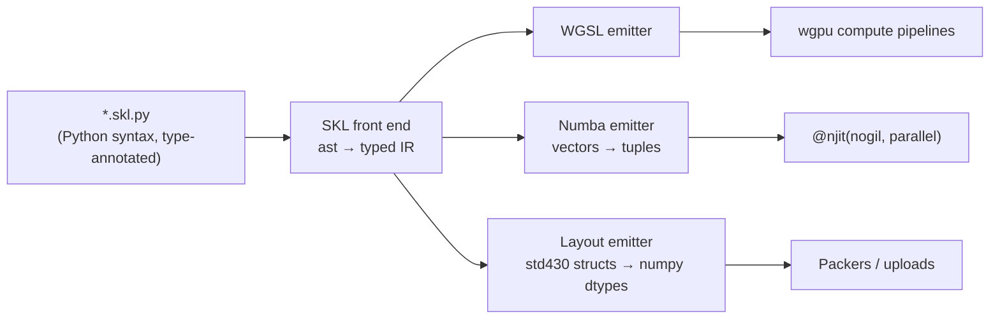

# 11 — Compute Backends: GPU (wgpu) & CPU (Numba) from One Kernel Source

## 1. The problem

The brief asks for three things at once:

1. GPU acceleration is a must.
2. A multithreaded CPU fallback is essential.
3. DRY.

A naive design writes the renderer twice, once in a shading language and once in Python/Numba. That
duplicates the most bug-prone code in the project (intersection, sampling, BSDFs, lights) and guarantees
drift between the two.

## 2. The approach: SKL (Structura Kernel Language)

**SKL is a restricted, statically typed subset of Python.** Kernel code is written once as ordinary `.py`
files. One compiler front end produces two outputs:



- **GPU:** the typed IR is emitted as WGSL and compiled by wgpu (Vulkan / Metal / D3D12).
- **CPU:** the same IR is emitted as plain Python. Vector operations are lowered to tuple helper calls, and
  the result is compiled by Numba. Entry points are wrapped in a `prange` loop over the dispatch grid.
- **Layouts:** SKL `struct` declarations also produce the **numpy structured dtypes** (std430 alignment and
  padding). The packers therefore write buffers that both backends read without conversion. The layout is
  defined once.
- **Debugging:** the generated Python also runs with `NUMBA_DISABLE_JIT=1`. Kernels can be stepped through in a
  normal Python debugger on the CPU path.

This is the same idea as Taichi or NVIDIA Warp, scoped down to exactly what Structura needs. Those tools
were rejected because of vendor lock-in or maintenance risk ([ADR-0004](adr/0004-single-source-kernels.md)).

## 3. SKL language definition

### 3.1 Example

```python
# structura/render/geometry/analytic.skl.py
from structura.kernels.skl import func, struct, f32, u32, vec3, select, min3, max3, INF

@struct
class Hit:
    t: f32
    normal: vec3
    prim: u32

@func
def intersect_unit_box(o: vec3, d: vec3, t_max: f32) -> Hit:
    inv = 1.0 / d
    t0 = (vec3(0.0) - o) * inv
    t1 = (vec3(1.0) - o) * inv
    t_near = max3(min(t0, t1))
    t_far = min3(max(t0, t1))
    hit = t_near <= t_far and t_far > 0.0 and t_near < t_max
    t = select(t_near > 0.0, t_near, t_far)
    n = box_face_normal(o + d * t)
    return Hit(select(hit, t, INF), n, u32(0))
```

Emitted WGSL (abridged):

```wgsl
struct Hit { t: f32, normal: vec3<f32>, prim: u32 }
fn intersect_unit_box(o: vec3<f32>, d: vec3<f32>, t_max: f32) -> Hit {
  let inv = 1.0 / d;
  let t0 = (vec3<f32>(0.0) - o) * inv;
  ...
}
```

Emitted Numba Python (abridged):

```python
@njit(inline="always", nogil=True, fastmath=_FM, cache=True)
def intersect_unit_box(o, d, t_max):
    inv = v3_rdiv(F32_1, d)
    t0 = v3_mul(v3_sub(v3_splat(F32_0), o), inv)
    ...
```

### 3.2 Allowed constructs

| Category | Allowed |
|----------|---------|
| Scalar types | `f32`, `i32`, `u32`, `bool` |
| Vector / matrix | `vec2`, `vec3`, `vec4` (f32), `ivec*`, `uvec*`, `mat3x4` (affine) |
| Aggregates | `@struct` classes with typed fields (no methods); fixed-size local arrays `local(u32, 64)` (e.g. the BVH stack) |
| Buffers | `Storage[T]` (read-only), `StorageRW[T]`, `Uniform[T]`; declared in the kernel signature |
| Control flow | `if/elif/else`, `for i in range(a, b[, step])`, `while`, `break`, `continue`, early `return` |
| Expressions | Arithmetic with vector broadcasting, comparisons, `and/or/not`, conditional expression → `select` |
| Functions | `@func` with full annotations; calls to other `@func`s and to builtins; **no recursion** |
| Entry points | `@kernel(workgroup=(8, 8, 1))` with `gid: uvec3` plus buffers and uniforms |
| Imports | Only `structura.kernels.skl` and other `*.skl.py` modules |

Not allowed: recursion, closures, exceptions, dynamic allocation, Python objects, `float64`, implicit
int↔float conversion, and globals other than `const`. The front end rejects these **with the Python source
location**.

### 3.3 Numerical contract

- Everything is `f32` / `u32`. Python float literals are typed as `f32` by the front end. The Numba emitter
  writes them as `np.float32` constants, so no silent float64 promotion occurs. A CI check inspects Numba's
  type annotations to confirm this.
- `u32` arithmetic wraps on both backends (the Numba emitter masks where Numba would widen).
- Fast-math: *allowed* for shading functions; **forbidden** for geometry/robustness functions (`@func(exact=True)`).
- Builtins (`dot`, `cross`, `normalize`, `length`, `clamp`, `mix`, `fract`, `sqrt`, `exp`, `log`, `pow`,
  `sin`, `cos`, `atan2`, `select`, `bitcast`, `countOneBits`, `reverseBits`…) are defined in **one table**,
  `kernels/skl/builtins.py`. Each entry gives the WGSL spelling and the Numba implementation.

### 3.4 Compiler layout (`structura/kernels/skl/`)

| Module | Responsibility | Budget |
|--------|----------------|--------|
| `frontend.py` | Python `ast` → SKL IR, with source spans | ≤ 300 lines |
| `types.py`, `typecheck.py` | Type inference, broadcasting rules, error reporting | ≤ 300 each |
| `builtins.py` | The builtin table (WGSL name, Numba impl, type signature) | data + ≤ 200 |
| `modules.py` | Module graph, imports, dead-function elimination | ≤ 200 |
| `emit_wgsl.py` | IR → WGSL, bind-group generation from kernel signatures | ≤ 300 |
| `emit_numba.py` | IR → Python source, `prange` dispatch wrappers | ≤ 300 |
| `layout.py` | std430 layout → numpy dtype and WGSL struct | ≤ 200 |
| `cache.py` | Content-hash cache of generated code | ≤ 150 |

The total is estimated at about 2.5k lines. Spike **S1** validates this ([19](19-roadmap.md)).

## 4. What is SKL and what is not

| Written in SKL (shared) | Written per backend (thin) | Plain Python/Numba (CPU only, shared by both backends) |
|-------------------------|----------------------------|--------------------------------------------------------|
| Ray/primitive intersection, BVH traversal, samplers (Sobol-Owen, Halton), warps, BSDFs, lights, env sampling, cameras, integrators, filters, view transforms, colour conversions | Dispatch & buffer binding (`gpu_wgpu.py`, `cpu_numba.py`), readback, tiling | Scene packing, BVH *build*, light CDF build, film resolve, denoise, output |

The viewport uses SKL only for its shared modules (camera, colour, view transform). Its raster shaders are
GPU-only WGSL, with no CPU counterpart needed, because the CPU viewport uses the `preview` integrator
([08](08-viewport.md) §9).

## 5. Backend interface

```python
class ComputeBackend(Protocol):
    name: str                                   # "gpu:<adapter>" | "cpu:<n threads>"
    def upload(self, scene: RenderScene) -> DeviceScene: ...
    def dispatch(self, kernel: KernelHandle, grid: tuple[int, int, int],
                 bindings: Mapping[str, DeviceBuffer], uniforms: object) -> Fence: ...
    def readback(self, buf: DeviceBuffer) -> Future[np.ndarray]: ...
    def limits(self) -> BackendLimits: ...
```

- **`GpuBackend` (wgpu):**
  - Adapter selection prefers high-performance. The user can pick any adapter in Preferences.
  - It requests the adapter's maximum `maxStorageBufferBindingSize` and `maxBufferSize`, and
    `timestamp-query` if present.
  - Pipelines are created asynchronously (`create_compute_pipeline_async`) and cached by WGSL hash.
  - Bind-group layouts are generated from kernel signatures.
- **`CpuBackend` (Numba):**
  - `dispatch` calls the generated `prange` wrapper on the compute lane ([04](04-concurrency-model.md) §6).
  - `readback` is a completed future that wraps the numpy array, with no copy.
- **`RenderScene` buffers are the same numpy arrays on both backends.** The GPU uploads them; the CPU uses
  them in place.

## 6. Device policy

| Situation | Behaviour |
|-----------|-----------|
| Compatible GPU present | GPU for the viewport and renderer (default "Auto") |
| No adapter / adapter creation fails | CPU renderer + CPU preview viewport; one-time non-blocking banner |
| Scene exceeds GPU limits (buffers > max binding size after paging, or VRAM estimate > 80%) | That *render* goes to the CPU with a banner; the viewport keeps running on the GPU with paging |
| Device lost mid-session | Scheduler emits `device_lost`; recreate once; if that fails, switch to CPU |
| User forces CPU (Preferences or `--device cpu`) | Respected everywhere |

## 7. JIT warm-up & caching

- Numba: `cache=True` into the user cache dir. The installer runs `structura --warmup`, which compiles all
  kernels, so the first launch is fast. If the cache is stale, the **warm-up Job** recompiles in the
  background at start-up with a status-bar indicator.
- Generated WGSL and Python are cached by SKL source hash. WGSL pipelines compile asynchronously on first
  use; the preview integrator is compiled first.

## 8. Parity testing (the guarantee behind "same results on every machine")

| Level | Method | Tolerance |
|-------|--------|-----------|
| Integer functions (hashes, Sobol, Owen scrambling, RNG) | Generated probe kernel evaluates 10⁶ inputs on both backends | **Bit-exact** |
| Float functions (intersection, warps, BSDF eval/pdf/sample) | Probe kernels on 10⁵ random inputs | ≤ 4 ULP (arithmetic); ≤ 1e-5 relative (transcendentals); hit/miss agreement ≥ 99.999% |
| Integrators | Render 12 canonical scenes at 1024 spp on both | Per-16×16-tile mean difference within 4σ of the tile's standard error; global relative RMSE < 1% |
| Determinism | Same backend, same inputs, twice | Bit-identical |

CI runs the GPU side on **Mesa lavapipe** (software Vulkan) on Linux, so shaders are exercised on every PR.
Nightly jobs run on real NVIDIA, AMD, Intel and Apple GPUs (self-hosted runners).

## 9. Risk control: the spike & the fallback plan

**Spike S1** (3 weeks, first milestone) transpiles:

- box/sphere intersection;
- BVH traversal;
- Sobol-Owen;
- principled BSDF evaluation.

**Exit criteria:**

1. The generated WGSL validates and runs on Vulkan, Metal and D3D12.
2. Parity tests pass.
3. The Numba output is within 1.3× of the speed of hand-written Numba.
4. The WGSL output is within 1.2× of hand-written WGSL on the reference GPU.

**If S1 fails:** keep the SKL *front end* for layouts and the builtin table, but write kernels twice (WGSL and
Numba). The parity suite above becomes the hard safety net. This documented DRY exception would be recorded
by superseding ADR-0004.
