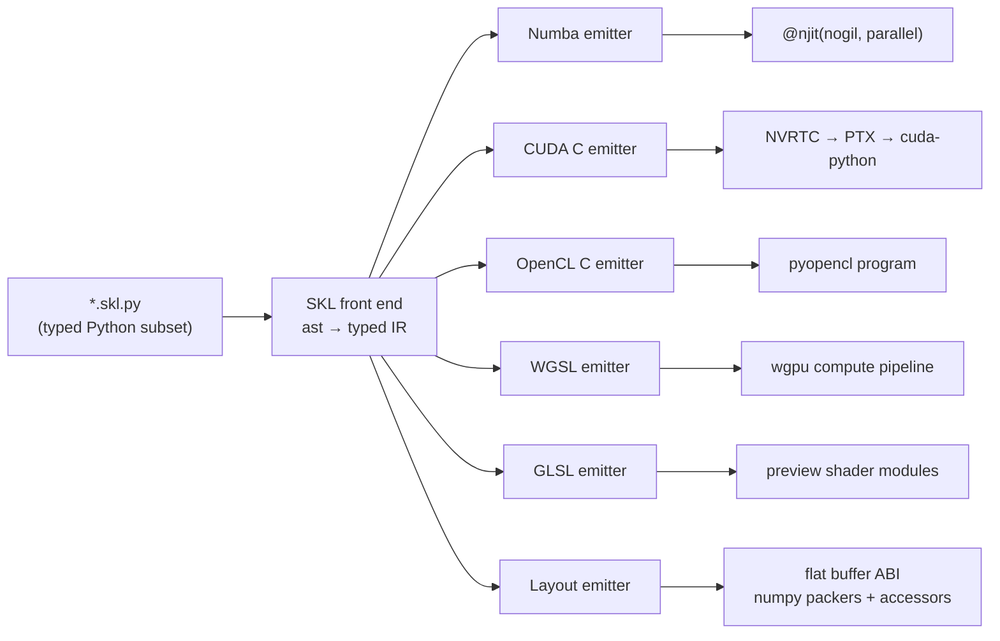

# 11 — Compute Backends: CUDA, OpenCL, WGSL, GLSL & Numba from One Kernel Source

## 1. The problem

Structura has two engines ([ADR-0013](adr/0013-two-render-engines.md)) and several compute targets:

| Target | Engine | Why |
|--------|--------|-----|
| **CUDA** (NVRTC-compiled CUDA C++) | Precision | Fastest path on NVIDIA (reference GPU: GTX 1660) |
| **OpenCL C** (pyopencl) | Precision | AMD and Intel GPUs; also any CPU via pocl |
| **WGSL** (wgpu: Vulkan / Metal / D3D12) | Precision | Universal GPU path, and the only GPU compute path on macOS |
| **Numba** (LLVM, multithreaded) | Precision + preview fallback | Essential CPU fallback; works everywhere |
| **GLSL** (OpenGL 3.3 / 4.1) | Preview | Shared camera, colour and view-transform modules for the raster viewport |

Writing the intersection, sampling, BSDF and light code five times would be the worst possible DRY
violation, and a guaranteed source of drift.

## 2. The approach: SKL (Structura Kernel Language)

**SKL is a restricted, statically typed subset of Python.** Kernels are written once as `*.skl.py` files. One
compiler front end lowers them to a typed IR, and **per-target emitters** generate the code:



- **One source, five targets.** Every emitter is a small module (≤ 300 lines) driven by a shared
  **builtins table**. For each builtin, the table gives the spelling per target and the Numba implementation.
- **Flat buffer ABI (portability rule).** Device buffers are **flat arrays of `f32` / `u32`** only. SKL
  `@struct` types are loaded and stored through *generated accessor functions* (`load_Material(buf, i)`).
  - This sidesteps `float3` alignment differences between CUDA, OpenCL, WGSL and std430.
  - The packers on the host write the same flat numpy arrays for every backend. The layout is defined once.
- **Debuggable.** The Numba output is ordinary Python and runs with `NUMBA_DISABLE_JIT=1` under a debugger.

## 3. SKL language definition

### 3.1 Example

```python
# structura/render/geometry/analytic.skl.py
from structura.kernels.skl import func, struct, f32, u32, vec3, select, min3, max3, INF

@struct
class Hit:
    t: f32
    normal: vec3
    prim: u32

@func(exact=True)
def intersect_unit_box(o: vec3, d: vec3, t_max: f32) -> Hit:
    inv = 1.0 / d
    t0 = (vec3(0.0) - o) * inv
    t1 = (vec3(1.0) - o) * inv
    t_near = max3(min(t0, t1))
    t_far = min3(max(t0, t1))
    ok = t_near <= t_far and t_far > 0.0 and t_near < t_max
    t = select(t_near > 0.0, t_near, t_far)
    return Hit(select(ok, t, INF), box_face_normal(o + d * t), u32(0))
```

| Target | Emitted form of `t0 = (vec3(0.0) - o) * inv` |
|--------|-----------------------------------------------|
| WGSL | `let t0 = (vec3<f32>(0.0) - o) * inv;` |
| GLSL | `vec3 t0 = (vec3(0.0) - o) * inv;` |
| OpenCL C | `float3 t0 = ((float3)(0.0f) - o) * inv;` |
| CUDA C++ | `v3 t0 = (v3s(0.0f) - o) * inv;` (`v3` is a prelude struct with inline operators) |
| Numba | `t0 = v3_mul(v3_sub(v3_splat(F0), o), inv)` (tuples of `float32`) |

### 3.2 Allowed constructs

| Category | Allowed |
|----------|---------|
| Scalars | `f32`, `i32`, `u32`, `bool` (`f64` only in functions marked `@func(targets=HOST_PRECISION)`, which excludes WGSL and GLSL) |
| Vectors / matrices | `vec2`, `vec3`, `vec4`, `ivec*`, `uvec*`, `mat3x4` (affine) |
| Aggregates | `@struct` with typed fields; fixed-size local arrays `local(u32, 64)` |
| Buffers | `Buf[f32]`, `Buf[u32]` (read-only) and `BufRW[...]`, with generated struct accessors |
| Buffer sets | `@bufset class SceneBufs: prim_f: Buf[f32] …` groups buffers that travel together. A `sc: SceneBufs` parameter is expanded by the front end into the individual buffers, `sc.prim_f` becomes `prim_f`, and passing `sc` to a call passes all of them. The IR and the emitted code only see plain buffers, so WGSL/GLSL global bindings keep their names. |
| Control flow | `if/elif/else`, `for i in range(...)`, `while`, `break`, `continue`, early `return` |
| Functions | `@func` with full annotations; **no recursion** |
| Entry points | `@kernel(grid="2d")` with `gid: uvec3`; the emitters produce `__global__`, `__kernel`, `@compute @workgroup_size(8,8,1)`, or a Numba `prange` wrapper |

Not allowed: recursion, closures, exceptions, dynamic allocation, Python objects, implicit numeric
conversions, and mutable globals. Errors are reported with the Python source location.

### 3.3 Numerical contract

- Everything is `f32` / `u32` unless declared otherwise. Literals are typed `f32` by the front end.
  - The Numba emitter writes `np.float32` constants.
  - The CUDA and OpenCL emitters write `1.0f`.
  - A CI check inspects Numba type annotations for accidental float64.
- `u32` arithmetic wraps on every target (the Numba emitter masks where Numba would widen).
- `@func(exact=True)` (geometry, robustness) disables fast-math on every target:
  - Numba `fastmath=False`;
  - NVRTC `--fmad=false` for that translation unit;
  - OpenCL without `-cl-fast-relaxed-math`.
  Shading functions may use fast-math.
- Local arrays:
  - CUDA, OpenCL, WGSL and GLSL emit stack arrays.
  - Numba hoists them into **per-worker scratch buffers**, allocated once per `prange` chunk and passed as
    hidden parameters, so there is no heap allocation per pixel.
- **Film accumulation** uses compensated (Kahan) `f32` on every backend, for consistent precision without
  `f64` on WGSL.

### 3.4 Compiler layout (`structura/kernels/skl/`)

| Module | Responsibility |
|--------|----------------|
| `frontend.py` | Python `ast` → SKL IR with source spans |
| `types.py`, `typecheck.py` | Type inference, broadcasting, diagnostics |
| `builtins.py` | **The one builtin table** (per-target spelling + Numba implementation) |
| `modules.py` | Module graph, imports, dead-function elimination |
| `emit_numba.py`, `emit_cuda.py`, `emit_opencl.py`, `emit_wgsl.py`, `emit_glsl.py` | One emitter per target, all subclasses of a shared `CLikeEmitter` (the four C-like targets share about 80% of their code) |
| `preludes/` | `cuda_prelude.cuh` (`v3` operators), `numba_prelude.py` (tuple vector helpers) |
| `layout.py` | Flat ABI: struct ↔ float/uint offsets, numpy packers, generated accessors |
| `cache.py` | Content-hash cache of emitted sources and compiled binaries (PTX, CL binaries, WGSL modules) |

## 4. What is SKL and what is not

| Written in SKL (shared) | Per-backend (thin runtime adapters) | Host Python/Numba (shared) |
|-------------------------|-------------------------------------|----------------------------|
| Intersections, BVH traversal, samplers, warps, BSDFs, lights, environment sampling, cameras, integrators, filters, view transforms, colour conversions | Device discovery, buffer upload, dispatch, readback, timing | Scene packing, BVH build, light CDFs, film resolve, denoise, outputs |

The preview engine consumes only the GLSL output of the shared camera, colour and view-transform modules.
Its raster shaders are hand-written GLSL.

## 5. Backend runtime interface

```python
class ComputeBackend(Protocol):
    name: str                                   # "cuda:GTX 1660" | "opencl:…" | "wgpu:…" | "cpu:8 threads"
    def compile(self, module: SklModule) -> KernelSet: ...
    def upload(self, arrays: Mapping[str, np.ndarray]) -> DeviceBuffers: ...
    def dispatch(self, kernel: KernelHandle, grid: tuple[int, int, int],
                 bindings: DeviceBuffers, uniforms: np.ndarray) -> Fence: ...
    def readback(self, buf: str) -> Future[np.ndarray]: ...
    def limits(self) -> BackendLimits: ...
```

| Backend | Library | Notes |
|---------|---------|-------|
| `CudaBackend` | `cuda-python` (driver API) + NVRTC (`nvidia-cuda-nvrtc-cu12`) | Compiles for the device's compute capability (7.5 on the GTX 1660); asynchronous streams; pinned host buffers for readback |
| `OpenCLBackend` | `pyopencl` (+ `pocl-binary-distribution`, which provides a CPU OpenCL device everywhere) | Prefers GPU devices; the pocl CPU device is used in CI for emitted-code tests |
| `WgpuBackend` | `wgpu` (offscreen compute only) | Requests the adapter's maximum storage-buffer binding size; buffers are paged beyond it |
| `CpuBackend` | Numba | `prange` wrappers; runs on the compute lane ([04](04-concurrency-model.md) §6) |

**Threading.** GPU backends run on the dedicated **device lane** (one QThread that owns the CUDA context,
CL queue or wgpu device). All calls are asynchronous, and dispatches are budgeted to ≤ 50 ms of GPU time
to respect OS watchdogs (Windows TDR ≈ 2 s). See [04](04-concurrency-model.md) §5.

## 6. Device policy (Auto)

Priority: **CUDA → OpenCL (GPU) → WGSL/wgpu → CPU (Numba)**. The user can force any available backend in
Preferences or with `--device`.

| Situation | Behaviour |
|-----------|-----------|
| NVIDIA GPU with a driver | CUDA |
| AMD/Intel GPU with an OpenCL ICD | OpenCL |
| macOS, or a GPU without OpenCL/CUDA | wgpu (Metal / Vulkan / D3D12) |
| No usable GPU | CPU (Numba) |
| The scene exceeds a backend's limits (VRAM estimate > 80%) | That render moves to the next backend or to the CPU, with a banner |
| Device lost or kernel failure | Retry once, then fall back down the list |

Every backend runs **the same kernels**, so features are identical everywhere. Only speed differs.

## 7. Warm-up & caching

- Numba: `cache=True`. The installer runs `structura warmup`, and a background warm-up Job handles stale caches.
- CUDA: PTX is cached per (source hash, compute capability). NVRTC compiles in the background on first use.
- OpenCL: program binaries are cached per (source hash, device).
- WGSL: shader modules are created asynchronously and cached per source hash.

## 8. Parity testing

| Level | Method | Tolerance |
|-------|--------|-----------|
| Integer kernels (hashes, Sobol/Owen, RNG) | Generated probe kernels over 10⁶ inputs on every available backend | **Bit-exact** |
| Float functions (intersection, warps, BSDF eval/pdf/sample) | Probe kernels over 10⁵ random inputs | ≤ 4 ULP (arithmetic); ≤ 1e-5 relative (transcendentals); hit/miss agreement ≥ 99.999% |
| Integrators | 12 canonical scenes at 1024 spp | Tile means within 4σ; global relative RMSE < 1% |
| Determinism | Same backend twice | Bit-identical |

CI coverage without GPUs:

- **Numba** runs natively.
- **OpenCL** runs on **pocl** (CPU).
- **CUDA** is compile-checked with NVRTC for `compute_75` and `compute_86`.
- **WGSL** runs through wgpu's OpenGL backend on Mesa llvmpipe (verified available in the planning sandbox).
- **GLSL** is validated and run on Mesa llvmpipe.

Nightly runs on the reference GTX 1660 execute CUDA, OpenCL and wgpu for real.

## 9. Risk control

Spike **S1** validates the front end plus **all five emitters** on: box/sphere intersection, BVH traversal,
Sobol-Owen and principled BSDF evaluation.

**Exit criteria:**

- emitted code compiles on every target;
- the parity suite passes on Numba + pocl + NVRTC-compile;
- Numba output is ≤ 1.3× slower than hand-written Numba.

Fallback: keep the front end for layouts and builtins, and hand-write the kernels per target behind the same
parity suite. That would be recorded by superseding ADR-0004.
