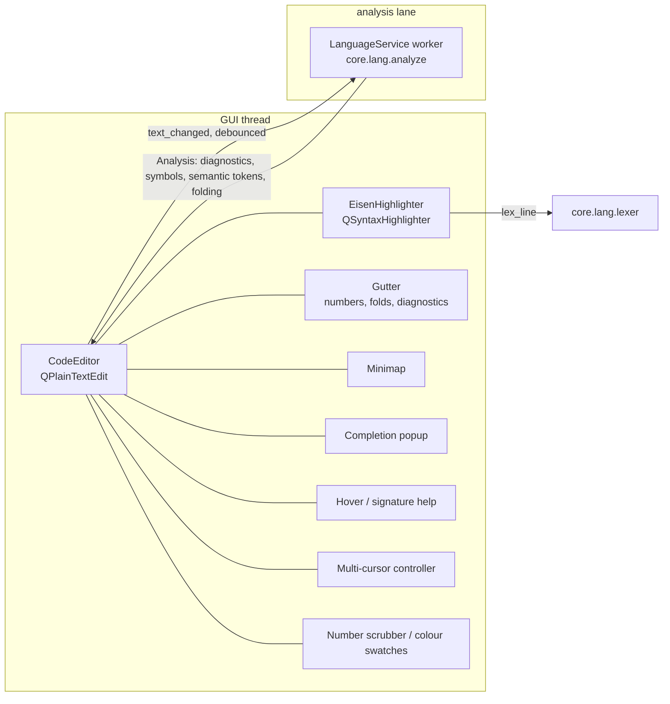

# 12 — Code Editor & Language Service

Structure Synth's editor was a `QTextEdit` with a regex highlighter (which had known errors) and a
context-menu snippet list. Structura's editor should feel like a modern IDE made for EisenScript, including
tools specific to generative work: number scrubbing, inline colour pickers, live rebuild, and provenance
jumps.

## 1. Architecture



- **One lexer.** The highlighter calls `core.lang.lexer.lex_line(text, state)`, the same scanner the parser
  uses ([06](06-language-engine.md) §4). This fixes defect D13 structurally.
- **Two-layer highlighting.**
  1. *Lexical* colours are applied synchronously per block, so there is no flicker while typing.
  2. *Semantic* colours come from the analysis: defined vs undefined rules, tags with or without materials,
     define-substituted tokens, unused rules. They are applied by re-highlighting only the changed blocks.
- **Everything language-specific comes from the `core.lang` catalogues.** That covers keyword lists,
  operator docs, signatures, `set` keys and colour names. The editor contains no EisenScript knowledge of its
  own.
- The `CodeEditor` is a composition of small components, each in its own module (§9). It is not a subclass
  that grows without bound.

## 2. Feature checklist

P0 = required for the first editor milestone (phase U1), P1 = for 1.0, P2 = post-1.0 candidate.

> **Status:** every P0 and P1 item is built (M3, M5, M10), including Find in Files, Quick Open and the colour
> picker. The P2 items are not built. Error tolerance is a *recovering* parser rather than a lossless CST
> ([22](22-implementation-notes.md) §2.8): after a syntax error the analysis resumes at the next `rule`, so all
> broken rules are reported and the rest keep their symbols. The editor's context menu carries the language
> commands (definition, peek, references, rename, quick fix, comment, format) and Pick / Insert Colour.

### 2.1 Core editing

| Feature | P |
|---------|---|
| Line numbers, current-line highlight, indentation guides, whitespace rendering toggle, word wrap toggle | P0 |
| Bracket matching; auto-closing of `{ } [ ] ( ) " "`; typing over the closing char; rainbow brackets (theme option) | P0 |
| Auto-indent; smart dedent on `}`; Tab/Shift+Tab block indent | P0 |
| Toggle line comment (`Ctrl+/`) and block comment (`Ctrl+Shift+/`) | P0 |
| Move line up/down (`Alt+↑/↓`), duplicate line (`Ctrl+Shift+D`), delete line (`Ctrl+Shift+K`) | P0 |
| Find / replace bar: regex, case, whole word, in selection, replace preview, match count | P0 |
| Code folding (rules, `material`/`camera`/`render` blocks, comment blocks); fold all / unfold all | P0 |
| Multiple cursors: Alt+click; `Ctrl+D` add next occurrence; `Ctrl+Shift+L` select all occurrences; column selection (Alt+Shift+drag) | P1 |
| Minimap with diagnostic markers and viewport indicator | P1 |
| Sticky scroll (the current `rule` header stays pinned at the top) | P1 |
| Split view (two views of one document); tabs with session restore; drag & drop to open | P0 |
| Zoom (`Ctrl+wheel`), font and ligature settings | P0 |
| External change detection and reload prompt; autosave and crash recovery ([07](07-scene-model.md) §8) | P0 |
| Encoding detection: UTF-8, with a fallback to Windows-1252/Latin-1 for legacy files, plus a status-bar indicator. All 155 corpus scripts are valid UTF-8, but Structure Synth's own `notes.txt`/`changelog.txt` are Latin-1, so user files written on Windows may be too. | P0 |
| Vim keybindings | P2 — not built |

### 2.2 Language intelligence

| Feature | Source | P |
|---------|--------|---|
| Diagnostics: squiggles (wave underline coloured by severity, plus an icon in the gutter for colour-blind users), Problems panel, hover message | Linter catalogue ([05](05-eisenscript-language.md) §10) | P0 |
| Completion (§3) with documentation side panel | Catalogues + semantic model | P0 |
| Hover docs: operators, `set` keys, primitives, colours (swatch), rules (definitions, weights, **probability %**), defines (expanded value) | Catalogues + semantic model | P0 |
| Signature help while typing arguments (`blend ‹colour› ‹strength›`, `s ‹x› [‹y› ‹z›]`, `matrix` 9 numbers, `reflect` 3 numbers) | Operator catalogue | P1 |
| Go to definition (`F12`, Ctrl+click), find references (`Shift+F12`), peek definition | Semantic model | P0 |
| Rename rule / tag / define (`F2`) | CST-based rewrite | P1 |
| Document outline (rules, materials, params) and breadcrumbs | Semantic model | P0 |
| Quick fixes (`Ctrl+.`): create missing rule, add `maxdepth`, replace `size`→`s` for 1.5 compatibility, convert defines to `#param` (v2), add `#version 2` when v2 syntax is used | Linter fixes | P1 |
| Refactorings: extract transforms into a new rule, inline rule, convert `{…} R` ↔ `1 * {…} R` | CST | P2 — not built |
| **Inlay hints:** ambiguous-rule probabilities, effective loop counts (e.g. `⟶ 27 children`), resolved material names on tags, estimated object count next to top-level calls | Semantic model + static estimate | P1 |
| Formatter (`Shift+Alt+F`): idempotent, comment-preserving, configurable indentation; optional format-on-save | CST printer | P1 |
| Semantic colouring of undefined rules (error colour) vs defined ones, unused rules dimmed | Semantic model | P0 |
| F1: opens the language reference at the symbol | Generated reference | P0 |

### 2.3 Generative-art tools

| Feature | Behaviour | P |
|---------|-----------|---|
| **Live rebuild** | Toggle (default on). It rebuilds after a clean analysis ([04](04-concurrency-model.md) §4). On errors, the last good scene stays visible with a "stale" badge. | P0 |
| **Number scrubbing** | Alt+drag over any number changes it (Shift = fine, Ctrl = coarse). Integers stay integers. Each change triggers a preview-budget rebuild, and release triggers a full build. All changes form one undo step. | P0 |
| **Colour swatches & picker** | Inline swatches after colour tokens (`#f80`, `red`). Clicking opens a colour picker that writes back in the token's original format (named colour → hex only if needed). | P0 — ✅ right-click ▸ Pick Colour…, Ctrl+click, Ctrl+Shift+C; live preview, one undo step (M10) |
| **Inline parameter sliders** | `#define x 1 (float:0-2)` and `#param` lines show a slider in the gutter overlay; the Parameters panel mirrors it | P1 |
| **Provenance jump** | Clicking in the viewport flashes the call site ([08](08-viewport.md) §6). The reverse also works: hovering an action highlights its instances in the viewport. | P0 |
| **Seed controls** | The seed box and dice button (randomise), auto-increment option (1.5 behaviour) | P0 |
| **Snippets** | All 1.5 context-menu snippets, plus pattern snippets (spiral, tree, grid3d, sphere-shell, Menger, …) with tab stops | P0 |
| Structure preview | Hovering a rule name shows a thumbnail of that rule built alone (background `preview` render, cached) | P2 — not built |

## 3. Completion contexts

Completion is computed from the **CST position** (tolerant parse). It is not regex-based.

| Cursor context | Items offered |
|----------------|---------------|
| Statement start (top level or in a rule) | `rule`, `set`, user rules, primitives (`box`, `sphere`, …), loop snippet `N * { }`, v2 blocks (`material`, `light`, …) |
| After `rule NAME` | Modifiers `maxdepth`/`md`, `weight`/`w`, `>` (after maxdepth N) |
| After `>` | Rule names |
| Inside `{ … }` transform list | Operators with signature detail (`x`, `rx`, `s`, `hue`, `color`, `blend`, …) |
| After `color` / `blend` | `random` (for `color`), recently used colours, theme palette colours, SVG names (with swatches) |
| After a rule/primitive name + `::` | Known tags; v2 materials; built-in preset names |
| After `set` | Set keys with docs ([05](05-eisenscript-language.md) §6) |
| After `set colorpool` | `randomhue`, `randomrgb`, `greyscale`, `image:` (+ file picker), `list:` |
| After `set raytracer::` | Raytracer properties and known tags |
| After `#` at line start | `define`, `include`, `version 2`, v2 `param` |
| Inside `#include "…"` | File paths (relative + library) |
| Inside v2 `( … )` | Params, defines, functions, constants, `time`/`frame` |

- **Ranking:** prefix match > camel/fuzzy match; then same-document symbols, recently used, and frequency.
  Items that would produce a diagnostic are demoted (for example, a float where an integer is required).
- **Abbreviations:** typing `md` offers `maxdepth`, and vice versa, with both shown.

## 4. "Typing" support

The brief lists *typing* among expected editor features. Structura delivers it in three senses:

1. **A type system for EisenScript values.** Every operator argument, `set` value and `#param` has a declared
   type: `int`, `float`, `number`, `colour`, `vec3`, `mat3`, `bool`, `enum`, `rule-ref`, `tag`, `path`. The
   analyser checks them (`E004`–`E008`, `E015`). Completion and hover show the types (`rx ‹angle: float,
   degrees›`), and inlay hints can display inferred types of defines.
2. **Smart typing aids.** Auto-closing pairs, auto-indent, smart dedent, type-over of closers, and surround
   selection with `{}`/`[]`/`()`/quotes. Snippet tab stops validate types as you tab through them.
3. **A fully typed codebase.** Structura itself is `mypy --strict` clean ([17](17-code-standards-and-layout.md)).

## 5. Language service API (in-process, LSP-shaped)

`structura.services.language.LanguageService` wraps `core.lang` with LSP-like methods. That keeps a later
`structura lsp` bridge for VS Code trivial.

```python
class LanguageService(QObject):
    analysis_ready = Signal(object)     # Analysis (diagnostics, semantic tokens, folding, symbols)
    def complete(self, doc: DocId, pos: int) -> list[CompletionItem]: ...       # sync, uses last Analysis + CST
    def hover(self, doc: DocId, pos: int) -> HoverInfo | None: ...
    def signature(self, doc: DocId, pos: int) -> SignatureHelp | None: ...
    def definition(self, doc: DocId, pos: int) -> list[SourceSpan]: ...
    def references(self, doc: DocId, pos: int) -> list[SourceSpan]: ...
    def rename(self, doc: DocId, pos: int, new: str) -> TextEdits: ...
    def code_actions(self, doc: DocId, span: SourceSpan) -> list[CodeAction]: ...
    def format(self, doc: DocId) -> TextEdits: ...
```

The **synchronous** methods (complete, hover, signature, definition) run on the GUI thread against the
latest immutable `Analysis`. They are O(log n) lookups with a < 2 ms budget. If the analysis is stale, the
service re-lexes the current line locally to adjust positions. Heavier operations run as analysis-lane Jobs.

## 6. Performance budgets

| Operation | Budget |
|-----------|--------|
| Keystroke → repaint | < 16 ms (the lexical highlighter for one block is < 0.2 ms) |
| Full analysis, 1,000-line script | < 15 ms on the analysis lane |
| Completion popup open | < 30 ms |
| 10,000-line file open + first highlight | < 300 ms (highlighting is incremental and viewport-first) |

## 7. Diagnostics UX

- Squiggle colours come from theme roles (`diag.error`, `diag.warning`, `diag.info`). Gutter icons mean
  colour is never the only signal.
- The Problems panel groups by file, is filterable by severity, and jumps to the location on click. Quick
  fixes are available from the panel.
- Build-time messages (for example `W111`, maxobjects reached) link to the `set` line that controls the limit,
  and offer "increase to …".

## 8. Legacy snippet parity

Every entry of 1.5's editor context menu (modifiers, transformations, set commands, colour pool, advanced
sets, camera sets, preprocessor, JavaScript builder calls, raytracer settings) appears:

- under **Insert ▸** in the menu bar;
- in the editor context menu;
- as a snippet in completion.

They are generated from the same catalogue, with the `size`/`v` fixes ([01](01-legacy-analysis.md) D2/D3).

## 9. Module breakdown

```
structura/ui/editor/
  code_editor.py        # composition root; wires components; no feature logic
  document_model.py     # QTextDocument ↔ SourceDocument snapshots, versions
  highlighter.py        # lexical + semantic layers (uses core.lang.lexer)
  gutter.py             # numbers, folding markers, diagnostic icons, param sliders host
  folding.py
  minimap.py
  squiggles.py          # ExtraSelections for diagnostics
  completion/
    popup.py  model.py  docs_panel.py
  hover.py
  signature_help.py
  multicursor.py
  snippets.py           # snippet sessions with tab stops
  find_replace.py
  scrubber.py           # Alt-drag number scrubbing
  color_swatches.py
  inlay_hints.py
  sticky_scroll.py
  commands.py           # editor commands registered into the command palette
  keymap.py             # default keymap (data), user overrides
structura/services/language/
  service.py  jobs.py  position_map.py
structura/core/lang/catalog/
  operators.toml  set_commands.toml  primitives.toml  colors.toml  diagnostics.toml  snippets.toml
```
