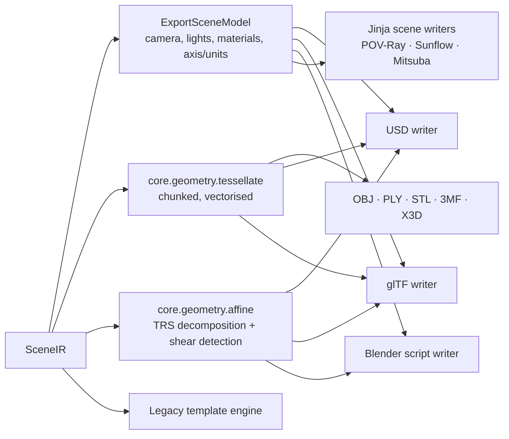

# 15 — Export Pipeline (`structura.export`)

Structure Synth could export through XML text templates and, from 1.5, OBJ. Structura adds first-class
**mesh**, **3D scene** and **DCC** exports, and keeps the template system fully compatible.

## 1. Architecture



- **`Exporter` registry.** Each exporter declares its `ParamSpec` options. Those options generate the export
  sheet UI, CLI flags and presets.
- **Exports run as Jobs.** Writers are generators that yield after each chunk (≤ 64k instances) for progress
  and cancellation, and they stream to disk. Work runs on the io lane; parallel tessellation uses the compute
  lane.
- **`ExportSceneModel`** is built once per export from `SceneIR`. It holds the camera converted to
  eye/target/up/fov/focal length, the lights, materials mapped to the generic PBR set ([07](07-scene-model.md)
  §3), and the axis and unit conversion. Every scene-level exporter consumes it (DRY).

## 2. Shared geometry services

### 2.1 Tessellation (`core.geometry.tessellate`)

- The unit meshes per kind come from `unit_shapes` (shared with the viewport).
- World vertices are computed in one vectorised operation per chunk:
  `einsum('nij,vj->nvi', xform[:, :, :3], unit_v) + xform[:, None, :, 3]`.
- Normals use the inverse-transpose (cofactor) per instance. Winding is flipped automatically for negative
  determinant transforms (`fx`, `reflect`); this fixes the 1.5 face-culling bug in `bugs.txt`.
- **LOD presets** (sphere / cylinder / torus segments):
  - *Low* (ico 1 / 8 seg), *Medium* (ico 2 / 16), *High* (ico 3 / 32), *Ultra* (ico 4 / 64).
  - *Legacy* uses a UV sphere with the 1.5 dt/dp resolution, for parity.
- **Lines and dots:** native primitives where the format supports them (OBJ `l`/`p`, PLY edges/vertices,
  USD `BasisCurves`/`Points`); otherwise tubes and icospheres with configurable world-space radius.
- `mesh` sweeps and `triangle[...]` rows are emitted directly from the aux tables.
- **Welding** (optional) uses quantised-position hashing in numpy (`np.unique` on int64 keys). This replaces
  1.5's O(n²) `indexOf`.

### 2.2 Affine decomposition & shear policy

glTF nodes and `EXT_mesh_gpu_instancing`, USD `PointInstancer`, Blender instances and X3D `Transform` all
represent **TRS only**. Structure Synth's `matrix` and non-uniform scale composed with rotation can produce
**shear**.

- `core.geometry.affine.decompose(xforms)` performs a vectorised polar decomposition (`M = R·S`), with
  reflection handling. It returns TRS and a per-instance shear residual.
- Instances with residual > ε (1e-5 relative) follow the exporter's **shear policy**:
  - *bake*: tessellate into a "sheared" mesh (the default);
  - *matrix-xform*: use a per-instance xform prim or node with a full matrix, where the format allows it
    (USD `xformOp:transform`).
- The export summary reports how many instances were baked.

### 2.3 Axis, units, grouping

- **Structura world:** right-handed, **Y-up**, 1 unit = 1 m by default (OpenGL conventions, as in 1.5).
- **Up axis:** Y (glTF, USD default) or Z (Blender, 3D printing) via a single conversion matrix applied in
  `ExportSceneModel`.
- **Unit scale:** any factor (STL/3MF default: 1 unit = 1 mm, with an auto-fit option to a target size).
- **Grouping:** by tag (legacy "group by tagging"), by colour (legacy "group by colour"), by material, or
  none.

## 3. Mesh formats

| Format | Instancing | Per-instance colour | Materials | Lines/points | Notes |
|--------|------------|---------------------|-----------|--------------|-------|
| **OBJ + MTL** | — (baked) | `usemtl` per group; optional vertex colours (`v x y z r g b` extension) | MTL (Kd, Ks, Ns, d, Ni, Ke + PBR extension keys Pr/Pm) | `l`, `p` | "Legacy layout" option reproduces 1.5's `g`/`usemtl` grouping |
| **PLY** (binary LE) | — | Vertex RGBA u8 | — (optional `tag` face property) | Vertices and edges | Compact and fast |
| **STL** (binary) | — | — | — | Tubes/spheres only | 3D printing. Optional **watertight union** via manifold3d; place on plate (min z = 0); mm scaling; a thin-feature warning uses the minimum instance extent |
| **3MF** | **Yes** (`components` + build items with transforms) | `basematerials` / `colorgroup` | Core + Materials extension | — | 3D printing with colour; optional watertight union; units in mm |
| **X3D** (XML) / **VRML97** | DEF/USE per kind + `Transform` (TRS) | `Material diffuseColor` per instance, or per-colour-group `Appearance` | Phong-ish | `IndexedLineSet`, `PointSet` | Satisfies the 1.5 roadmap request ("VRML/OBJ template"); sheared instances are baked |

> **As built (M8):** X3D and VRML97 place instances with exact Transforms (the SVD gives
> translation, rotation, scale and scaleOrientation), so sheared instances are not baked. 3MF uses
> `components` of one assembly object. All formats that take a full matrix share `export/affine_instances.py`.

### 3.1 CSG and watertight output

- **Watertight union** merges all solids into one manifold (manifold3d). The process is chunked, with
  hierarchical union in groups of 1,024, on the compute lane. It targets 3D printing.
- **Legacy CSG markers** (`template::union-begin` … `-end`, `difference`, `intersection`):
  - In template export, they emit text as in 1.5.
  - In mesh export, an option **evaluates** them with manifold3d booleans, in emission order.
  - This makes the 1.5 "CSG test" example printable without POV-Ray.

## 4. Scene formats

### 4.1 USD (`usd-core`)

| Aspect | Design |
|--------|--------|
| Files | `.usda` (text), `.usdc` (binary, default), `.usdz` (packaged via `UsdUtils.CreateNewUsdzPackage`) |
| Stage metadata | `upAxis`, `metersPerUnit`, `defaultPrim = /Structura` |
| Instanced mode (default) | One `UsdGeomPointInstancer` per kind/material group, with prototypes = unit meshes (or `UsdGeomSphere`/`Cylinder`/`Cube` gprims, an option), and `protoIndices`, `positions`, `orientations` (half quats), `scales`. Per-instance `primvars:displayColor` / `displayOpacity` use instance interpolation. |
| Sheared instances | A baked `Mesh` (policy *bake*) or `Xform` + instanceable reference with `xformOp:transform` (policy *matrix-xform*) |
| Flattened mode | `UsdGeomMesh` per material group with vertex `displayColor` |
| Lines / dots | `UsdGeomBasisCurves` (linear, with widths) / `UsdGeomPoints` |
| Materials | `UsdShade` + **UsdPreviewSurface**. `diffuseColor` comes from a `UsdPrimvarReader_float3` on `displayColor`, so per-instance colour survives. Also `metallic`, `roughness`, `ior`, `opacity`, `emissiveColor`, `clearcoat`, `clearcoatRoughness`. |
| Camera | `UsdGeomCamera`: focal length/aperture from fov; `fStop` and `focusDistance` from the thin lens |
| Lights | `UsdLux`: `DistantLight` (sun, angle), `SphereLight`, `RectLight`, `DomeLight` (HDRI); colour environment → `DomeLight` with a colour |
| Performance | Arrays authored with `Vt.*Array.FromNumpy` in chunks (< 50 ms per call, so GIL friendly, [04](04-concurrency-model.md) §8). Target: 1M instances → `.usdc` in < 3 s. |
| Validation | CI opens the output with `Usd.Stage.Open` and runs `usdchecker` on the `.usdz` |

### 4.2 glTF 2.0 / GLB (`pygltflib`)

| Aspect | Design |
|--------|--------|
| Default mode | **Baked**: one mesh per material with `COLOR_0` vertex colours. This is the most compatible option (three.js, Blender, Unreal, Godot, web viewers). |
| Instanced mode | `EXT_mesh_gpu_instancing` (TRANSLATION/ROTATION/SCALE accessors) per (kind, material, colour-bucket). Colours are quantised into ≤ N buckets (default 256) with one material each. Shear follows §2.2. Marked "for engines that support it". |
| Materials | `pbrMetallicRoughness` + `KHR_materials_emissive_strength`, `KHR_materials_transmission`, `KHR_materials_ior`, `KHR_materials_volume`, `KHR_materials_clearcoat`, `KHR_materials_anisotropy` |
| Camera | `perspective` (yfov, aspect) or `orthographic` |
| Lights | `KHR_lights_punctual` (directional, point, spot) |
| Limits | A 2 GB GLB limit check. Above it, the writer suggests `.gltf` + `.bin` or instanced mode. |

### 4.3 Blender script (`.py`)

Generates a **self-contained Python script for Blender ≥ 4.2 LTS**, plus a sidecar `scene.npz` (or one file
with embedded base64/zlib data, "single-file mode"). Blender ships numpy, so the script loads arrays directly.

| Aspect | Design |
|--------|--------|
| Entry | `blender --python scene_structura.py`, or run it in Blender's Text Editor. Idempotent: it rebuilds the `Structura` collection. |
| Geometry mode A: **Baked** (default, works in any Blender ≥ 3.6) | One mesh per material, built with `foreach_set` from numpy (vertices, loops, polygons), and a `FLOAT_COLOR` point attribute `Col` |
| Geometry mode B: **Instanced (Geometry Nodes)** | A point-cloud mesh (one point per instance) with attributes `kind`, colour, and transform. The GN tree instances the unit prototypes. Full-matrix instance transforms rely on Blender 4.2+ matrix attributes/sockets. **Spike S5 ([19](19-roadmap.md)) verifies the exact node path.** The fallback is rotation (quaternion) + scale attributes from the TRS decomposition, with sheared instances baked. |
| Materials | Principled BSDF per Structura material; base colour from an Attribute node (`Col`, instance or geometry); metallic, roughness, IOR, transmission, coat, emission and anisotropy mapped 1:1 |
| Scene | Camera (sensor/focal from fov; DOF f-stop from aperture and focus distance), lights (Sun/Point/Area/Spot), world (colour / gradient / HDRI Environment Texture / Nishita sky for sun-sky), Cycles settings (samples, denoise), axis conversion (Y-up → Z-up) |
| Convenience | "Open in Blender": if a Blender executable is configured or detected, launch it with the script via a non-blocking `QProcess`. This is a convenience only. Export itself needs no Blender. |
| Legacy | The 1.5 `Blender_Importer_2` template (Blender 2.4x API) ships unchanged and is marked *obsolete* |
| Validation | Nightly CI runs the generated scripts in headless Blender 4.2 LTS and the latest release, and checks object counts and material assignment |

### 4.4 Text scene exporters (Jinja2)

These use the same `ExportSceneModel` and **unit prototype + instance** pattern in each target language:

| Target | Output |
|--------|--------|
| POV-Ray 3.8 SDL | `#declare` unit box/sphere/cylinder; `object { … matrix <…> }` per instance; finishes mapped from materials; the CSG markers respected |
| Sunflow `.sc` | `generic-mesh` prototypes + `instance` blocks; shaders mapped by the reverse of [10](10-renderer-shading.md) §3.3. Users can still render in original Sunflow. |
| Mitsuba 3 XML | `shapegroup` + `instance`; `principled` BSDF |
| RenderMan RIB / appleseed | Via the legacy templates (kept) |

## 5. Legacy template export (`.rendertemplate`), fully compatible

### 5.1 Engine

- Parses the 1.5 XML: root `template` with `name`, `defaultExtension`, `runAfter`; a `description`;
  `primitive name="…" [type="tag"]` elements (the deprecated `substitution` element name is accepted with a
  warning).
- Emits `begin`, then each primitive **in emission order** (including `template::ID` snippets), then `end`.
  It looks up `name::tag` first and falls back to `name`. A missing primitive produces one warning per type,
  as in 1.5.
- **Placeholders** are precompiled into literal/placeholder segments once per primitive type. Values are
  formatted with `%g` (6 significant digits), which equals `QString::number` defaults, so output is
  **byte-identical** to 1.5 for the golden corpus ([18](18-testing-and-quality.md) §3).

| Scope | Placeholders (1.5) |
|-------|--------------------|
| begin/end | `{CamPosX/Y/Z}`, `{CamUpX/Y/Z}`, `{CamDirX/Y/Z}`, `{CamRightX/Y/Z}`, `{CamTargetX/Y/Z}`, `{CamColumnMatrix}`, `{aspect}`, `{width}`, `{height}`, `{fov}`, `{BR}`, `{BG}`, `{BB}`, `{BR256}`, `{BG256}`, `{BB256}` |
| box/grid | `{matrix}`, `{columnmatrix}`, `{povmatrix}`, `{r}`, `{g}`, `{b}`, `{alpha}`, `{oneminusalpha}`, `{uid}` |
| sphere | `{cx}`, `{cy}`, `{cz}`, `{rad}`, `{r}`, `{g}`, `{b}`, `{alpha}`, `{oneminusalpha}`, `{uid}` |
| line | `{x1}`…`{z2}`, `{alpha}`, `{oneminusalpha}`, `{uid}` |
| dot | `{x}`, `{y}`, `{z}`, `{r}`, `{g}`, `{b}`, `{alpha}`, `{oneminusalpha}`, `{uid}` |
| triangle | `{p1x}`…`{p3z}`, `{alpha}`, `{oneminusalpha}`, `{uid}` |
| mesh | `{matrix}` (the 1.5 "18 numbers" form), colour and alpha placeholders |

**New placeholders** (ignored by 1.5, usable in new templates):

- `{r_lin}`/`{g_lin}`/`{b_lin}` (linear colour);
- `{material}`, `{roughness}`, `{metallic}`, `{ior}`, `{emission}`;
- `{tag}`, `{generation}`;
- `{mesh.p0x}`… (explicit sweep corners);
- `{cyl.*}` for v2 kinds.

### 5.2 Template export sheet

The successor to `TemplateExportDialog`. Every 1.5 feature is kept:

- template picker with description;
- **template editor** tab (EisenScript-style highlighting for XML + placeholders);
- output preview of the first 64 KB;
- output size (width/height/aspect lock);
- **"Autosave script with seed and camera"**;
- **post-process command** (`runAfter`, with `$FILE` and environment-variable expansion such as `%SUNFLOW%`),
  run via a non-blocking `QProcess`, with its output piped to the Console.

The first time a template's command runs, the user confirms the command, because templates can execute
arbitrary programs.

### 5.3 Bundled templates

The 12 legacy templates, unchanged, plus updated versions: POV-Ray 3.8 (modern finish, radiosity, CSG-aware)
and Sunflow (AO, Colored, Ultimate) fixed to include `grid`/`line`/`dot`/`triangle` where possible.

## 6. Image, sequence & video

| Output | Details |
|--------|---------|
| Still | From the viewport (screenshot, [08](08-viewport.md) §10) or the renderer ([09](09-renderer.md) §8): PNG 8/16, JPEG, WebP, TIFF 16, EXR (layers), HDR; metadata embedded |
| Sequence | Numbered frames (`name_####.png/exr`) from the timeline ([16](16-animation-scripting-cli.md)) |
| Video | MP4 (H.264), WebM (VP9), GIF, via imageio-ffmpeg (bundled ffmpeg); quality/bitrate presets; optional audio-free ProRes (`.mov`) |

## 7. Export presets & CLI parity

- Any export sheet can "Save preset…". Presets are TOML files of ParamSpec values.
- `structura export scene.es --format usd --preset "Omniverse instanced" -o out.usdc` uses exactly the same
  exporter and options ([16](16-animation-scripting-cli.md) §5).

## 8. Performance targets (1M boxes, reference machine)

| Export | Target |
|--------|--------|
| USD instanced `.usdc` | < 3 s |
| glTF instanced | < 3 s |
| glTF baked GLB (12M tris) | < 12 s |
| OBJ baked | < 20 s |
| Legacy template (Sunflow-Colored) | < 15 s |
| Blender script (baked, `.npz` sidecar) | < 5 s to write; < 30 s to import in Blender |

## 9. Module breakdown

```
structura/export/
  registry.py  base.py (Exporter protocol, chunked writer helpers)  scene_model.py  presets.py
  mesh/      obj.py  ply.py  stl.py  threemf.py  x3d.py  vrml.py  grouping.py  watertight.py  csg_markers.py
  scene/     usd/ stage.py instancer.py materials.py lights.py camera.py flatten.py
             gltf/ baked.py instanced.py materials.py
             blender/ writer.py data_pack.py templates/blender_script.py.j2
             jinja/ povray.sdl.j2 sunflow.sc.j2 mitsuba.xml.j2 writer.py
  templates/ legacy_parser.py  placeholders.py  engine.py  run_after.py
  media/     stills.py  sequence.py  video.py
structura/core/geometry/
  unit_shapes.py  tessellate.py  affine.py  weld.py  lod.py
```
