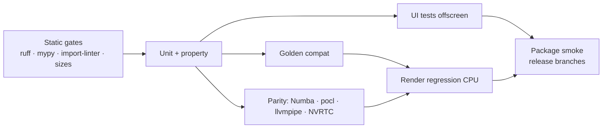

# 18 — Testing & Quality

## 1. Strategy overview

| Layer | What it proves | Tools | Runs |
|-------|----------------|-------|------|
| Static gates | Style, types, layering, size limits, banned APIs | ruff, mypy --strict, import-linter, `check_sizes.py` | Every PR |
| Unit + property tests | Module correctness | pytest, hypothesis | Every PR |
| **Golden compatibility** | Structure Synth 1.5 behaviour is reproduced | Corpus + expected outputs from the original C++ | Every PR |
| **Kernel parity** | All backends (Numba, CUDA, OpenCL, WGSL) compute the same thing | Probe kernels, statistical image comparison | Every PR (Numba + pocl OpenCL + wgpu-on-llvmpipe + NVRTC compile); nightly (GTX 1660: CUDA/OpenCL/wgpu) |
| Render correctness | The physics is right (energy, sampling) | Furnace tests, chi² tests, analytic scenes | Every PR (CPU), nightly (GPU) |
| Render regression | Images don't change unexpectedly | Reference images, SSIM/MAE thresholds | Every PR (CPU), nightly (GPU) |
| Export validation | Files are valid and readable | usd-core, pygltflib, trimesh (dev), headless Blender | PR (readers), nightly (Blender) |
| UI tests | Panels and workflows work; no stalls | pytest-qt (offscreen QPA), watchdog | Every PR |
| Performance | Budgets in docs 06/08/09/15 hold | pytest-benchmark on a dedicated runner | Nightly; perf label on PR |
| Fuzzing | No crash, hang or OOM on hostile input | hypothesis + atheris (parser, preprocessor, templates) | Nightly |
| Packaging smoke | Installers work | Build app bundle → `structura --version`, headless render | Release branches, nightly |

## 2. Coverage targets

| Package | Line coverage |
|---------|---------------|
| `core.*` | ≥ 90% |
| `kernels.skl`, `render.*`, `export.*` | ≥ 80% |
| `services.*` | ≥ 85% |
| `ui.*` | ≥ 60% (workflow tests carry the rest) |

## 3. Golden compatibility suite (the G1 guarantee)

### 3.1 Corpus

| Source | Count |
|--------|-------|
| 1.5 `Examples/` + `Examples/Tutorials/` (as shipped in `resources/legacy/examples`) | 38 |
| `StructureSynth-code-samples/` (community, MIT) | 117 |
| **Unique scripts** (duplicates removed by content hash) | **155** (154 EisenScript + 1 `#javascript`) |
| Synthetic micro-scripts (one per semantic rule in [06](06-language-engine.md) §10.6 and each `set` command) | ≈ 120 |
| Error scripts (mutations of corpus scripts that 1.5 rejects) | ≈ 200 |

One corpus script is a `#javascript` movie. It is tested through the JS bridge with the frame count reduced.

### 3.2 Golden generator (`tools/golden/`)

- A small C++ harness compiles the original `Parser/`, `Model/`, `Model/Rendering/{TemplateRenderer,
  ObjRenderer}` and `SyntopiaCore/{Math,Misc}` sources against **Qt 5** with minimal patches:
  - `QProgressDialog` is replaced by a stub;
  - the GUI and QtScript are excluded;
  - a `DumpRenderer : Renderer` records each call.
- For each script, with seeds {0, 1, 42, 1234}, it records:
  - the primitive stream (JSON lines: kind, `base/dir1/dir2/dir3` or centre/radius, endpoints, rgb, alpha,
    class, order);
  - build statistics and termination messages;
  - the output of every bundled template;
  - OBJ output (legacy options);
  - the **parse error message and position** for error scripts.
- Outputs are committed compressed (`tests/golden/data/*.jsonl.zst`) with a manifest (harness commit, Qt
  version, compiler). They are regenerated only when the corpus changes.
- A handful of scripts are cross-checked manually against the released 1.5 Windows binary (screenshots and
  template outputs). This guards against Qt4→Qt5 differences, notably `QColor` rounding.

### 3.3 Comparison rules

| Aspect | Rule |
|--------|------|
| Object count, order, kind, tag | Exact |
| Transforms | \|Δ\| ≤ 1e-5 absolute or 1e-4 relative per component (float32 accumulation differences) |
| Colours | Exact after 8-bit quantisation; otherwise ≤ 1e-6 |
| Template text | Byte-identical. If numeric formatting diverges, numbers are compared with the transform tolerance and everything else must be byte-identical. |
| Errors | Same acceptance or rejection; same error class; position within the same token |
| Stats | Same termination causes and counts |

A failure prints a **first-divergence report**: the primitive index, the emitting rule chain (via trace mode,
[06](06-language-engine.md) §10.4) and the RNG draw count at that point.

## 4. Unit & property tests (selection)

| Subject | Property |
|---------|----------|
| Lexer + CST | `print(parse(s)) == s` for all corpus files and for hypothesis-generated token soups (lossless) |
| Formatter | Idempotent: `fmt(fmt(s)) == fmt(s)`; the AST is unchanged by formatting |
| Tolerant parser | Never raises and always terminates within 10× the linear time bound |
| MT19937 | Equals `numpy.random.RandomState(seed)._bit_generator.random_raw()` for random seeds (including negative seeds mod 2³²) |
| `QColorCompat` | Equals PySide6 `QColor(name).toHsv()` values for all SVG names and 10⁴ random hex colours |
| HSV legacy | Matches the `ColorUtils::HSVtoRGB` port on a dense grid, including h = 360 and h = −1 edge cases |
| Affine decomposition | Reconstruction error < 1e-6; shear detection flags exactly the constructed shear cases |
| Tessellation | Unit normals, outward orientation (signed volume > 0), correct winding under negative determinants |
| Camera legacy mapping | Round-trip (legacy → physical → legacy) error < 1e-5 |
| Theme derivation | All derived text roles meet the contrast thresholds |
| ParamSpec | Round-trip: UI value ⇄ TOML ⇄ CLI flag |

## 5. Kernel parity & render correctness

- **Parity** as specified in [11](11-compute-backends.md) §8: bit-exact integer kernels, ULP-bounded float
  kernels, and statistical agreement for full integrators.
- **Correctness:**
  - White furnace test: every BSDF/material preset in a uniform white environment must return ≤ 1 (energy
    conservation); Lambert and dielectric-without-absorption cases must reach 1 within noise.
  - **χ² goodness-of-fit** tests for every BSDF sampling routine against its pdf. This is standard practice,
    as in Mitsuba and POV-Ray's `chi2.cpp`.
  - pdf normalisation (numerical integration = 1 ± 1e-3).
  - Analytic scenes: a sphere under constant environment (known radiance); a thin lens circle of confusion
    vs. formula; HDRI importance sampling vs. uniform sampling converging to the same mean.
  - Cross-renderer sanity: three scenes exported to Sunflow `.sc` and rendered in original Sunflow (offline,
    once) to confirm the `ao` integrator look within tolerance.

## 6. Render regression

- 25 canonical scenes (examples plus synthetic), covering every integrator, material preset, light type,
  camera, filter, and the adaptive sampler.
- References are **per backend** (`cpu/`, `gpu-<vendor>/`), since each backend is bit-deterministic.
- Thresholds: SSIM ≥ 0.995 **and** mean absolute error ≤ 0.5/255 (after the view transform). Failures write a
  diff, heatmap and side-by-side to the test artefacts.
- Intentional changes: `pytest --update-refs`, then reviewer approval of the image diffs in the PR.

## 7. UI tests (pytest-qt)

- CI runs the GLSL preview engine on Mesa llvmpipe (EGL), and tests the Numba preview fallback explicitly.
- **Smoke:** every panel opens, renders and closes without warnings. Every registered command executes in
  a sensible state.
- **Workflows:**
  1. Open an example → live build → pick an object → the editor jumps to the call site.
  2. Number scrubbing → rebuild → undo restores the value and the scene.
  3. Export USD → the file validates.
  4. Theme switch → no unthemed widgets (an automated scan for default palette colours).
  5. Render → cancel → re-render.
- **Watchdog:** all UI tests run with the UI-stall watchdog ([04](04-concurrency-model.md) §8). Any stall
  > 50 ms fails the test and attaches thread stacks.
- **Accessibility:** every focusable widget has an accessible name; tab order covers every panel.

## 8. Performance benchmarks

| Benchmark | Budget source |
|-----------|---------------|
| Analysis of a 1,000-line script | [12](12-editor.md) §6 |
| Build 100k / 1M boxes | [06](06-language-engine.md) §10.5 |
| TLAS build 1M / 10M | [09](09-renderer.md) §3.2 |
| Viewport frame time at 1M / 5M (offscreen, timestamp queries) | [08](08-viewport.md) §1 |
| Render throughput, GPU and CPU (spp/s) | [09](09-renderer.md) §1 |
| Export USD / GLB / OBJ at 1M | [15](15-export.md) §8 |
| Cold start to interactive window (warm cache) | < 2.5 s |

- Results are stored per commit on a dedicated runner (fixed hardware).
- A regression > 10% against the 7-day median fails the nightly run and opens an issue automatically.

## 9. CI pipeline

- **Matrix:** {Windows x64, macOS arm64, Ubuntu x64} × {Python 3.12, 3.13}. Software GPU tests (llvmpipe,
  pocl) run on Ubuntu.
- **Nightly:** real-GPU parity and regression on the reference **GTX 1660** (CUDA, OpenCL, wgpu, GLSL), plus AMD/Intel/Apple when available, fuzzing, benchmarks, headless
  Blender validation, full golden corpus across all seeds.

## 10. Release checklist (manual, per release)

1. All automated gates are green on the release commit; no P0/P1 issues remain.
2. Visual review of all 40 themes (screenshot gallery artefact).
3. Accessibility pass with a screen reader on Windows (NVDA) and macOS (VoiceOver).
4. A clean-machine install test for each installer, including machines without a discrete GPU.
5. Open every bundled example, build it, do a quick render, and export to USD. (This is also automated,
   but repeated by hand on each OS.)
6. THIRD_PARTY_NOTICES is updated, and licences are reviewed ([20](20-risks.md)).
