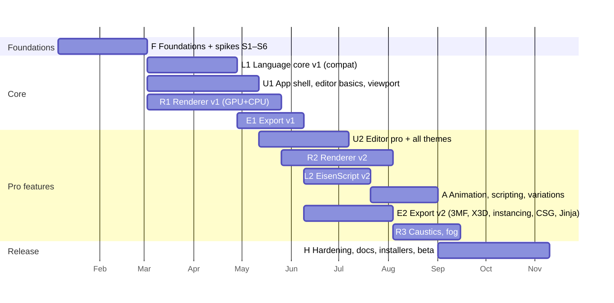
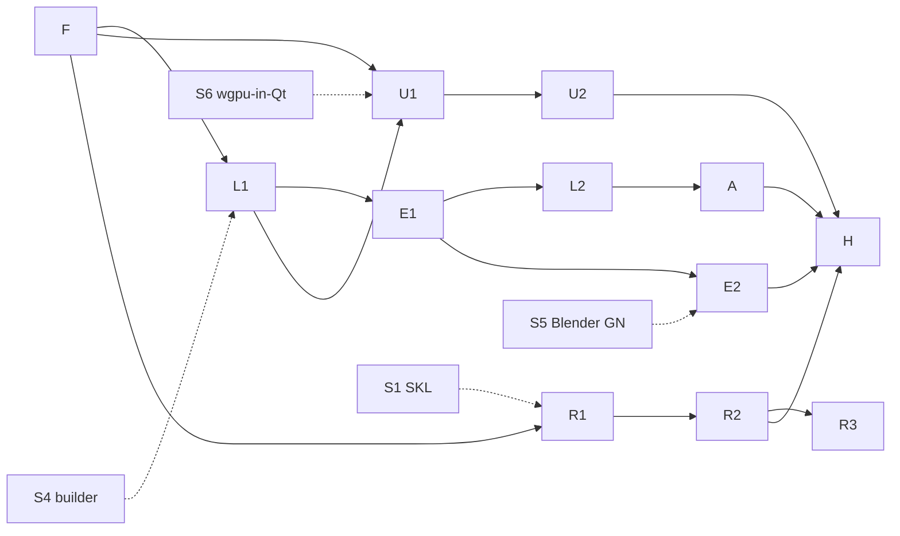

# 19 — Roadmap & Milestones

The plan is organised into **phases** with codes used throughout these docs (F, L1, U1, R1, E1, U2, R2, L2,
A, E2, R3, H) and **spikes** (S1–S6) that retire the biggest technical risks first.

Estimates assume a core team of **4 engineers** (roles below), with part-time design and QA. They are
planning-grade (±30%) and will be re-baselined after Phase F.

| Role | Focus |
|------|-------|
| Language & engine | `core.lang`, `core.build`, compat suite, scripting |
| Rendering & GPU | `kernels.skl`, `gpu`, `render`, `viewport` (GPU parts) |
| Application & editor | `services`, `ui`, editor, themes |
| Pipeline & export | `core.geometry`, `export`, CLI, packaging |

## 1. Spikes (inside Phase F)

| Spike | Question | Exit criteria | Fallback if it fails |
|-------|----------|---------------|----------------------|
| **S1 — SKL single-source kernels** | Can one typed-Python kernel source produce both good WGSL and fast Numba? | See [11](11-compute-backends.md) §9: WGSL valid on Vulkan/Metal/D3D12; parity passes; Numba ≤ 1.3× and WGSL ≤ 1.2× of the speed of hand-written code | Hand-written WGSL + Numba with the parity suite; supersede ADR-0004 |
| **S2 — GPU throughput** | Does compute-shader BVH traversal over instanced analytic primitives meet ≥ 10 spp/s (1080p, 1M boxes, 4 bounces)? | Prototype path tracer on the reference GPU | Reduce the default bounces; wavefront restructuring; BVH4 earlier |
| **S3 — CPU throughput** | Does the Numba CPU backend reach ≥ 1 spp/s on 8 cores? | Prototype on the reference CPU | Packet traversal; lower default quality on CPU; emphasise AO/preview on CPU |
| **S4 — Builder performance & exactness** | Numba builder ≥ 1M boxes in < 600 ms, with an RNG-exact match on 10 corpus scripts | Bench + golden diff | Optimise state layout; C extension as last resort (ADR required) |
| **S5 — Blender instancing path** | Can a generated GN tree apply full per-instance matrices in Blender 4.2 LTS? | A script that instances 100k sheared boxes correctly | TRS attributes with sheared instances baked ([15](15-export.md) §4.3) |
| **S6 — wgpu in Qt** | Does rendercanvas + PySide6 give a stable, resizable, high-DPI viewport on Windows, macOS and Linux (X11 + Wayland)? | 30-minute soak test with resize/dock/undock/fullscreen on all 3 OSes | Offscreen wgpu rendering → `QImage`/`QOpenGLWidget` texture blit (higher latency, still GPU) |

## 2. Phases

The dates are illustrative; only the relative sequencing is binding.

- **Critical path:** F → L1 → E1 → L2 → A → H = 8 + 8 + 6 + 6 + 6 + 10 = **44 weeks**.
- **Near-critical:** the renderer chain F → R1 → R2 → R3 = 36 weeks. R2 (needed by H) finishes at week 30.
- Total effort is about 175 person-weeks. With 4 engineers the plan spans about **44 weeks (~10 months)**, or
  **10–14 months** with the ±30% planning margin.

### Phase F — Foundations (8 weeks)

| Deliverables | Acceptance |
|--------------|------------|
| Repository skeleton per [17](17-code-standards-and-layout.md); `pyproject`, lock file, pre-commit | `uv sync && pytest` green on all 3 OSes |
| CI pipeline with all static gates, lavapipe runner | Gates block PRs |
| Job framework + lanes + watchdog ([04](04-concurrency-model.md)) | A demo job streams partials; the watchdog catches an injected stall |
| `Registry` + `ParamSpec` + `param_form` prototype | A form is generated from a spec; ParamSpec ⇄ TOML ⇄ argparse round-trip test |
| Golden generator (`tools/golden`) + corpus goldens committed | 156 scripts × 4 seeds dumped |
| Spikes S1–S6 with written reports and ADR updates | Each spike's exit criteria are met or its fallback is adopted |

### Phase L1 — Language core v1 (8 weeks)

| Deliverables | Acceptance |
|--------------|------------|
| Legacy preprocessor, lexer, tolerant parser + CST/AST, resolver, linter (v1 catalogue), compiler, Numba builder (BFS/DFS), MT19937, QColorCompat, SceneIR | **100% of the golden corpus passes** ([18](18-testing-and-quality.md) §3), including error scripts |
| `structura lint/build` CLI; legacy OBJ export | CLI output matches the 1.5 OBJ goldens |
| Build performance | S4 budgets met in CI perf runs |

### Phase U1 — App shell, editor basics, viewport v1 (10 weeks)

| Deliverables | Acceptance |
|--------------|------------|
| Main window, docks, workspaces, command registry, palette, status bar, welcome page | All commands reachable via menu and palette |
| Editor P0 features ([12](12-editor.md) §2), lexical + semantic highlighting, diagnostics, outline, seed controls, live build, number scrubbing, colour swatches | Typing latency < 16 ms; live build of Default.es < 300 ms |
| Theme engine + Structura Dark/Light + the 6 Nord variants | Contrast validator green |
| GPU viewport: instanced pipelines, impostors, SSAO, shadows, OIT, picking → editor jump, camera presets, copy camera to script | [08](08-viewport.md) §1 budgets at 1M boxes |
| Parameters panel, Examples gallery, Problems, Console, Build Stats | 1.5 parity checklist items for the GUI ticked ([01](01-legacy-analysis.md) §1.5) |

### Phase R1 — Renderer v1 (12 weeks)

| Deliverables | Acceptance |
|--------------|------------|
| SKL compiler (production quality), `gpu` device layer, GpuScheduler | Probe-kernel parity suite green |
| RenderScene compile, TLAS/BLAS build, Sobol-Owen sampler, film, filters, view transforms | TLAS 1M < 400 ms |
| Integrators `preview`, `classic`, `ao`, `path` (principled: diffuse, dielectric specular, metal, smooth glass) | Furnace + χ² tests green; 1.5 raytracer examples recognisably reproduced with `classic` |
| Progressive sampler; render view (zoom, AOVs, exposure, progress); outputs + metadata; open-from-render | First frame < 100 ms; metadata round-trip |
| CPU backend + CPU fallback viewport | Parity suite green on CPU vs lavapipe; fallback viewport ≥ 15 fps at 1M |

### Phase E1 — Export v1 (6 weeks)

| Deliverables | Acceptance |
|--------------|------------|
| Tessellation, affine decomposition, `ExportSceneModel` | Property tests green |
| OBJ/MTL, PLY, STL (+ watertight union), glTF baked, USD PointInstancer (+ UsdPreviewSurface, camera, lights), Blender script (baked) | Validators pass; nightly headless Blender passes |
| Legacy template engine + export sheet + bundled templates | Byte-identical template goldens |
| Export presets; `structura export/template` | CLI ≡ GUI options |

### Phase U2 — Editor pro & complete theming (8 weeks)

| Deliverables | Acceptance |
|--------------|------------|
| Completion (all contexts), hover, signature help, go-to/references/rename, quick fixes, formatter, inlay hints, multi-cursor, minimap, sticky scroll, snippets | Feature checklist P0+P1 complete |
| All 40 themes; VS Code / base16 importers; theme editor; follow system appearance | Screenshot + contrast tests for every theme |
| Preferences (generated), keymaps (Structura / Legacy / VS Code-like) | |

### Phase R2 — Renderer v2 (10 weeks)

| Deliverables | Acceptance |
|--------------|------------|
| Full principled BSDF (coat, anisotropy, rough transmission, attenuation), emissive geometry, light set (point/sphere/spot/sun/rect), HDRI + sun-sky environments | Furnace/χ² tests; HDRI MIS convergence test |
| Cameras: orthographic, spherical, fisheye, polygonal bokeh, click-to-focus | Analytic CoC test |
| Tiled adaptive sampler with bucket orders, noise threshold; all 9 filters; region render; ground/shadow catcher | Adaptive renders reach the target noise with ≥ 30% fewer samples on the benchmark scenes |
| OIDN denoising; AOVs; multi-layer EXR | Final-render workflow end-to-end |
| GPU throughput and CPU fallback meet the [09](09-renderer.md) §1 targets | Perf CI |

### Phase L2 — EisenScript v2 (6 weeks)

| Deliverables | Acceptance |
|--------------|------------|
| `#version 2`, whole-word defines, expressions, `#param`, `material`/`light`/`environment`/`camera`/`render` blocks, `mat` operator, new primitives (cylinder, cone, torus, ellipsoid, tube), context-sensitive lexing | Spec examples in [05](05-eisenscript-language.md) §9 all build and render |
| `structura convert --to v2` | Converted corpus scripts produce identical geometry |
| Editor catalogues extended (completion, hover, diagnostics E015/E016, W112/W113) | |

### Phase A — Animation, scripting, variations (6 weeks)

| Deliverables | Acceptance |
|--------------|------------|
| Timeline + keyframes + playback + frame cache; animation render Job with pipelining; video export | A 240-frame animation renders unattended; resumable |
| Legacy `#javascript` bridge (Builder, Debug, World, Vector3) | The 3 corpus JS scripts run (reduced frames) |
| Python API + in-app script runner; `structura animate/run` | API doctests green |
| Variation Explorer; snapshot history | 6×6 grid of a 100k-object script fills in < 20 s on the reference machine |

### Phase E2 — Export v2 (8 weeks)

| Deliverables | Acceptance |
|--------------|------------|
| 3MF (components + colour), X3D/VRML, glTF instanced (EXT_mesh_gpu_instancing), USD flattened + matrix-xform policy, Blender GN instancing (per S5), legacy CSG marker evaluation | Validators; Blender nightly |
| Jinja exporters: POV-Ray 3.8, Sunflow `.sc`, Mitsuba 3 | Files render in the target renderers (manual nightly smoke) |

### Phase R3 — Caustics & fog (6 weeks)

| Deliverables | Acceptance |
|--------------|------------|
| Photon-caustics integrator (CPU, then GPU); homogeneous/height fog | Parity; caustic reference scene within tolerance of a high-spp path-traced reference |

### Phase H — Hardening & 1.0 (10 weeks)

| Deliverables | Acceptance |
|--------------|------------|
| Performance tuning to all budgets; memory guard polish; crash reporting (local logs; opt-in upload) | Perf CI green for 2 consecutive weeks |
| Accessibility audit fixes; i18n infrastructure; user guide, language reference (generated), developer guide | Release checklist ([18](18-testing-and-quality.md) §10) |
| Installers (MSIX/MSI, notarised DMG, AppImage, Flatpak) + PyPI; `structura warmup` in installers | Clean-machine tests, with and without a GPU |
| Public beta (6 weeks), then RC and 1.0 | Goals G1–G10 ([00](00-vision-and-scope.md)) verified |

## 3. Dependency graph (what blocks what)

U1 needs L1 for live build. Both start after F and integrate in U1's final weeks (L1 ends at week 16, U1 at
week 18). The CPU fallback viewport needs the `preview` integrator, so it is an R1 deliverable, not a U1
one.

## 4. First two weeks (immediate next actions)

1. Approve these planning docs and ADRs. Confirm licensing (GPL-3.0-or-later) and the reference hardware.
2. Create the repository skeleton and CI gates (Phase F, item 1–2).
3. Build the golden generator against Qt 5 and dump the corpus. This de-risks G1 early.
4. Start spikes S1 (SKL), S6 (wgpu in Qt) and S4 (builder) in parallel. They have the highest information
   value.
5. Draft `core/lang/catalog/*.toml` from [05](05-eisenscript-language.md). It unblocks the parser, linter,
   completion and docs at once.
