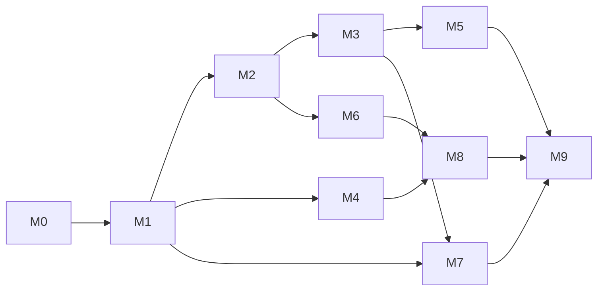

# 19 — Roadmap & Execution Plan

**Execution model ([ADR-0014](adr/0014-agent-driven-execution.md)).** Structura is built by an AI engineering
agent working with the project owner. The plan is no longer sized in person-weeks. It is a **dependency-ordered
sequence of milestones**, and each ends in a **verifiable checkpoint**:

- tests green;
- a demonstrable artefact;
- an entry in [PROGRESS.md](PROGRESS.md).

The owner reviews at checkpoints and runs the hardware-specific steps the sandbox cannot: the GTX 1660,
Windows/macOS, and Blender.

Phase codes used elsewhere in the docs map to milestones as follows: F→M0, L1→M1, R1→M2, U1→M3, E1→M4,
U2→M5, R2→M6, L2/A→M7, E2/R3→M8, H→M9.

## 1. What the sandbox can verify

| Capability | Status in the sandbox | Consequence |
|------------|-----------------------|-------------|
| Python 3.12 + all runtime dependencies | ✅ installed with `uv` | Full unit, golden and UI (offscreen) testing |
| Numba CPU backend | ✅ runs (4 cores) | CPU engines are tested for real |
| OpenCL | ✅ runs on **pocl** (CPU) | Emitted OpenCL C is compiled *and executed* |
| CUDA | ⚠️ **NVRTC compile only** (no GPU) | Emitted CUDA is compiled to PTX for `compute_75`; execution happens on the owner's GTX 1660 |
| WGSL | ✅ wgpu adapter: llvmpipe via GL backend | Emitted WGSL is compiled and executed (software) |
| GLSL / OpenGL | ✅ ModernGL EGL context on llvmpipe | The preview engine renders headlessly |
| Qt | ✅ PySide6 offscreen QPA | UI tests, screenshots |
| Performance budgets | ⚠️ indicative only (software GPU, 4 CPU cores) | The owner runs `tools/bench` on the reference GTX 1660 |

## 2. Spikes

| Spike | Question | Where it runs | Status |
|-------|----------|---------------|--------|
| **S1 — SKL, five targets** | Does one typed-Python source emit valid Numba, CUDA C, OpenCL C, WGSL and GLSL with parity? | Sandbox (Numba, pocl, NVRTC, wgpu-llvmpipe, EGL) | Part of M2 |
| **S2 — GPU throughput** | ≥ 5 spp/s at 1080p, 1M boxes, on the GTX 1660 (CUDA) | Owner's machine (`tools/bench/render_throughput.py`) | After M2 |
| **S3 — CPU throughput** | ≥ 1 spp/s on 8 cores | Sandbox (scaled) + owner | After M2 |
| **S4 — Builder** | ≥ 1M boxes in < 600 ms with a golden-exact RNG | Sandbox | Part of M1 |
| **S5 — Blender GN instancing** | Full-matrix instances in Blender 4.2 LTS | Owner (or CI with Blender) | Before M8 |
| ~~S6 — wgpu in Qt~~ | Retired: the preview uses `QOpenGLWidget` ([ADR-0013](adr/0013-two-render-engines.md)) | — | — |

## 3. Milestones

| # | Milestone | Contents | Checkpoint (definition of done) |
|---|-----------|----------|----------------------------------|
| **M0** | Foundations & brand | Repo skeleton per [17](17-code-standards-and-layout.md); `pyproject.toml` (MIT); ruff, mypy, import-linter, `tools/check_sizes.py`; pytest setup; Job framework skeleton; **logo & brand assets** ([21](21-brand-and-logo.md)) | `pytest` green; all gates pass; logo renders at 16–1024 px |
| **M1** | Language core v1 | Catalogues; legacy preprocessor; lexer; tolerant parser (CST/AST); resolver; linter; compiler; MT19937; QColorCompat; Numba builder; SceneIR; `structura lint/build`; legacy OBJ; **golden generator** (Qt 5.15 headers from Ubuntu packages, user space) | Golden corpus green (155 scripts × 4 seeds); S4 budget met (scaled) |
| **M2** | SKL + precision engine core | SKL front end + 5 emitters; flat ABI; backends CUDA/OpenCL/wgpu/CPU; RenderScene; BVH; Sobol-Owen; film + filters; integrators `preview`, `classic`, `ao`, `path` (diffuse, dielectric, metal, glass); outputs + metadata; `structura render` | Parity suite green on Numba/pocl/wgpu-llvmpipe; NVRTC compiles; furnace + χ² tests; example renders committed |
| **M3** | App shell + preview engine + editor basics | Main window, docks, command registry/palette; GLSL preview (instancing, impostors, SSAO, shadows, OIT, picking); Numba fallback; editor P0; live build; Parameters/Examples/Problems/Console/Build Stats; base themes | UI tests + watchdog green; headless screenshots of the viewport and editor |
| **M4** | Export v1 | Tessellation, affine decomposition, ExportSceneModel; OBJ/PLY/STL(+watertight)/glTF baked/USD instanced/Blender script (baked); legacy template engine | Validators green; template goldens byte-identical |
| **M5** | Editor pro + all themes | Completion, hover, signatures, navigation, rename, quick fixes, formatter, inlays, multi-cursor, minimap, sticky scroll; 40 themes + importers + theme editor; preferences; keymaps | Feature checklist P0+P1; theme screenshot + contrast tests |
| **M6** | Precision engine v2 | Full principled BSDF, emissive geometry, all lights, HDRI + sun-sky, all cameras + bokeh, tiled adaptive + noise threshold, all filters, OIDN, AOVs/EXR, region render, ground/shadow catcher; device lane fairness | Correctness suites; owner benchmark on the GTX 1660 |
| **M7** | EisenScript v2, animation & scripting | v2 dialect; `convert --to v2`; timeline/keyframes; animation render + video; legacy `#javascript` bridge; Python API; Variation Explorer | Spec examples build; the 3 corpus JS scripts run |
| **M8** | Export v2 + caustics/fog | 3MF, X3D/VRML, glTF instanced, USD flatten/matrix policies, Blender GN (S5), Jinja exporters, CSG markers; photon caustics; fog | Validators; reference scenes |
| **M9** | Hardening & 1.0 | Performance tuning to budgets on the GTX 1660; accessibility; i18n; user guide and generated reference; installers (Windows, macOS, Linux) + PyPI | Release checklist ([18](18-testing-and-quality.md) §10); goals G1–G10 verified |
| **M10** | Studio completion (added after owner feedback) | The rest of the docs/14 window: activity rail, workspaces, welcome page, Files/Camera/Inspector/Materials/Lights/Render Queue/Activity panels, toasts and banners; viewport colour modes, overlays, navigation presets, CPU picking; Save As flows; render reports; export presets; recovering parser | UI suite green (stall watchdog on); owner review of the window |

The **order of execution** is M0 → M1 → M2 → M3 → M4 → M5 → M6 → M7 → M8 → M9. Later milestones can start
earlier where the dependencies above allow.

## 4. Owner checkpoints (things only the owner can do)

1. Run `tools/bench` and `pytest -m gpu` on the GTX 1660 after M2 and M6. Report the numbers and any
   failures.
2. Smoke-test installers on Windows and macOS (M9), and test the Blender script in Blender 4.2 LTS (M4, M8).
3. Approve visual decisions: logo (M0), default theme (M3), look presets (M3/M6).

## 5. Current status

M0–M8 and M10 are done; M9 waits on the owner's hardware and platform checks. The status table, the
deviations from this plan and the backlog of planned-but-unbuilt items are in
[22-implementation-notes.md](22-implementation-notes.md); the chronological log is [PROGRESS.md](PROGRESS.md).
