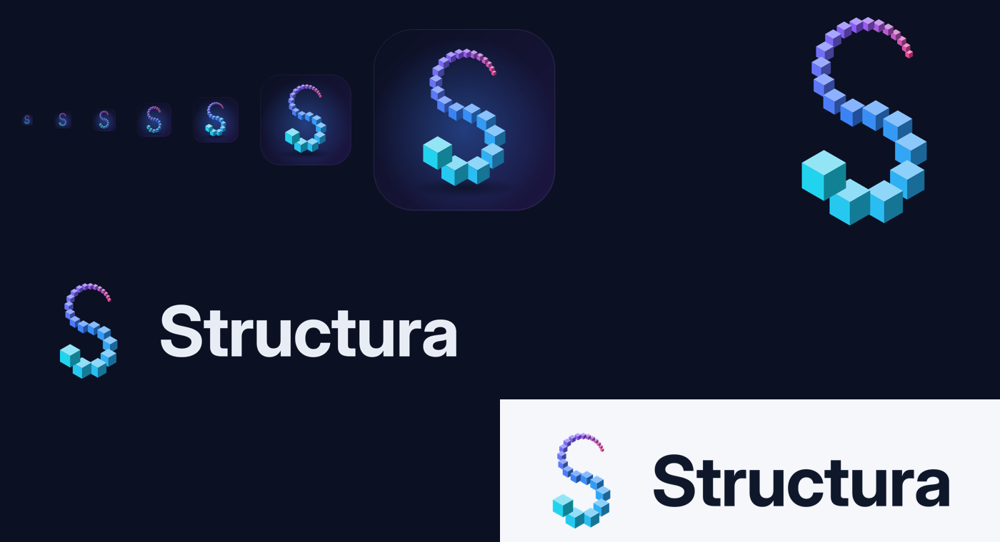

# 21 — Brand & Logo



## 1. Concept

The Structura mark is a **grammar-grown "S"**: a chain of isometric cubes that starts from a large *seed*
cube and shrinks as it winds along an S-curve. It is literally what an EisenScript rule produces:

```
rule R md 22 { { x 1 rz 15 s 0.92 } R  box }
```

- **Cubes** refer to Structure Synth's most common primitive, the `box`.
- **Geometric shrinking** refers to recursion and depth limits.
- **The colour sweep** (cyan → blue → violet → pink) refers to the HSV `hue` operator: every generation
  shifts colour.
- **The "S"** is for Structura and Structure Synth: continuity with the original.

## 2. Assets (generated, never hand-edited)

All assets come from `tools/brand/make_logo.py` (`QT_QPA_PLATFORM=offscreen python -m
tools.brand.make_logo`). They are written to `src/structura/resources/brand/`:

| Asset | Use |
|-------|-----|
| `structura-mark.svg` | Primary mark (22 cubes), transparent background, ≥ 64 px |
| `structura-mark-compact.svg` | Compact "ribbon" mark (20 overlapping cubes), ≤ 48 px |
| `structura-icon.svg` / `structura-icon-compact.svg` | App icon: rounded square, deep navy gradient, soft blue glow, ground shadow |
| `structura-logo-on-dark.svg` / `-on-light.svg` | Horizontal lockup: mark + "Structura" wordmark (outlined Inter Bold, −1.5% tracking) |
| `png/icon-{16…1024}.png` | Raster icons (compact mark used ≤ 48 px) |
| `structura.ico` | Windows icon (16–256) |
| `structura.icns` | macOS icon |
| `brand-sheet.png` | Review sheet (above) |

## 3. Construction

| Parameter | Primary | Compact |
|-----------|---------|---------|
| Cubes | 22 | 20 |
| Size ratio per generation | 0.92 | 0.97 |
| Spacing (× mean neighbour size) | 0.97 | 0.70 (overlapping ribbon) |
| Curve | Two 250° arcs of equal radius; the tail starts at −160° on the lower bowl, and the head ends top-right | same |
| Faces | top = base mixed 38% toward white (OKLab); left = base; right = base mixed 30% toward black | same, plus a background-coloured outline for separation |
| Paint order | Younger (smaller) cubes behind older ones | same |

## 4. Colour

| Token | Hex | Role |
|-------|-----|------|
| Seed cyan | `#22D3EE` | Gradient stop 0 (seed cube) |
| Growth blue | `#3B82F6` | Stop 1; icon glow |
| Recursion violet | `#8B5CF6` | Stop 2 |
| Tip pink | `#EC4899` | Stop 3 (youngest cube) |
| Icon navy | `#0B1022` → `#1C1642` | Icon background gradient |
| Ink on dark | `#E8ECF4` | Wordmark on dark surfaces |
| Ink on light | `#0F172A` | Wordmark on light surfaces |

The gradient is interpolated in **OKLab**, so the sweep has no muddy midpoints. The same stops seed the
accent of the *Structura Dark/Light* themes ([13](13-theming.md)).

## 5. Typography

- **Wordmark:** Inter Bold (`wght` 700, `opsz` 32), converted to outlines.
- **UI:** Inter. **Code:** JetBrains Mono.

Both fonts are bundled under the SIL OFL 1.1 (`src/structura/resources/fonts/`).

## 6. Usage rules

- Minimum sizes: primary mark 64 px, compact mark 16 px, lockup 120 px wide.
- Clear space: half the seed-cube width on every side.
- Do not recolour individual cubes, change the paint order, or set the wordmark in another typeface.
- On photographs or renders, use the app-icon tile rather than the bare mark.

## 7. Future

Once the precision engine is running (M2), the mark will also ship as an EisenScript example
(`examples/structura-logo.es`) and a path-traced hero render. The brand then eats its own cooking.
