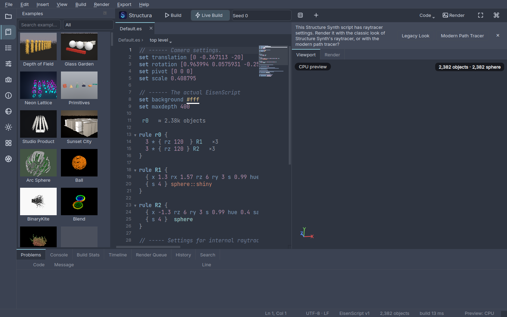
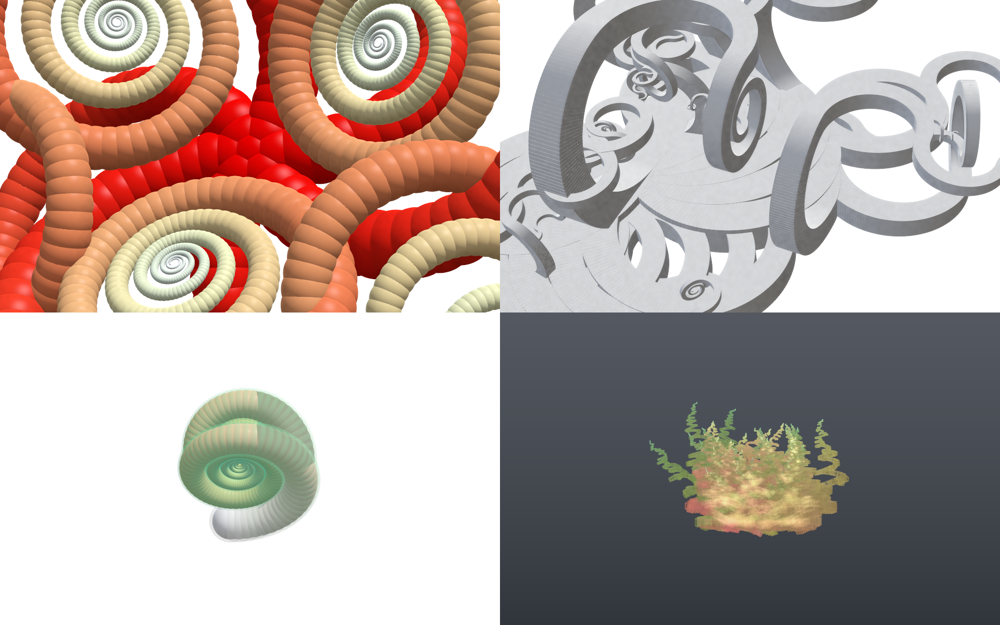
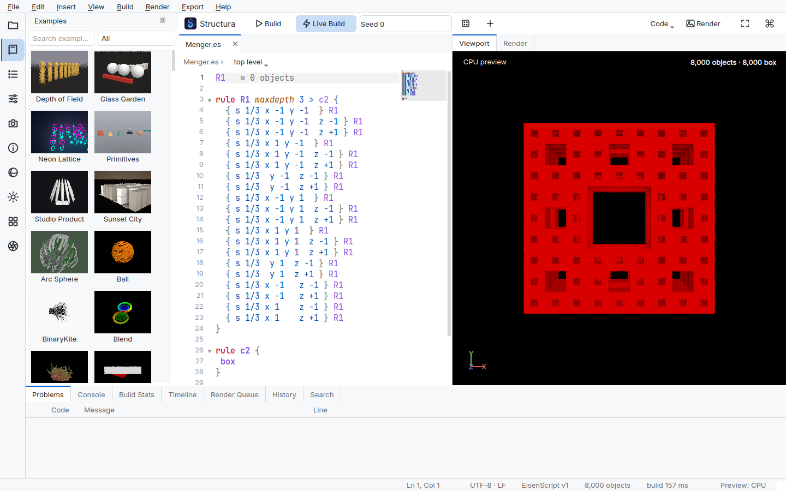

# Progress Log

Living record of execution against the roadmap ([19](19-roadmap.md), [ADR-0014](adr/0014-agent-driven-execution.md)).
Entries are in the order the work was done (oldest first); the milestone headings say where each belongs.
The current status of every milestone, the deviations from the plan and the remaining backlog are in
[22-implementation-notes.md](22-implementation-notes.md).

## Status overview

| Milestone | Status |
|-----------|--------|
| M0 Foundations & brand | ✅ done |
| M1 Language core v1 | ✅ done |
| M2 SKL + precision engine | ✅ done |
| M3 App shell + preview + editor basics | ✅ done |
| M4 Export v1 | ✅ done |
| M5 Editor pro + themes | ✅ done |
| M6 Precision engine v2 | ✅ done (owner benchmark pending) |
| M7 v2, animation, scripting | ✅ done |
| M8 Export v2 | ✅ done (Blender Geometry Nodes run pending) |
| M9 Hardening & 1.0 | 🟡 owner checks pending (installers, benchmarks, screen reader, German review) |
| M10 Studio completion | ✅ done |

---

## 2026-11-05 — M0 + M1 core

### Delivered

- **Planning docs updated for the owner's decisions:**
  - MIT licence, with clean re-implementation ([ADR-0010](adr/0010-licensing.md));
  - reference GPU GTX 1660;
  - **two render engines** ([ADR-0013](adr/0013-two-render-engines.md)): GLSL/Numba preview and
    CUDA/OpenCL/WGSL/CPU precision;
  - SKL with five targets;
  - agent-driven roadmap;
  - brand doc.
- **Logo and brand** ([21](21-brand-and-logo.md)): procedural S-chain of isometric cubes; app icons
  (.ico/.icns); lockups; outlined Inter wordmark. Everything is generated by `tools/brand/make_logo.py`.
- **Repository skeleton:**
  - `pyproject.toml` (all deps required);
  - ruff, mypy `--strict`, import-linter layer contracts, `tools/check_sizes.py` (size and nesting limits);
  - every planned top-level package exists.
- **Golden generator** (`tools/golden/`):
  - builds the *original* Structure Synth 1.5 model/parser code against Qt 5.15.13 (headers extracted from
    Ubuntu packages in user space);
  - dumps all **155** unique corpus scripts × 4 seeds (plus template and OBJ outputs for 84 small scripts)
    into `tests/golden/data` (24 MB, xz).
- **EisenScript v1 core** (`structura.core`):
  - catalogues (TOML);
  - legacy preprocessor with GUI parameters;
  - tokenizer and strict parser;
  - resolver (ambiguous rules, tags, triangles);
  - compiler to flat `RuleProgram` tables, with float32 transformation composition;
  - QColor-compatible colours;
  - MT19937;
  - **Numba builder kernel** (BFS/DFS, resumable slices, streaming outputs);
  - `SceneIR`.

### Verified

- **Golden compatibility: 616 / 616** script × seed runs match Structure Synth 1.5. That is 539,832 records:
  primitives, colours, tags, camera and background events.
  - Fault injection confirms the comparison is meaningful. A wrong seed is detected in 98/154 scripts (the
    rest are deterministic). A 1e-3 transform perturbation is detected everywhere except where it is
    legitimately invisible (triangle corners are compared directly; relative tolerance at large coordinates).
- Unit tests: 47 pass. Gates: ruff ✓, mypy --strict ✓, import-linter 2/2 ✓, size limits ✓.

### Findings worth knowing

1. **15 legacy behaviours** were verified against the original engine and recorded in
   [05 §11](05-eisenscript-language.md). Among them:
   - do-while loops;
   - tabs inside tokens;
   - recursive defines still applied;
   - shared `random[]` values;
   - 2-decimal GUI parameters;
   - BFS overshooting `maxobjects`;
   - DFS `maxdepth` semantics.
2. **Qt 5 vs Qt 6 colour maths.** Qt 5's `QColor::toHsv` uses double precision with rounded /257 reduction;
   Qt 6 (PySide6) uses single precision and differs in about 0.3% of colours. Structura follows Qt 5, the
   version behind the goldens.
3. **Numba NRT overhead.** Passing namedtuples of arrays into functions with certain branch shapes made
   Numba refcount every array on every call (about 1 µs per call). Kernels now compile with `_nrt=False` via
   `structura.core.jit.kernel`. They never allocate.
4. **Sandbox memory is slow to first-touch.** In this Firecracker VM, first writes to fresh memory cost
   120–370 µs per 4 KB page (bare metal: about 0.2 µs). Builder benchmarks therefore use pre-touched
   buffers. A **buffer pool reused across builds** is planned; it also helps live-coding on real hardware.

### Performance (sandbox: 4-core Xeon 2.6 GHz VM, noisy ±30%)

| Benchmark | Result | Target (reference desktop) |
|-----------|--------|----------------------------|
| 1M boxes (binary tree depth 20, 3.1M rule applications), pre-touched buffers | **1.7–2.5 s** (about 530–800 ns per application) | < 0.6 s |
| Structure Synth 1.5 on the same script in this VM | 54 s (including its dump I/O) | — |

The remaining ideas for the S4 target are a 3×4 state matrix (25% fewer flops and bytes), the buffer pool,
and measuring on real hardware before optimising further.

### Next

1. Finish M1: CLI (`structura lint/build`), legacy OBJ + template exporters against their goldens, buffer
   pool.
2. M2: SKL front end and the five emitters, then precision-engine core.

---

## M2 — SKL and precision engine R1

### Delivered

- **SKL** (`structura.kernels.skl`) is a restricted Python kernel language. One kernel source now compiles to
  **five targets**:
  - Numba (CPU, `cache=True`);
  - OpenCL C;
  - CUDA C (via NVRTC → PTX);
  - WGSL (wgpu);
  - GLSL 4.30 compute (ModernGL).

  The frontend type-checks kernels (f32/u32/i32, vec2–4, structs, `Buf`/`BufRW`, local arrays). The emitters
  share one C-like base and one builtin spelling table, so there is no per-target copy-paste.
- **Compute backends** (`structura.compute`): CPU (Numba), OpenCL, wgpu, and CUDA (cuda-python + NVRTC).
  `select_backend("auto")` tries CUDA, then an OpenCL GPU, then a wgpu GPU, then the CPU.
- **Precision engine R1** (`structura.render`):
  - primitive packing (box, sphere, capsule for lines, triangle, grid; `mesh` → 12 triangles; degenerate
    transforms get epsilon thickness);
  - binned-SAH BVH (Numba; O(BINS) prefix/suffix sweep);
  - the camera comes from the script's view events, or is framed automatically with `--frame`;
  - three integrators: `preview`, `ao`, and `path` (sun next-event estimation plus a gradient sky);
  - progressive passes;
  - tone mapping to PNG.
- **CLI:** `structura render file.es -o out.png --size WxH --samples N --integrator path|ao|preview --device
  auto|cpu|opencl|wgpu|cuda [--frame]`.

### Verified

- **SKL parity:** a demo kernel matches Numba to 7.5e-9 on OpenCL, wgpu and GLSL.
- **Render parity:** all three integrators × {OpenCL, wgpu, GLSL} agree with the Numba reference. At least
  98.5% of values are within 2e-3. The rest are edge pixels, where float noise flips the hit primitive.
- **CUDA:** the full render kernel compiles to PTX for sm_75 (GTX 1660 class) and sm_86 (160 KB). This
  sandbox has no NVIDIA GPU, so execution on CUDA is verified only on the owner's machine (`pytest -m gpu`).
- **BVH:** property tests check that every primitive sits in exactly one leaf inside its bounds, that
  children are nested in their parents, and that degenerate inputs (1000 identical boxes, an empty scene)
  are handled.
- 68 unit and parity tests pass. Gates: ruff ✓, mypy --strict ✓ (SKL kernel modules are checked by the SKL
  frontend instead), import-linter ✓, size limits ✓.

### Performance (sandbox: no GPU; OpenCL = pocl on CPU; wgpu = llvmpipe)

| Benchmark | CPU (Numba) | OpenCL (pocl) | wgpu (llvmpipe) |
|-----------|-------------|---------------|-----------------|
| Default.es, AO, 320×240, 8 spp (render loop) | 2.2 s | 3.4 s | 12.9 s |
| BVH build, 1M random boxes | 5.2 s (single-threaded) | — | — |

These numbers show the fallbacks work; they are not GPU numbers. The BVH build is the next CPU bottleneck.
The plan is a parallel build (Numba `prange` over the top-level subtrees) or an LBVH on the device.

### Next (M2 continued)

1. Persistent device buffers per backend, so the scene is not re-uploaded on every pass.
2. A classic integrator (emulates the legacy OpenGL look) and a principled BSDF for `path`.
3. A faster BVH build.
4. `tools/bench` scripts and `pytest -m gpu` for the GTX 1660.

---

## M2 (continued) — materials, classic integrator, correctness suites

### Delivered

- **Resident device buffers.** `Backend.bind(launch)` returns a `Bound` kernel whose buffers stay on the
  device. `update()` re-sends only what changed, so progressive passes send two scalars. This is
  implemented for CPU, OpenCL, wgpu, CUDA and the GLSL test runner. OpenCL Default.es AO went from 3.4 s
  to 1.7 s.
- **SKL buffer sets** (`@bufset`). The render kernels pass one `sc: SceneBufs` instead of eight buffers.
  This is a front-end AST rewrite, so the IR and all five emitters are unchanged.
- **Materials** (`core/scene/material.py`, `materials.toml`, `material_library.py`):
  - the principled parameter set;
  - 22 presets;
  - per-tag resolution with Structure Synth's exact semantics. `raytracer::phong|reflection` applies to
    untagged primitives, and `raytracer::TAG::…` to one tag, starting from the 0.6/0.6/0.6 defaults;
  - migration to principled parameters (docs/10 §6.2).
  - The CLI has `--tag-presets` (`box::glass`, `sphere::gold`, …).
- **Principled BSDF** (SKL):
  - Lambert diffuse;
  - GGX dielectric/metal specular with VNDF spherical-cap sampling;
  - rough dielectric transmission (Walter 2007);
  - GGX clear coat;
  - one-sample lobe-mixture pdf, so estimators divide `f·cos` by the full mixture pdf.
- **Path integrator:**
  - sun NEE + BSDF sampling combined with MIS (power heuristic);
  - stochastic opacity with Structure Synth's single-crossing semantics;
  - emission and the constant model;
  - Russian roulette;
  - filtered caustics.
- **Classic integrator:** Structure Synth 1.5's `RenderThread::rayCast`:
  - Phong with the unnormalised-L specular quirk;
  - uniform-sphere AO at the first hit;
  - hard shadows that ignore α < 1 occluders;
  - transparency and reflection as a stochastic walk (docs/10 §2.1 note);
  - the default light from the near-plane unprojection;
  - display-space shading;
  - `--view standard` by default.
- **Legacy render keys:** `samples`, `ambient-occlusion-samples`, `max-depth`, `dof` (→ thin lens),
  `shadows`, `light`, `size`. The CLI order is defaults → script → command line.

### Verified

- **χ² tests.** Samples match the reported pdf for diffuse, plastic, metal, rough glass (outside and
  inside) and coated, over 24×48 sphere bins with 400k samples each.
  - This caught a real bug: microfacet samples below the horizon were not rejected.
- **White furnace.**
  - Diffuse, mirror and smooth glass vanish (mean 1 ± 0.01).
  - Plastic, rough metal, rough glass and coated never exceed 1 and stay above 0.8.
- **Parity.** All four integrators, now including glass, gold, plastic, alpha and reflection, agree across
  Numba, OpenCL, WGSL and GLSL.
- **CUDA.** The kernel compiles with NVRTC.
- Gates green. Example renders are in [docs/renders](renders/) (classic and path, corpus scripts).

### Outputs, benchmarks and GPU hooks

- **Outputs.** PNG, JPEG, WebP, TIFF (display-transformed) and **EXR** (linear float, ZIP). Reproducibility
  metadata is embedded under `structura:*`: version, seed, settings JSON, camera JSON, parameters, script
  SHA-256 and the script text (`--no-embed-script` leaves the text out). `render.metadata.read_metadata`
  reads PNG and EXR.
- **Owner hardware hooks:**
  - `pytest -m gpu` (`tests/gpu`);
  - the parity suite's `device` fixture now includes **CUDA**, so on the GTX 1660 every parity test also
    runs against CUDA (it is skipped here);
  - `python -m tools.bench.render_throughput --device cuda --size 1920x1080` (spike S2).
- **Sandbox reference (CPU, 4 cores):** 524k boxes at 480×270 run at 10.9 spp/s with the path tracer. At
  1080p that is about 0.7 spp/s, already close to the S3 budget (≥ 1 spp/s on 8 cores).

---

## M3 — App shell, preview engine, editor basics, themes

### Delivered

- **Themes** (`structura.themes`):
  - the role catalogue (`roles.toml`: 104 roles with derivation expressions, plus contrast pairs);
  - an OKLab/OKLCH expression language (`mix`, `alpha`, `deepen`, `chroma`, `rotate`, `lift`);
  - WCAG contrast enforcement that walks lightness and flips sides if it must, with every fix reported;
  - one Jinja2 stylesheet template;
  - **all 40 built-in themes:** 6 Nord variants, 16 other dark themes, 14 other light themes, and the 4
    Structura originals. They are generated from `tools/themes/palettes.toml`.
- **Job framework** (`services.jobs`):
  - one `QThread` lane per kind (analysis, build, compute, device, io);
  - latest-wins keys, cooperative cancellation, throttled progress, streaming partial results;
  - every outcome delivered as a queued signal. Failures become `ErrorInfo`.
- **Services:**
  - `LanguageService` (120 ms debounce);
  - `BuildService` (resumable 20k-application slices);
  - `RenderService` (device lane; backends created on that thread);
  - `ThemeService`, `SettingsService`.
- **Preview engine** (`structura.preview`, GLSL 3.30, ModernGL):
  - instanced boxes, culled by orientation (mirrored and flat instances handled);
  - ray-cast sphere impostors (exact silhouettes, `gl_FragDepth`);
  - screen-space lines and grid edges generated from `gl_VertexID`;
  - triangle soups for mesh sweeps;
  - a G-buffer with ids, half-resolution SSAO + blur, a PCF shadow map from the precision engine's sun;
  - weighted-blended **OIT** for alpha < 1 (two passes, because GL 3.3 has no per-attachment blend);
  - pickable see-through surfaces, selection outline;
  - **accumulation AA** (16 jittered frames when still);
  - looks: studio / legacy / clay / flat.

  
- **App shell** (`structura.ui`, `structura-gui` / `python -m structura`):
  - header bar with Build, Live, seed controls, Render, Frame, command palette;
  - editor tabs, the Viewport and Render views in a splitter;
  - docks: Examples, Outline, Parameters, Problems, Console, Build Stats;
  - status bar;
  - one `CommandRegistry` behind the menus, shortcuts and the fuzzy command palette, including 61 Insert
    snippets (every 1.5 context-menu entry, plus patterns).
- **Editor:**
  - lexical highlighting through one core line lexer;
  - a semantic layer from the analysis (undefined and unused rules);
  - gutter with line numbers and shape-coded diagnostic markers; wave squiggles and tooltips;
  - current line, bracket matching;
  - auto-close / type-over / surround, smart indent and dedent;
  - comment toggle, move / duplicate / delete line;
  - find / replace (regex, case, whole word, replace-all as one undo step);
  - zoom;
  - **number scrubbing** (Alt+drag; Ctrl coarse, Shift fine);
  - colour swatches under colour literals, Ctrl+click for a colour picker;
  - go to definition (F12 / Ctrl+click);
  - **provenance**: clicking an object in the viewport jumps to the call site that created it;
  - external-change reload.
- **Viewport:** turntable orbit that preserves legacy roll, pan, dolly, frame (F), click to pick.
  - The **CPU preview** (the precision engine's `preview` integrator on Numba) is used when GL is
    unavailable or on headless platforms.
  - **Render view:** progressive precision renders of the viewport camera; choose integrator, samples and
    device; save with metadata.

### Verified

- 181 tests pass (plus 616 golden), including:
  - 18 UI tests (offscreen): edit → analyse → build → preview, diagnostics, seeds, commands, palette,
    themes, typing aids, scrubbing, semantic colours, go to definition, snippets, reload;
  - 5 headless preview-engine tests (EGL): every pipeline draws, picking, transparency, accumulation,
    empty scene;
  - 45 theme tests (all 40 built-ins pass the contrast rules).
- Gates: ruff, mypy --strict, import-linter, size limits.

### Findings

1. **Lost signals.** A job could finish before `submit()`'s caller connected to its handle, so results
   were occasionally lost. `JobRunner` now dispatches through a queued self-connection: a job starts only
   after the submitting slot returns. A regression test covers this.
2. **Qt quirk.** `QSpinBox` with `NoButtons` and a styled border collapses its inner line edit to 1 px.
   The seed box keeps its buttons.
3. **Headless platforms.** Headless Qt platforms cannot show a child `QOpenGLWidget`. The viewport creates
   the GL widget only when the GPU preview is wanted (`STRUCTURA_PREVIEW=auto|gpu|cpu|off`). This also
   avoids a crash when an EGL context already exists in the process.

### Next

- M4: exports (OBJ/PLY/STL/glTF/USD/Blender script, legacy templates).
- M5: completion, hover, signature help, the remaining editor P1 items; theme importers and editor.

---

## M4 — Export v1

### Delivered

- **Legacy exports, byte-identical to Structure Synth 1.5:**
  - the `.rendertemplate` engine (`export/templates`): QDom-compatible parsing (CDATA kept, whitespace-only
    text dropped), placeholders compiled once per primitive, streamed output, per-type missing-primitive
    warnings, and the `mesh`/`{uid}` quirks;
  - the 1.5 OBJ layout (`export/legacy_obj.py`): per-primitive vertex de-duplication, Bourke's unit sphere
    with the float `3.1415` constant, `j+1 % 4` grid segments, and the normal indices that 1.5's
    de-duplication invents for line faces.
- **Geometry services** (`core.geometry`):
  - vectorised, chunked tessellation (einsum placement, cofactor normals, automatic winding flip for
    mirrored instances, beams for lines and grid edges, spheres with LOD presets);
  - TRS decomposition with shear detection;
  - `SceneIR.subset`.
- **Modern exporters** (registry + `ParamSpec` options; `export_scene` API; `structura export` CLI;
  Export menu + options form + io-lane `ExportService`):

  | Exporter | Format |
  |----------|--------|
  | `obj` | OBJ + MTL: grouped by colour, tag or material; vertex colours; streamed |
  | `ply` | Binary PLY with normals and RGBA |
  | `stl` | Binary STL in mm, placed on the plate; optional **watertight union** (manifold3d, welded shells) |
  | `gltf` | Baked GLB: one primitive per material with COLOR_0; PBR + transmission, IOR, clearcoat and emissive-strength extensions; camera |
  | `usd` | `.usd`/`.usda`/`.usdc`/`.usdz`: PointInstancers per material for boxes (TRS) and spheres; sheared boxes, grids and triangles baked; lines as BasisCurves; dots as Points; UsdPreviewSurface driven by `displayColor`; camera; up axis and units |
  | `blender` | Script for Blender ≥ 4.2 + `.npz` sidecar: baked meshes per material via `foreach_set`, a `Col` colour attribute wired into Principled BSDF, camera, world, Cycles |
  | `template` | Any bundled `.rendertemplate` (F6) |
  | `obj-legacy` | The 1.5 OBJ layout |

### Verified

- **Golden exports:**
  - **252 / 252 template outputs** (Sunflow-Colored, POV-Ray and RenderMan × 84 scripts) are
    byte-identical to Structure Synth 1.5;
  - **75 / 75 OBJ outputs** are byte-identical.
- **Validators:**
  - USD files reopen with `Usd.Stage.Open`: instancer counts, baked sheared rows, BasisCurves, Points,
    Mesh, Camera, Material;
  - GLB reloads with pygltflib;
  - PLY and STL sizes match their headers;
  - the watertight STL is a closed 2-manifold (every edge is shared twice);
  - the Blender script byte-compiles and its sidecar loads.
- **Tessellation tests:** unit box volume 1 (also when mirrored), sphere volume → π/6, every row owns
  triangles, TRS round trip, shear flagged.
- 196 tests pass (plus 943 golden). Gates green.

### Findings

1. **Builder bit-exactness.** With the template goldens as a microscope, two builder deviations from 1.5
   showed up and are now fixed:
   - 1.5's `HSVtoRGB` computes `q` and `t` in **double** (the variable `f` is a double), then rounds once to
     float;
   - renderers receive `M·e − M·0`, not the matrix columns.

   Box records now match 1.5 **bit for bit (43,367 / 43,367)**.
2. **`SceneIR.xform` holds the exact state matrix.** 1.5's derived direction vectors lose low bits far
   from the origin, so they are now computed only where 1.5 output is reproduced (`legacy_vectors`).
3. **Qt number formatting** differs from printf in two ways. `QString::number` rounds exact decimal ties
   away from zero (0.2890625 → `0.289063`), and it prints negative zero as `0`. `qt_format.qnum` does both;
   ties are detected cheaply, so the common path is plain `%g`.
4. **Stale Numba caches.** Numba's cache keys a kernel by its own file only, so kernels that inline
   helpers from other modules kept stale machine code after those helpers changed. `core.jit` now hashes
   all kernel sources at import and drops cached kernels when anything changes.

### Performance (sandbox)

Default.es (2,382 spheres → 1.37M triangles):

| Exporter | Time |
|----------|------|
| USD (instanced) | 0.2 s |
| GLB | 1.8 s |
| PLY | 3.2 s |
| Blender | 4.8 s |
| STL | 8.9 s |
| OBJ (113 MB of text) | 21 s |
| 1.5 OBJ | 20 s |

Text formats are bound by number formatting.

### Next

- M5: editor pro (completion, hover, signatures), theme importers and editor, preferences.
- Then M6: precision engine v2.

---

## M5 (part 1) — Editor intelligence and theme tooling

### Delivered

- **Completion** (`core.lang.assist` + `ui/editor/completion.py`). Contexts come from the line lexer and
  the vocabulary from the catalogues:
  - set keys, and `raytracer::` keys (new `raytracer.toml` catalogue);
  - operators inside `{ … }` with argument signatures;
  - modifiers after `rule NAME`, rule names after `>`;
  - colour names and `random` after `color` / `blend` / `background`;
  - preprocessor directives;
  - statements: keywords, primitives, pattern snippets, the script's rules.

  The popup opens while typing or with Ctrl+Space. It has a docs pane, moves with ↑/↓, and accepts with
  Enter/Tab.
- **Hover documentation:** operators, set keys, primitives, colours, and rules with the **probability of
  each weighted alternative**, usage count and maxdepth. Diagnostics take precedence.
- **Inlay hints:** "⟶ 75.0%" after the header of every alternative of an ambiguous rule.
- **Refactorings** (token-based, so comments, tags and strings are untouched):
  - Rename Rule (F2);
  - Find References (Shift+F12);
  - Format Document (Shift+Alt+F: brace-depth indentation, idempotent).
- **Themes:**
  - theme picker with live preview (Cancel reverts);
  - importers for VS Code colour themes (JSON with comments, TextMate scopes by longest prefix, later rules
    win ties) and base16/base24 YAML;
  - imported themes land in the user themes directory as TOML.
- **Preferences** (ParamForm over ParamSpecs): theme, interface and code font sizes, live build, viewport
  backend, render device.

### Still to do in M5

Minimap, sticky scroll, multi-cursor, signature help while typing, the keymap editor, and the theme editor
(role-by-role). They are planned, not started.

---

## M7 (part 1) — EisenScript v2 essentials

Scripts whose first line is `#version 2` get the v2 front passes (`core/lang/v2`). Each pass keeps line
structure, so diagnostics and viewport provenance still point at what the user wrote.

- **Blocks:** `material`, `light`, `environment`, `camera` and `render` are extracted into
  `SceneDeclarations`, which travel with the `RuleProgram` into `SceneIR.declarations`.
  - `material NAME { preset … base state|colour metallic … emission colour strength … }` covers every
    principled field.
  - Tags select declared materials first, then built-in presets (`box::gold`).
- **Compile-time expressions:** `( expr )` anywhere a number goes. It supports `+ − * / % ^`, trig in
  degrees, sqrt/pow/exp/log/abs/min/max/clamp/floor/ceil/round/mix, and pi/tau/e. Errors are `E016` with
  the span of the expression.
- **`#param NAME float|int = V range A..B "label"`** becomes a GUI slider. Other types become plain
  defines for now.
- **Rendering:**
  - `render { integrator samples size max-bounces }` and `camera { position target up fov aperture focus }`
    override the legacy settings;
  - the first `light { type sun direction intensity color angle }` drives the sun;
  - `environment { type color|gradient … }` drives the sky. Camera rays that miss see the environment
    unless the script sets a background.
- **Exporters** use the declared materials (glTF PBR, USD PreviewSurface, Blender Principled, MTL).
- **Editor:**
  - block keywords are highlighted (a new lexer state 2 inside block bodies: keys and values);
  - completion and hover already cover the v1 vocabulary inside v2 scripts.

Not yet: point, sphere, spot and rect lights, and HDRI / sun-sky environments (these need M6 renderer
work); the `mat` state operator; the v2-only primitives (cylinder, cone, torus, ellipsoid, tube);
whole-word defines; `convert --to v2`.

---

## M6 (part 1) — Lights and cameras

- **Lights** (v2 `light` blocks, packed into a new `light_f` buffer): **point**, **sphere** (jittered over
  the disc facing the shaded point, so shadows are soft) and **spot** (smooth cone with `cone` and
  `blend`).
  - They use next-event estimation in `path`, alongside the MIS-weighted sun.
  - Intensity is power/4π × colour, so `power` is comparable across types.
- **Cameras:** `camera { type perspective | orthographic height H | spherical | fisheye fov F }`.
  Spherical is equirectangular 360°; fisheye is equidistant.
- Both are SKL, so they run on every backend. The parity suite (now with the light buffer) is still green
  on Numba, OpenCL, WGSL and GLSL.
- Still in M6: rect lights, HDRI and sun-sky environments, emissive-geometry NEE, bokeh, tiled adaptive
  sampling + noise threshold, reconstruction filters, denoising, AOVs / multi-layer EXR.

---

## M7 (part 2) — Variations, animation, Python API

- **Variation Explorer** (Build ▸ Explore Seed Variations, Ctrl+Shift+V; the "Variations" dock):
  - a 3×3 grid of random seeds;
  - every cell is one compute-lane Job (build, then a 2-spp `preview` render on the CPU backend);
  - cells appear as they finish, and a new exploration cancels the old one;
  - click a cell to adopt its seed.
- **Animation:** v2 expressions can use `frame`, `time` and `fps`.
  `structura animate script.es -o frames/f.png --frames 0:48 --fps 24 --video out.mp4` rebuilds and renders
  every frame. It writes numbered frames and encodes MP4, WebM or GIF through imageio-ffmpeg.
- **Python API** (`structura.api`):
  - `build(path_or_text, seed, params, frame, fps)`;
  - `render(scene, output, device, camera, **settings)` (writes metadata);
  - `export(scene, output, format, **options)`.
- Not yet: the timeline panel with keyframes, the legacy `#javascript` bridge (QJSEngine), and
  `convert --to v2`.

### Legacy `#javascript` scripts

`structura run script.es [--limit N] [--samples S] [--allow-execute]` runs Structure Synth's JavaScript
scripts with QJSEngine (`structura.scripting.js_bridge`). The global `Builder` has 1.5's API: `load`,
`define` (skips `#define` lines, like 1.5), `prepend`, `append`, `reset`, `setSize`, `build`,
`raytraceToFile` / `renderToFile` (the classic integrator), `templateRenderToFile` and `execute`.

- `execute` is disabled unless `--allow-execute` is given.
- Building, rendering and template export come from a `JsHost` supplied by the caller, so the scripting
  layer stays a leaf.
- The corpus script (*JavaScript - Movie.es*) runs and writes its frames.

---

## M6 (part 2) — Render Settings panel, BVH

- **Render Settings panel:**
  - every renderer option is a `ParamSpec` (`render_param_specs`);
  - after each build the panel shows the script's values (`set`, v2 `render { }`);
  - values the user edits are kept as overrides until reset;
  - a render combines the script settings, the panel overrides and the toolbar (device, samples).
- **BVH build:**
  - primitives are permuted in place, so each pass is sequential;
  - large nodes use widest-axis binning;
  - the working set is float32;
  - 1M boxes now build in 2.8 s instead of 5.1 s (sandbox CPU).

## M8 (part 1) — 3MF and X3D

- **3MF** (`export/mesh/threemf.py`):
  - the OPC package holds `[Content_Types].xml`, `_rels/.rels` and `3D/3dmodel.model`;
  - units are millimetres (10 mm per unit by default) and the model sits on the build plate;
  - per-triangle colour goes through one `basematerials` group with a palette of the distinct RGBA values.
- **X3D 4.0 XML** (`export/mesh/x3d.py`):
  - one `IndexedTriangleSet` with per-vertex normals and `ColorRGBA`;
  - a `Background` from the script;
  - a `Viewpoint` from the script camera, with the orientation given as axis-angle from the (right, up, −forward) basis and the field of view taken on the smaller side.
- Both exporters are picked up by `structura export` and the Export menu through the registry.
- Tests parse both outputs and check counts, the palette, the plate and the background.
- **Deviation:** the docs/15 table asks for instancing (3MF `components`, X3D `DEF/USE` + `Transform`). Both
  formats are baked meshes for now; instancing is still open under M8.

## M8 (part 2) — VRML97, glTF instancing

- **VRML97** (`export/mesh/vrml.py`):
  - one `IndexedFaceSet` with per-vertex colours and normals;
  - the `Background` and `Viewpoint` fields come from the same `x3d.viewpoint()` helper.
- **Shared instancing** (`export/scene/instancing.py`):
  - `instance_groups(job)` returns one group per (kind, material), with TRS in output axes;
  - it also returns the mask of sheared boxes, which must be baked;
  - the USD PointInstancer writer now uses it.
- **glTF `instancing` option** (off by default, `gltf_instances.py`):
  - each group becomes a node whose mesh is the unit prototype, carrying `EXT_mesh_gpu_instancing`
    TRANSLATION / ROTATION / SCALE and a linear `_COLOR_0`;
  - everything else (grids, lines, dots, triangles, sheared boxes) stays baked.
  - It is off by default because core-glTF viewers without the extension would show nothing for
    instanced nodes, and `_COLOR_0` is a convention (three.js/Babylon.js) rather than part of the spec.
  - The test checks sphere placement, scale and linear colour against the authored scene.

## M5 (part 3) — Signature help

- `core/lang/signatures.py` (Qt-free):
  - holds a signature and a one-line description for every v2 expression function;
  - a test keeps this table in sync with `v2.expressions.FUNCTIONS`;
  - `signature_at(text, pos)` finds the unmatched `(` on the current line and the active argument (top-level commas).
- `ui/editor/signature.py`:
  - shows a palette-coloured label above the cursor with the active parameter in bold;
  - it refreshes after every key press, deferred with a zero-length timer so the edit has been applied first;
  - it hides outside calls and when the editor loses focus.
- Hover documents a function only where it is called. Otherwise a rule with the same name still gets the rule hover.

## Fix — `core/build` missing from the repository

- **Symptom:** `structura-gui` failed on a fresh checkout with `ModuleNotFoundError: No module named
  'structura.core.build'`.
- **Cause:** a bare `build/` rule in `.gitignore` matched the source package `src/structura/core/build/`,
  so it was never committed. Ruff honours `.gitignore`, so the package had also never been linted or formatted.
- **Fix:**
  - the `build/` and `dist/` rules are anchored to the project root (`/build/`, `/dist/`), and the package is committed;
  - the builder kernels get the same rule exceptions as the render kernels;
  - the single-letter buffer names are renamed (`P`→`tables`, `A`/`B`→`buf_a`/`buf_b`, `W`→`work`, `O`→`outbuf`, `N`→`children`, `L`→`layout`).
  - The 943 golden tests still pass (bit-exact).
- **Guard:** `tests/unit/test_repository.py` fails if any file under `src/` or `tests/` is git-ignored.
- **Verified from a fresh clone:** new venv, `pip install -e .`, every module imports, the GUI starts, and
  both the full suite and the golden suite pass.

## Fix — the window never appeared when OpenGL context creation failed

- **Symptom (owner, Linux/Wayland):** repeated `QEGLPlatformContext: Failed to create context: 3009` and
  `Failed to create QRhi for QBackingStoreRhiSupport`. The log said it switched to the CPU preview, but the
  window never appeared.
- **Cause:**
  - start-up set OpenGL 3.3 core as the application-wide default format;
  - the driver rejected it (`EGL_BAD_MATCH`);
  - a window containing a `QOpenGLWidget` is composited through such a context, so it never produced a frame, and on Wayland a window without a frame is never shown;
  - the CPU fallback only ran after the widget had failed, which was too late.
- **Fix** (`ui/viewport/gl_probe.py`, see docs/08 §9):
  - at start-up, before any window exists, throw-away contexts are tried: 3.3 core, 3.3 compatibility, then the driver default (accepted if `GL_VERSION` ≥ 3.3 desktop);
  - the first that works becomes the default format, which the viewport widget also uses;
  - if none works, no GL widget is created, the window stays a plain raster window, and the CPU preview is used;
  - Qt's warnings are captured into one explanatory log line.
- **`structura doctor`:** prints the Qt platform, every OpenGL attempt with its result, and the compute
  backends. When no display can be reached it falls back to `offscreen` instead of letting Qt abort.
- **Reproduced in the sandbox:**
  - Xvfb with Qt's `xcb_egl` integration and `MESA_GL_VERSION_OVERRIDE=3.0` (a stub `libxcb-cursor` was built for the sandbox only);
  - before the fix: the same `3009` messages; after it: one warning line and the CPU preview;
  - GLX and EGL without the override still choose the GPU preview. This is also the first check of the GPU viewport through a real window system;
  - a test proves that a CPU-preview window is a `RasterSurface` (it was an `OpenGLSurface` with the GL widget).
- **Window size** (found while testing under Xvfb):
  - the window's minimum width was 1644 px, wider than most laptops: the header buttons never collapsed, the Variations grid was fixed at 150 px thumbnails, and the long labels in the Parameters and Render panels were never elided;
  - now the header drops secondary labels first and then all labels, thumbnails scale (64–150 px), the labels wrap or elide, and the first size is bounded by the screen;
  - the minimum is 1095 px, and a 1280×800 screen shows the whole window.
- **Tests:**
  - the probe order, message capture and backend choice;
  - the raster window;
  - doctor, and an impossible format, each in a fresh process. The test process has already used standalone EGL contexts, and mixing those with Qt's GLX contexts on one X display is refused by the X server.
  - layout: the screen-bounded size, the minimum ≤ 1280 px, header collapse levels, thumbnail scaling.

## M5 — completion pass (editor, language service, themes, keymaps)

An audit of the docs/12 checklist against the code found most P0 and P1 items missing. They are now done:

- **Editing and view:**
  - code folding (rules, v2 blocks, comment runs; gutter markers, fold commands);
  - indent guides, whitespace and word-wrap toggles, rainbow brackets, block comments;
  - multiple cursors (Alt+click, Ctrl+D, Ctrl+Shift+L, Ctrl+Alt+↑/↓, Alt+Shift column select), minimap, sticky scroll;
  - split view (one shared document), breadcrumbs, snippet tab stops with mirrors, inline parameter sliders;
  - the view options live in one `EditorOptions` (Preferences and View ▸ Editor).
- **Documents:**
  - session restore with hot exit, crash recovery (snapshots every 60 s), and the window layout restored;
  - drag and drop to open files;
  - encoding and line endings detected, kept on save, and shown in the status bar. One `core.text_file` module serves the UI, CLI and API;
  - `.structura` project files: versioned JSON with migrations, the script embedded or linked, seed, parameters, camera, render overrides and a thumbnail.
- **Language service:**
  - `catalog/diagnostics.toml` is the single source of codes and severities;
  - a semantic linter (W101–W114, W120/W121, I203/I204; resolution errors now have their E-codes);
  - quick fixes (Ctrl+.), a language reference generated from the catalogues (docs/reference/language.md and the F1 browser), peek definition;
  - signature help for operators, v2 completion (block keys, functions, blocks);
  - provenance hover: the instances of a call are highlighted in the viewport;
  - inlay hints for loop counts and materials.
- **`#javascript` scripts:** recognised and highlighted, and run from the GUI (Build ▸ Run JavaScript, F7) as a cancellable job. The host is shared with `structura run`.
- **Themes and keymaps:**
  - the theme editor: roles by group, a live app-wide preview, "start from accent", the contrast report and automatic fix, duplicate, export and delete;
  - keymap presets (Structura, Legacy 1.5, VS Code-like) and a keymap editor with conflict marking;
  - a screenshot test for each of the 40 built-in themes.
- **Bugs found on the way:**
  - the editor used the UI font, and theme changes reset its zoom;
  - Render Settings edits were discarded on every rebuild;
  - `Ctrl+K Ctrl+T` never parsed;
  - spans after a v2 expression were shifted;
  - `#version 2` was reported as an unknown directive;
  - defines and functions were coloured as undefined rules;
  - the dialect segment was never updated after edits;
  - the Render toolbar forced the viewport side to at least 640 px.

## M6 (part 3) — Area lights, environments, emitters, filters, view transforms, AOVs, denoising

- **Rect lights:** `light { type rect size [w h] }`, one-sided, with area-sampled next-event estimation.
- **Environments** (`render/environment.py`, kernel `kernels/environment.py`):
  - `environment { type hdri file "x.exr" }` reads `.exr` / `.hdr` (`render/hdr_io.py`);
  - `environment { type sunsky turbidity T }` is the Preetham model, baked into the same equirect path;
  - a 2-D CDF drives importance sampling, with MIS between environment NEE and escaped BSDF rays;
  - tests: the white furnace, an analytic sky cap, and backend parity.
- **Emissive geometry as lights** (`render/emitters.py`, kernel `kernels/emitters.py`):
  - emitter records are picked by power: spheres by solid angle, box faces and triangles by area;
  - NEE plus MIS on BSDF hits;
  - analytic irradiance tests for spheres and boxes;
  - v2 scripts that declare lights or an environment no longer get the implicit sun.
- **Reconstruction filters** (`render/filters.py`) by filter importance sampling: box, triangle,
  gaussian, Blackman-Harris, Mitchell, Catmull-Rom, B-spline and Lanczos. Negative lobes are signed weights.
- **Camera and output:**
  - polygonal bokeh (`blades`, `blade_rotation`);
  - region render (`region x0 y0 x1 y1`).
- **View transforms** (`render/views.py`): standard, soft, AgX, ACES (fitted) and Hable filmic.
  - `auto` picks AgX for physically based integrators and standard for `classic`.
  - In the Render view, exposure and view transform apply live without re-rendering.
- **AOVs** (`render/aovs.py`, kernel `render/kernels/aov.py`):
  - a separate 16-sample first-hit pass, in its own kernel module, produces albedo, world normal, depth, coverage, instance id and material id;
  - it reuses the beauty pass's scene buffers and `cfg`;
  - `RenderSettings.aovs`, `structura render --aovs` (EXR layers `albedo.*`, `N.*`, `Z`, `A`, `instance`, `material`).
- **Denoising** (`render/denoise/`):
  - `denoise(image, albedo, normal, method)` with methods `auto`, `oidn` and `atrous`;
  - `auto` uses Open Image Denoise when its library can be loaded (ctypes; `STRUCTURA_OIDN` or a bundled `resources/oidn/`), else the À-Trous filter;
  - À-Trous is the edge-avoiding wavelet filter (Dammertz 2010): 5 passes, guided by colour, normal and albedo, and a parallel Numba kernel;
  - CLI: `--denoise auto|oidn|atrous`. `oidn` without the library is a usage error; `auto` falls back.
- **Render view:**
  - a Denoise selector; the denoiser runs on the compute lane after the render, and changing it afterwards re-denoises without re-rendering;
  - a channel selector (beauty or any AOV, false-coloured by `render/aov_display.py`);
  - saving to EXR writes the AOV layers too.
- **Deviation:** the À-Trous filter uses the albedo only as an edge-stopping guide and does *not*
  demodulate (divide colour by albedo). Glossy highlights are not proportional to albedo, and dividing by
  a saturated albedo such as pure green blew up the other channels: the denoised error was 2.6× the noisy
  error in the test scene. The test now measures the error inside the silhouettes, where it drops by about
  half. At the edges the error is dominated by anti-aliasing, not noise.

## M6 (part 4) — Adaptive sampling, banded dispatch, ground and shadow catcher

- **Film** (`render/film.py`): `accum` now has 8 floats per pixel, the RGB and weight sums of all samples
  and of the even-numbered samples.
  - The difference between the two means is the per-pixel error estimate (as in Cycles): |all − even| summed over RGB, divided by √brightness.
  - No squared sums are needed, and it works with signed filter weights.
- **Adaptive sampling:** `noise_threshold` (0 = off; about 0.01 is a good final value) and
  `adaptive_min_samples` (16).
  - After each pass, pixels below the threshold are switched off in a `pixel_mask` buffer that the kernel reads. The mask is dilated by one pixel so that converged areas keep soft borders, and a pixel that is off stays off.
  - The render stops when no pixel is left, at `samples`, or at `time_limit`.
  - `RenderProgress` carries the per-pixel `sample_map` and the still-active fraction. The Render view shows the map as the "samples" channel (a heat ramp).
  - Region render now uses the same mask, so the `REGION` cfg slot and its kernel test are gone.
  - Test: a white background stops at 16 spp, the sphere takes all 64, and the mean image matches the uniform render within 0.02.
- **Banded dispatch** (`render/bands.py`, docs/04 §5.2):
  - every pass is split into bands of rows (the kernel takes `row0`; `Bound.set_grid` narrows the dispatch grid on all four backends);
  - the band height adapts so that each dispatch takes about 30 ms, and asynchronous GPU dispatches grow to one band;
  - the render service checks for cancellation between bands, so Stop responds within one band, not one pass.
- **Parallel Numba is serialised across lanes** (`core.jit.parallel_section`, a FIFO `FairLock`):
  - CPU render bands, the À-Trous passes and any other parallel region take turns;
  - a thread that releases and re-acquires at once queues behind waiting threads;
  - this fixes a latent violation of docs/04 §6, where a CPU render on the device lane could overlap the Variation Explorer's CPU renders on the compute lane.
- **Ground** (`render/ground.py`):
  - `render { ground plane|catcher ground_color … ground_offset … }`, the Render Settings panel, or `RenderSettings.ground_plane`;
  - the ground is one large thin box appended to the packed scene with its own material, so the BVH, lights, AOVs and every integrator handle it. It is excluded from the framing bounds;
  - the new material model `shadow_catcher` (usable on any geometry) makes camera rays show the backdrop × the lit fraction. That fraction is estimated with one sun, one sky and one sample per light (`kernels/catcher.py`);
  - reflections and bounces see it as a diffuse ground.
- **Filter table:** moved into `cfg` (after the 64 header floats). This frees a storage-buffer binding: the render kernel is at exactly 16 (`SceneBufs` 14 + `pixel_mask` + `accum`), the limit that llvmpipe's Vulkan reports.
- **Deviations:**
  - adaptive sampling refines the whole image progressively rather than in Hilbert-ordered 64×64 buckets (docs/09 §5.2). The noise test and knobs are the same, and the progressive form gives a better preview at the same cost;
  - the shadow catcher is evaluated for the `path` integrator only. The other integrators render it as a plain ground.

## M7 (part 3) — v2 primitives and the `mat` operator

- **Primitives** (`#version 2` only; catalog `[[v2_primitive]]` with explicit builder ids 9–13):
  - `cylinder` (v1's cylinder still draws nothing), `cone[r]`, `torus[r]`, `ellipsoid` and `tube[r]`;
  - a bracket argument is stored in the instance's aux row (`SceneIR.params(rows)`);
  - tags work on bracket forms (`cone[0.5]::gold`, and now also `triangle[…]::glass`). The tokenizer keeps `]::` in one word, which was an error in 1.5, so nothing changes for legacy scripts;
  - v1 scripts may still use these names for their own rules.
- **Precision engine** (`render/kernels/solids.py`):
  - ellipsoid, cylinder/cone and torus are intersected in object space through the stored inverse affine, so non-uniform scales and shears are exact;
  - ellipsoid and cylinder/cone are analytic; the torus is sphere-traced inside its bounding cube;
  - tubes are capsules with the world radius taken from the parameter;
  - the shared hit helpers moved to `kernels/hit.py`.
- **Tessellation** (`core/geometry/v2_shapes.py`, shared by every exporter and the GPU preview):
  - shapes with a parameter are grouped by value, so each distinct mesh is built once;
  - `unit_torus` is new;
  - tubes are a cylinder plus two end spheres, matching the renderer's capsule;
  - `TriMesh`, `instanced` and `beams` moved to `core/geometry/trimesh.py`.
- **Preview:** the v2 shapes join the triangle soup with smooth normals.
- **`mat NAME`** (v2 state operator):
  - the material tag is inherited by the subtree, and an explicit tag wins;
  - it is a new int state column `I_MAT` and a transform column `xf_mat`. The 943 golden builds are still bit-exact;
  - `mat` names get the same I203/W112 checks as tags.
- **Tests:**
  - analytic silhouettes match the finest tessellation (AOV coverage within 1%);
  - a uniform ellipsoid equals a sphere;
  - backend parity for the solids (OpenCL, WGSL, GLSL);
  - build, tag, inheritance and tessellation checks.
- **Bug fixed on the way:** the Numba kernels used Python's division semantics. A degenerate
  triangle (`normalize` of a zero normal) raised `ZeroDivisionError` inside a `prange` chunk, which silently
  skipped the rest of that chunk (half a sphere was missing). Emitted kernels now use `error_model="numpy"`
  (IEEE, like every GPU target), and the triangle hit no longer normalises before checking for a miss.

## M7 (part 4) — Whole-word defines in v2, `structura convert --to v2`

- **Whole-word substitution:** in `#version 2` scripts, `#define` and `#param`/GUI parameters now replace
  whole words only (`#define R 3` no longer rewrites `R1`). This was documented but not implemented: v2 went
  through the v1 substring preprocessor. v1 keeps 1.5's substring rules.
- **Converter** (`core/lang/convert.py`): `convert_to_v2(text) → Conversion(text, notes)`. It keeps what a v1
  script builds:
  - adds `#version 2`;
  - lines where substring and whole-word substitution differ get the v1 result written out;
  - rules named like v2 keywords (`cone`, `torus`, `ellipsoid`, `tube`, `mat`) are renamed with every reference (case-insensitive, tags untouched);
  - `cylinder` calls are kept and reported: they now draw, and dropping them would change `maxobjects` counting.
- **CLI:** `structura convert FILE --to v2 [-o OUT] [--quiet]` prints the notes and a unified diff.
- **GUI:** Edit ▸ Convert to EisenScript v2 rewrites the open script as one undo step; the notes go to the Console.
- **Test:** every bundled v1 example builds to identical kinds, matrices and colours after conversion,
  apart from the v1 cylinders.

## M7 (part 5) — Timeline and keyframes, Render Animation

- **Model** (`core/animation/`, Qt-free):
  - `Timeline(fps, start, end, tracks)` of `Track(target, keys)`;
  - targets are `param:NAME`, `camera:eye.x` … `camera:target.z`, `camera:fov`, and `seed` (stepped);
  - keys hold, interpolate linearly, or ease (smoothstep); the key on the left decides;
  - `params_at`, `camera_at`, `key_camera`, `set_interp`, and a tolerant JSON form;
  - the timeline is saved in `.structura` projects (the section that was reserved).
- **Analysis** takes the frame (`analyze(…, frame, fps)`), so v2 `frame` / `time` expressions follow the
  timeline in the GUI too, not only in `structura animate`.
- **Timeline dock** (`ui/panels/timeline/`):
  - transport (first, play/pause, last), frame, start, end and fps;
  - "◆ Camera", "◆ Parameters" and "Render Animation…";
  - a keyframe strip with a ruler and one row per parameter (the seven camera tracks share a row). Click or drag to scrub; right-click a key for its interpolation or Delete.
- **Parameters panel:** each slider has a key button: ◇ not animated, ◈ animated, ◆ key here. Clicking adds or removes the key at the current frame.
- **Scrubbing and playback** (`ui/timeline_actions.py`):
  - a frame change applies keyed parameters, the seed and the camera, then re-analyses;
  - the workbench rebuilds only if the program changed (`follow_frame`), so camera-only animation never rebuilds, even with live build off;
  - playback is a QTimer at the timeline fps, and latest-wins builds drop frames that cannot keep up.
  - Commands: Play/Pause (Ctrl+Alt+Space), Next/Previous Frame (Alt+. / Alt+,), Key Camera.
- **Render Animation** (Render menu and the dock):
  - a dialog for the frame files, range, samples and video (MP4, WebM, GIF);
  - `AnimationService` runs on the device lane, sharing `DeviceBackends` with the Render view;
  - each frame appears in the Render view as it finishes, and Stop Animation cancels within one row band.
- **One frame pipeline** (`render/animation.py`): `Animation` plus `build_frame` / `render_frame` are shared
  by the GUI job and `structura animate`. The command now also accepts a `.structura` project: its timeline
  gives the frame range and fps, and its parameters, seed, camera and render overrides apply. `render/video.py`
  holds the encoder.

## M8 (part 3) — Instanced 3MF / X3D / VRML, USD policies, scene writers, CSG, Blender Geometry Nodes, fog

- **Affine prototypes** (`export/affine_instances.py`): unit prototypes (box, round sphere, ellipsoid,
  cylinder, cone[r], torus[r]) placed by full 3×4 matrices, for every format whose instances take a matrix.
  Shear needs no special case.
- **3MF**, instanced by default:
  - one prototype object per (shape, colour), placed by the `components` of a single assembly object, so a slicer sees one object;
  - the remaining kinds are baked into one colour mesh;
  - `instancing false` keeps the previous single-mesh layout;
  - the build-plate offset moved into the build item's transform;
  - test: the flattened instanced package equals the baked one (triangle count and bounds).
- **X3D and VRML97**, instanced by default (`export/mesh/placed.py`):
  - DEF/USE geometry per prototype and an Appearance per colour;
  - each instance is a `Transform` whose translation, rotation, scale and **scaleOrientation** come from an SVD (`core.geometry.affine.scaled_transforms`), so sheared instances are exact rather than baked (docs/15 §3 expected baking);
  - test: the world points of the scene graph match the baked export.
- **USD:**
  - `mode flattened` writes one mesh per material;
  - `shear matrix` places sheared boxes and the v2 solids as instanceable references of unit prototypes (under `/StructuraPrototypes`) with one `xformOp:transform`, a constant displayColor and a bound material;
  - **fix:** the v2 solids were missing from USD exports.
- **Text scene writers** (`export/scene/text_scene.py` + Jinja2 templates in `export/scene/text/`):
  - **POV-Ray 3.8** (`.pov`): native box, sphere, cylinder, cone and torus with `matrix`, materials from the closest classic finish, a radiosity option, and `mesh2` with vertex colours for the rest;
  - **Sunflow** (`.sc`): generic-mesh prototypes plus `instance … transform row …`, sunsky;
  - **Mitsuba 3** (`.xml`): shapegroups per (prototype, BSDF), instances with `to_world` matrices, principled BSDFs, and PLY meshes in `<name>_meshes/`;
  - the legacy template exporter is no longer the default for `.pov`, `.sc` and `.xml`; it stays available as `template`;
  - **verified:** the Sunflow export renders in Sunflow 0.07.3 (built from `sample_source`).
- **CSG markers** (`export/csg.py`, `export/solids.py`):
  - `template::union|difference|intersection-begin … -end` form a tree in emission order, evaluated with manifold3d. Colours ride along as vertex properties;
  - `csg` option on STL, PLY and 3MF; unbalanced markers produce warnings in the export report;
  - the legacy "CSG test" example now exports as a printable solid;
  - the STL watertight union shares the same solids code.
- **Blender Geometry Nodes** (`geometry instanced`):
  - one point cloud per (prototype, material), with `rotation` (quaternion), `scale` and `Col` point attributes;
  - a shared "Structura Instancer" node tree (Instance on Points + Object Info);
  - prototypes live in a hidden child collection, and the material reads `Col` with an INSTANCER attribute node;
  - sheared instances and the other kinds stay baked;
  - **not verified in Blender** (no Blender in the sandbox; spike S5, owner check).
- **Fog** (`render/kernels/fog.py`):
  - density with optional exponential height falloff (`fog_density`, `fog_falloff`, `fog_base`, `fog_color` in `render {}` and the Render Settings panel);
  - the optical depth of every path segment is integrated analytically, so fog adds no noise;
  - like POV-Ray's fog it changes what rays see, not the light reaching surfaces;
  - path integrator only.
- **Deferred: photon-mapped caustics** (docs/10 §2.5, phase R3).
  - Photons need a storage buffer the render kernel does not have: it is at the 16-binding limit.
  - The path tracer would also have to exclude the same caustic paths, otherwise light is counted twice.
  - `caustics on` (unbiased path-traced caustics) remains the way to render them.

## M9 (part 1) — Warm-up, i18n, accessibility, packaging, user guide, benchmarks

- **Kernel warm-up:**
  - `structura warmup [--device …]` compiles the builder, every integrator, the AOV pass and the denoiser (`render/warmup.py`);
  - the GUI runs the same steps as a compute-lane job at start-up (`ui/warmup.py`, from `app/main.py` only, so tests are unaffected);
  - installers call `warmup`;
  - frozen app bundles keep Numba's cache in the user cache folder (`structura/__init__.py`).
- **Internationalisation** (`ui/i18n.py`):
  - `tr(text, context)` and Qt translators for Structura and qtbase;
  - command titles and tips, menus, submenus and dock titles are translated where they are shown, so the tables that define them stay English;
  - `tools/update_translations.py` extracts every string (AST: `Command(...)` titles and tips, literal `tr()` calls, menus and docks) into Qt Linguist `.ts` catalogues. It keeps existing translations, regenerates the accented **pseudo-locale**, and compiles `.qm` files with `pyside6-lrelease`. `--check` is a CI gate;
  - Preferences ▸ Language (restart);
  - a UI test runs the whole window in the pseudo-locale.
- **Accessibility:**
  - every focusable widget has an accessible name: the editor, panels, search fields, lists, spin boxes, variation cells, the timeline;
  - `tests/ui/test_accessibility.py` scans the main window and the Preferences and Render Animation dialogs, skipping Qt's own sub-widgets.
- **Packaging** (`packaging/`, see its README):
  - a PyInstaller one-folder spec with the GUI and CLI, all package data and OIDN if present;
  - `build.py` builds, warms up and smoke-tests;
  - an AppImage script, a Flatpak manifest, an Inno Setup script with file associations, and a macOS DMG script with signing, notarisation and entitlements;
  - GitHub workflows for CI (gates + 3 OS × 2 Pythons) and releases;
  - **none of these can run in the sandbox** (no PyInstaller, Windows or macOS): owner check.
- **User guide** (`docs/user-guide/`): getting started, writing scripts, the editor, rendering, animation,
  exporting, command line, troubleshooting.
- **THIRD_PARTY_NOTICES:** theme palettes; algorithms implemented from publications (À-Trous, Preetham,
  AgX, ACES fit, Hable, adaptive sampling, filter importance sampling, the integer hash); optional OIDN and ffmpeg.
- **Benchmarks** (`tools/bench/suite.py`, JSON for the owner):
  - covers analysis, build, pack + BVH, render throughput per device, USD/GLB/OBJ export, viewport fps (headless GL) and UI import time.
  - **Sandbox, 100k boxes:** build 0.23 s; pack + BVH 0.4 s; USD 0.9 s; GLB 8.5 → 4.6 s; OBJ 16 → 5 s.
  - **Optimisations made:**
    - batched `matmul` instead of `einsum` in tessellation;
    - adjugate inverses and column-sum bounds in packing;
    - one-material glTF primitives skip re-indexing;
    - a 16-bit sRGB lookup table;
    - per-row (not per-triangle) colour group names;
    - **a Numba ASCII formatter for OBJ** (`export/mesh/ascii.py`);
    - the v2-syntax hint no longer lexes scripts without parentheses;
    - a cheaper tokenizer inner loop (runs of plain characters, tuple tokens). The 943 golden builds are unchanged.
  - **Still over budget in the sandbox:**
    - analysis of a 1,000-line script takes about 190 ms against 15 ms (it runs debounced on the analysis lane, so typing is unaffected);
    - GLB and OBJ at 1M are projected at about 45 s and 35 s against 12 s and 20 s.
  - The owner's numbers on the GTX 1660 machine decide whether more work is needed.

## M8 (part 4) — Photon-mapped caustics

The deferral noted in part 3 is resolved.

- **Freeing storage bindings:** the environment CDFs now follow the texels in `env_f`, and the emitter CDF
  follows the records in `emit_f`. The render kernel dropped from 16 bindings to 14, and the photon map takes one.
- **Photon pass** (`render/kernels/photons.py`, its own module, on every backend):
  - sun photons leave a disc that covers the scene's bounding sphere;
  - they pass through *specular* surfaces (`is_specular`: transmission, polished metal, roughness < 0.05) by sampling the principled BSDF;
  - they are stored at the first other surface after at least one specular bounce.
- **Photon map** (`render/photons.py`): a hash grid with cells twice the gather radius. Buckets hold
  (start, count), followed by the photons sorted by bucket. The host hash mirrors the kernel's `hash_u32`.
- **Gather:** at every non-specular path vertex, `caustic_light` visits the up to eight overlapping cells,
  each bucket once, and weights photons with a cone filter and the BSDF (`f / cos θ × Φ`).
- **No double counting:**
  - a three-state `caustic` variable in `path_radiance` marks "leaving a specular surface after a non-specular bounce";
  - the sun reached by such a path is dropped (`escaped(…, photon_mapped)`). The sky and emitters are kept, because only sun photons are traced;
  - sun NEE through glass is already occluded.
- **Settings:** `caustics photons`, `photon_count` (300k) and `photon_radius` (0 = 0.6 % of the bounding
  radius); also in the Render Settings panel and `render {}` blocks.
- **Tests:**
  - the stored flux matches the sphere's cross-section × sun irradiance (minus reflection);
  - every photon is found through its own cell;
  - a focused spot appears inside the shadow;
  - backend parity.
- **Fix found on the way:** wgpu pipelines used `layout="auto"`, which keeps only the bindings a shader uses.
  Kernels that bind the whole scene buffer set but use part of it (the AOV pass, the photon pass) failed to
  bind on wgpu. Pipelines now get an explicit layout from the declared parameters, and AOV parity is tested.

## M9 (part 2) — UI-stall watchdog (G9)

- **`ui/watchdog.py`:** a 10 ms heartbeat QTimer on the GUI thread and a sampling thread.
  - A gap between beats longer than the budget is a stall.
  - While it is going on, the sampler records the GUI thread's stack, so a stall names the code that blocked.
  - A first version used the event dispatcher's `awake`/`aboutToBlock` signals. The GLib dispatcher runs timers before `awake`, so that version missed stalls.
- **UI tests:** the `window` fixture runs the watchdog for every test and fails a test whose stall shows
  Structura code running inside qtbot's event loop.
  - Not counted: work the test does itself outside the loop; closing the window (lane shutdown); time spent only inside Qt's C++.
  - The budget is `STRUCTURA_STALL_MS`: 500 ms by default for shared CI and software rendering, 50 ms on the reference machine. `@pytest.mark.allow_stalls` marks the deliberate case, restyling the app for a theme preview.
- **In the app:** `STRUCTURA_WATCHDOG=50 structura-gui` logs every stall over 50 ms, with its stack, at exit.
- **Stalls found and fixed:**
  - the CPU viewport and the Render view tone-mapped every progressive pass on the GUI thread (0.3 s for a viewport-sized image in the sandbox). Render jobs now also make the 8-bit display image (`RenderRequest.display`), and the views only wrap it in a QImage. The GUI thread tone-maps again only when the user changes exposure, view or channel;
  - re-applying the theme re-set the Fusion style (0.14 s of re-polishing for nothing).
- **Known remaining stalls in the sandbox** (under 500 ms, none in Structura's own code): first paints (glyph caches), the first editor layout, and restyling on a theme change (0.4–0.6 s of `setStyleSheet`).

## M6 (addendum) — Render view: zoom, inspector, A/B, region re-render, ETA

The docs/09 §9 items that were still missing from the Render view:

- **Zoom and pan:** the wheel zooms about the cursor, dragging pans, and a double-click toggles between fit
  and 1:1.
- **Pixel inspector:** the linear (HDR) value of the pixel under the cursor, in the tool bar.
- **A/B compare:** the "A/B" button keeps a snapshot of the current image; the next render shows beside it,
  split by a draggable line.
- **Region re-render:** Shift+drag a rectangle to render just that region again. It is pasted into the last
  image wherever the region render has samples (`render_view/regions.py`).
- **Progress:** the estimated time left next to spp and elapsed time.
- **Not done (post-1.0):** pause/resume and a render queue.

## M9 (part 3) — GPU preview on NVIDIA/Wayland, GPU compute preview, faster GPU renders

Owner report: `structura doctor` on Wayland + GTX 1660 showed "Failed to create context: 3009" for 3.3 core
and compatibility, and "OpenGL ES only" for the driver default. The viewport fell back to the CPU preview,
and GPU renders were slow.

- **Cause of 3009:** without an explicit renderable type, Qt's EGL config chooser picks an *OpenGL ES*
  config on NVIDIA. Asking that config for a desktop 3.3 core context fails with `EGL_BAD_MATCH` (0x3009).
  This was reproduced in the sandbox on a headless mutter Wayland compositor by requesting an ES config at
  3.3 core.
- **Fix:** `gl_probe.requested_format` asks for `RenderableType.OpenGL`. This was re-verified on Mesa/Wayland.
- **XWayland fallback (`ui/viewport/xwayland.py`):** if the probe still fails on native Wayland and an X
  display exists, the app re-executes once with `QT_QPA_PLATFORM=xcb`. A success is remembered per Qt
  version. `structura doctor` probes XWayland in a child process and prints the result.
- **GPU compute preview:** the no-OpenGL fallback (`ComputeViewport`, formerly `CpuViewport`) now renders
  with the best compute device (CUDA/OpenCL/wgpu, then CPU). Its badge and the status bar name the device
  ("CUDA preview"); `STRUCTURA_PREVIEW_DEVICE` overrides the choice.
- **Faster GPU renders:**
  - **CUDA machine code:** NVRTC now emits CUBIN for the device's architecture, with a PTX fallback for
    architectures it does not know. The result is cached on disk, so the ~10 s NVRTC compile of the render
    megakernel and the driver's PTX JIT happen once per machine, not once per session.
  - **Warm-up:** the GUI warms the render device on the device lane at start-up.
  - **Device time per band:** `Bound.finish()` (CUDA `cuCtxSynchronize`, OpenCL `queue.finish`, wgpu
    read-back) makes band timings real device time. Before, asynchronous GPU dispatches grew into one
    image-sized submission.
  - **Pacing:** `samples_per_pass = 0` ("auto", `render/pacing.py`) starts at 1 spp and grows passes up
    to 4× at a time, towards 0.4 s of device time and at most 64 spp. Before, passes were fixed at ≤ 8 spp,
    so per-pass read-back and tone mapping dominated on a fast GPU. The GUI, the CLI, animations and
    scripting use it. Results do not depend on the pass partition (checked: max difference 2e-7).
- **Tests:**
  - XWayland decisions (hint, restart command, single retry, remember);
  - desktop-GL renderable type in every probe format;
  - compute-preview badge;
  - CUBIN cache and PTX fallback with NVRTC;
  - pass pacing, including adaptive minimum samples.
- **Workarounds for the current build:**
  - `QT_QPA_PLATFORM=xcb structura-gui` for the viewport;
  - `structura warmup --device cuda` to compile the CUDA kernels once.

## M9 (part 3, confirmed) — owner check

The owner confirmed that the GPU viewport and GPU rendering now work on the GTX 1660 under Linux (Wayland).

## M10 — Studio completion (owner feedback round 3)

The owner asked for: the documentation cleaned up with done and open items marked; readable tabs in the
library (side) panel; render reports in several formats; Save As dialogs for every export; a colour picker
on hex colours in the editor; and the rest of the plan. Everything below is tested (UI suite with the stall
watchdog, unit, parity and golden suites).

### Requested items

- **Readable side panels** (`ui/dock_layout.py`). The five tabified side docks had tabs elided to "Exa…",
  "Ou…". They are now shown one at a time, chosen from an **activity rail** of icons at the window's left
  edge (tooltips carry the names and shortcuts); the side panel's own title bar names it at full size; the
  active icon collapses the side bar. Bottom panels keep tabs, moved to the top, and a tabified dock hides
  its redundant title bar. View ▸ Panels lists every panel with its shortcut.
- **Colour picker** (`ui/editor/color_edit.py`): right-click a colour ▸ Pick Colour… (also Ctrl+click,
  Ctrl+Shift+C, Insert Colour… elsewhere). Hex literals anywhere (also in `#define` lines) and colour names.
  The script follows the picker live; Cancel restores; one undo step; the literal's style is kept. The
  editor's context menu also gained the language commands.
- **Save As for exports** (`ui/save_paths.py`, `ui/dialogs/export_dialog.py`): File ▸ Export As… (Ctrl+E)
  lists every format in the native Save As dialog; the chosen type (or a typed extension) decides the format;
  the export sheet shows the full destination (Change…), the contents and the options. Every Save As (scripts,
  projects, renders, reports, queued renders) starts in the folder last used for that kind, else next to the
  script, else *Documents/Structura* (*Pictures/Structura* for images) — never the working directory.
- **Render reports** (`render/report/`, `services/report_documents.py`): PDF, HTML, Markdown, text, JSON,
  CSV and ODT, from the Render view (Report…), the render queue, and `structura render --report`. Sections:
  script, geometry, build, camera, settings, lighting, materials, image statistics (incl. coverage and
  visible objects from the AOVs), performance (incl. BVH figures), system, and a reproducing command line;
  plus thumbnail, histogram and palette. One HTML source serves browsers and Qt's PDF/ODT engine.

### The rest of the plan (docs/14, docs/08, docs/12, docs/15, docs/16)

- **Window:** workspaces (Code, Explore, Render, Present) with remembered layouts and Reset Layout; a
  welcome page (start actions, recent files, theme thumbnails, the render device); toasts with Show in
  Folder; banners (legacy raytracer look offer, compute-preview fallback); the stale-scene badge.
- **Panels:** Files (folder view that follows the script; new, rename, delete; opens renders' scripts),
  Examples gallery (thumbnails rendered once on the compute lane and cached; group filter; examples open as
  unsaved copies), Camera (numbers, standard views, saved views kept in projects, Copy Camera to Script),
  Inspector (picked object, go to source, select same call site/tag/generation/kind), Materials (tags,
  presets, live swatch, writes v2 `material` blocks), Lights (adds, finds and removes v2 `light` blocks placed
  around the structure), Render Queue, Activity; Console filters and search; the Outline groups ambiguous
  rules with their chances.
- **Viewport:** colour-by modes (generation/cividis, call site, tag, kind, random), a ground grid in the
  composite shader, the Technical look, a QPainter overlay (gizmo, bounds, HUD) over both viewports,
  navigation presets (Structura, Structure Synth 1.5, Blender) with RMB + WASD fly, standard views, animated
  camera moves (Reduce motion turns them off), CPU picking for the compute preview, Alt+click focus, Frame
  Selection.
- **Render view:** presets (Draft, Standard, Final, Print 4K); the render queue; denoised results are
  tone-mapped in the denoise job (a 0.6 s GUI stall found by the watchdog).
- **Editor:** a recovering parser for the analysis — every broken rule is reported and the others keep their
  symbols; builds keep the strict 1.5 parser.
- **Export:** export presets (sheet and `--preset`); template 'runAfter' commands with confirmation, output
  in the Console.
- **CLI:** `theme list/check/import`, `devices`, `template`, `structura FILE`; File ▸ Open from Render.
- **Refactoring:** `BuildActions` and `RenderActions` took the seed, look, colour and render-source logic out
  of `MainWindow` (class limit 300 lines); the Workbench is parented to the tabs so late results of a closed
  window go nowhere.

### Later in M10

- **Pause / resume:** `RenderProgress` keeps the film, pixel mask and sample map; `progressive(resume=…)`
  continues with the same sample indices (tested: equal to an uninterrupted render). Stop, then Resume in the
  Render view.
- **History panel:** snapshots (text, seed, parameters, camera, thumbnail) per tab; restore is one undo step.
- **Parameter variations:** the Variation Explorer varies the `#define` sliders (±25 % of their ranges);
  Expand Around This halves the spread around a cell.
- **Rendered View** (Ctrl+Alt+V): the viewport path-traces with the script's settings (the compute viewport
  with the path integrator); **keypad** standard views.
- **X-ray and isolation** (`core/scene/view_filter.py`), **trackball** orbit for the Structure Synth controls,
  **animated** camera moves, **Build Stats** termination reasons and generation histogram, Preferences for
  **CPU threads** (applied in every parallel section) and the **default folder**.

### Documentation

- [22-implementation-notes.md](22-implementation-notes.md): status table (M10 added), refinements §2.8–2.10,
  and §4 **Backlog** — every planned item that is not built, with its workaround.
- Status notes ("As built") in docs 08, 09, 12, 14, 15, 16 and 19; this log's status table; the user guide
  (getting started, rendering, exporting, editor, command line, troubleshooting); README and CHANGELOG.

### Owner checks added

- Look at the side panels, workspaces and the Examples gallery on your screen (the sandbox screen is small).
- Render a report as PDF and HTML and check the layout in your viewers.
- Template export with Sunflow-Colored: the 'runAfter' prompt, with `SUNFLOW` set or not.
