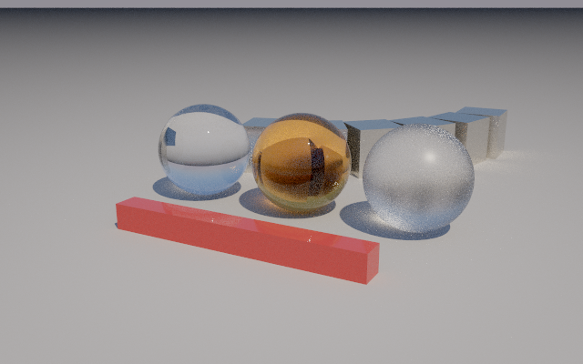
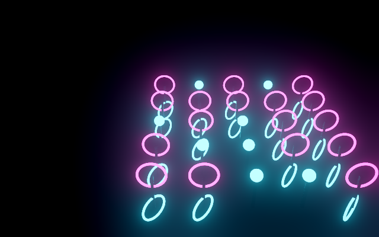
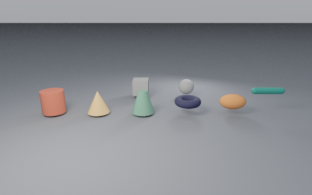
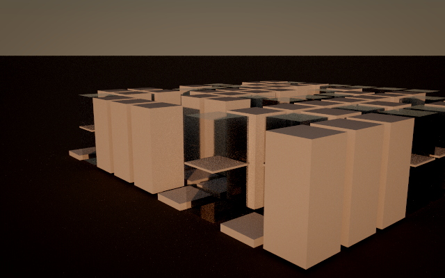
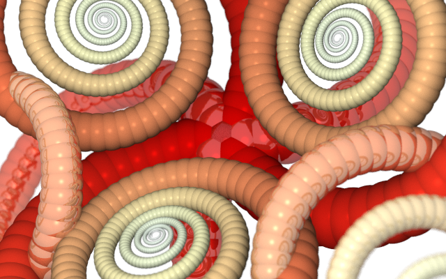
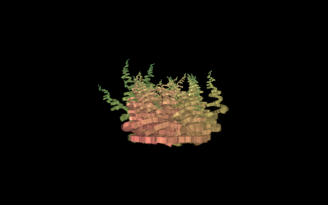
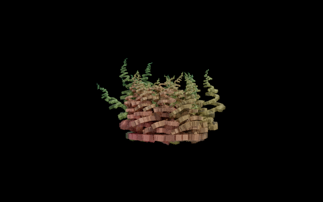

# Example renders

Made by `python -m tools.example_renders` (CPU or GPU give the same image). Each PNG embeds its script: File ▸ Open from Render reopens it.

| Image | Script | Settings |
|-------|--------|----------|
|  | `examples/v2/Depth of Field.es` | path, 96 spp, 640×400, no look, 60 s |
|  | `examples/v2/Glass Garden.es` | path, 96 spp, 640×400, its look (render block), 90 s |
|  | `examples/v2/Neon Lattice.es` | path, 96 spp, 640×400, its look (render block), 24 s |
|  | `examples/v2/Primitives.es` | path, 96 spp, 640×400, no look, 56 s |
|  | `examples/v2/Studio Product.es` | path, 96 spp, 640×400, its look (render block), 65 s |
|  | `examples/v2/Sunset City.es` | path, 96 spp, 640×400, its look (render block), 69 s |
|  | `legacy/examples/Default.es` | classic, 96 spp, 640×400, no look, 110 s |
|  | `legacy/examples/Default.es` | path, 96 spp, 640×400, no look, 95 s |
|  | `legacy/examples/Nouveau.es` | classic, 96 spp, 640×400, no look, 126 s |
|  | `legacy/examples/Nouveau.es` | path, 96 spp, 640×400, no look, 80 s |
|  | `legacy/examples/City of Glass.es` | classic, 96 spp, 640×400, no look, 53 s |
|  | `legacy/examples/City of Glass.es` | path, 96 spp, 640×400, no look, 34 s |
